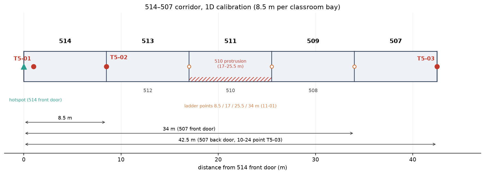
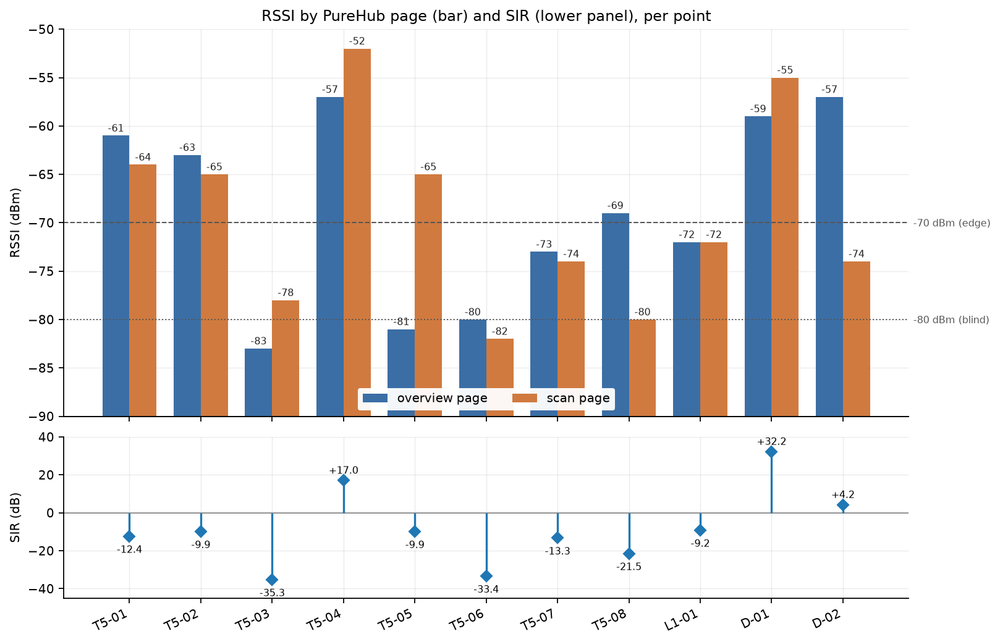
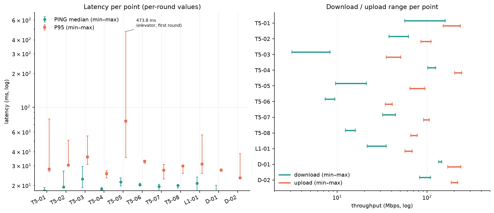
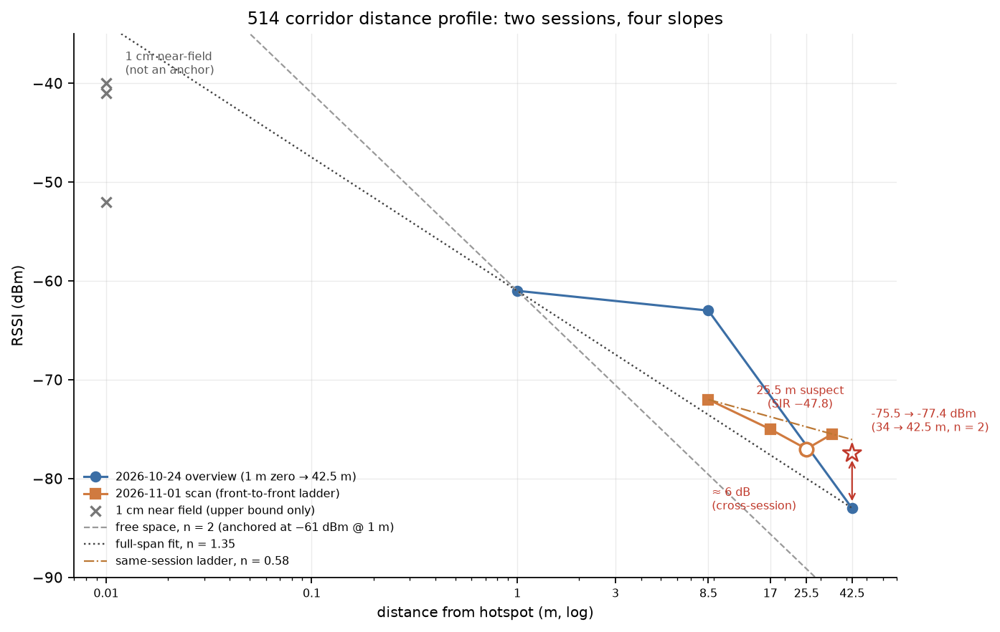

# 课题 3 实验报告：教学楼、图书馆与宿舍 2.4 GHz 无线信号测绘

> 版本 v5.2（2026-11-01）
> 采集：2026-10-24 11:39–12:39（教学楼 5F、图书馆 1F）· 2026-10-25 15:30–15:36（1 m 本地零点复测）· 2026-10-25 20:14–20:21（宿舍 6F）· 2026-11-01 14:45–15:10（走廊距离阶梯与点位重测）
> 规模：8 个测试点位 + 3 个本地零点；40 条测速；43 条 PureHub 读数；74 个采集素材（43 张 PureHub 截图 + 10 张测速页 + 20 张位置照 + 1 张 5F 平面图）+ 4 张分析图（`picture/analysis/`）
> 数据：[`data/results.json`](data/results.json)（40 条原始记录，只读）· [`data/measurements.csv`](data/measurements.csv)（40 行）· [`data/signal.csv`](data/signal.csv)（43 行）
> 测速工具：[`SpeedMeasurement/`](SpeedMeasurement/README.md)

## 摘要

以一台 Linux 笔记本同时作 2.4 GHz 热点与测速服务端（SSID `wireless_2.4G`、BSSID `a2:1e:09:30:b6:a3`、信道 7 / 2442 MHz、20 MHz、开放网络），手机连该热点，在教学楼 5F、图书馆 1F、宿舍 6F 的 8 个测试点位采集 40 轮延迟 / 吞吐，并用 PureHub 记录 43 条点位级 RSSI / SIR；另设 514 走廊、电梯口、617 桌面 3 个 1 m 本地零点。

40 轮丢包均为 0；单轮 PING 中位 15.9–29.5 ms；单轮 P95 22.9–473.8 ms（仅电梯首轮 473.8 ms 超过 100 ms）；下载 3.14–158.32 Mbps，有效上传 34.11–242.08 Mbps（T5-03 两轮上传为 0，按失败处理）。采用页 RSSI 为 −83 ~ −63 dBm（概览）/ −82 ~ −65 dBm（扫描），SIR −35.3 ~ +4.2 dB。

可配对的相对衰减只有三组：514 走廊 8.5 m 约 −2 dB、42.5 m 约 −22 dB；电梯轿厢相对电梯口约 −24 dB（概览）；宿舍隔墙相对桌面约 −19 dB（扫描），但概览页同组为 +2 dB、方向相反，不能定稿。

10-24 的走廊远点是 514 前门→507 后门 42.5 m（概览 −83 dBm）；11-01 同会话重测在前门→前门的 8.5 / 17 / 25.5 / 34 m 阶梯上读到 −72 / −75 / −77 / −75.5 dBm（25.5 m 为单次扫描、SIR −47.8 异常，存疑，见 §5.7），把 34 m 按 n = 2 折算到 42.5 m 约 −77.4 dBm，仍比 10-24 高约 6 dB。距离衰减指数：近段（1→8.5 m）0.22、远段（8.5→42.5 m）2.86、全程 1.35、同会话（8.5→34 m）0.58，跨会话不可判。

受 RSSI / SIR 点位级快照、同一位置换页差 0–17 dB、4 个点位无本地零点、距离与墙距未实测等限制，本报告只做描述性汇总：盲区结论只列候选，不定级。

**关键词**：2.4 GHz；RSSI；SIR；本地零点；换页偏差；局域网测速

**关键结果速览**

| 项目 | 结果 |
|---|---|
| 规模 | 8 个测试点位 + 3 个本地零点；40 轮测速；43 条截图读数 |
| 丢包 | 0 / 40 轮（请求级，单轮分辨率 3.4%） |
| 延迟 | PING 中位 15.9–29.5 ms；P95 22.9–473.8 ms（仅 1 轮 > 100 ms） |
| 吞吐 | 下载 3.14–158.32 Mbps；有效上传 34.11–242.08 Mbps |
| RSSI | 采用页 −83 ~ −63 dBm；同一位置换页差 0–17 dB |
| SIR | −35.3 ~ +4.2 dB |
| 可配对 ΔRSSI | 走廊 −2 / −22 dB；电梯 −24 dB；宿舍 −19 dB（扫描口径） |
| 走廊衰减指数 n | 0.22（近段）/ 2.86（远段）/ 1.35（全程）/ 0.58（同会话） |
| 盲区候选 | T5-03、T5-06 至少边缘；T5-07、L1-01 边缘；T5-05、D-02 不稳定 |

## 1 目标与研究问题

**目标**：以一台无线电参数可控的笔记本热点为信号源，在教学楼、图书馆、宿舍选取遮挡 / 距离特征不同的点位，采集点位级 RSSI、SIR 与端到端延迟 / 吞吐，识别候选盲区 / 边缘区，并在可配对的组内估算相对衰减。

- **RQ1**：各测试点位的 RSSI / SIR 是多少？哪些低于 §5.3 的阈值？
- **RQ2**：点位级 RSSI / SIR 与延迟（中位数、P95、丢包）是否同向？只在 n = 8 上做探索性描述，不作因果结论。
- **RQ3**：在「同一热点位置 + 本地 1 m 零点」的组内（514 走廊、电梯、宿舍），距离 / 遮挡造成多大相对衰减？其余点位只报绝对值，不做归因。

**原定成功标准的达成情况**

| # | 原定标准 | 状态 | 说明 |
|---|---|---|---|
| 1 | 8 个点位 × ≥ 3 轮，关键字段齐全 | 基本达成 | 8 个测试点位 3–7 轮；RSSI / SIR 齐全但是点位级快照；`distance_m` 全空；T5-01 概览样本仅 16/30、23/30 |
| 2 | 点位标注图 + 可复现报告 | 部分达成 | 报告与脚本已交付且可复跑；点位标注图未产出（有平面图照片，缺点位坐标） |
| 3 | 热点重启 / BSSID 变化 / 100% 丢包有记录 | 达成 | 均未发生；上传为 0 的失败轮见 §5.2 |
| 4 | 频段 / 信道 / 热点位置可追溯 | 部分达成 | SSID / BSSID / 频段 / 信道 / 功率可追溯；热点随区域移动，未逐点记录坐标 / 高度 / 朝向 |

## 2 实验设计与点位

### 2.1 热点组与本地零点

| 组 | 热点位置 | 手机位置 | 本地 1 m 零点 | 可算 ΔRSSI |
|---|---|---|---|---|
| 514 走廊 | 514 前门，椅面 | T5-01 水平 1 m；T5-02 约 8.5 m；T5-03 约 42.5 m | T5-01 | 是（距离） |
| 电梯 | 电梯口，椅面 | T5-04 水平 1 m；T5-05 轿厢内 | T5-04 | 是（轿厢遮挡） |
| 512 转角 | 512 拐角，椅面 | 转角另一侧 | 无 | 否 |
| 楼梯间 | 5F 楼梯平台，椅面 | 梯段 / 下层平台 | 无 | 否 |
| 防火门 | 门一侧，椅面 | 门另一侧 | 无 | 否 |
| 图书馆玻璃 | 玻璃内侧，椅面 | 玻璃外侧 | 无 | 否 |
| 宿舍 | 617 桌面 | D-01 同一桌面（< 1 m）；D-02 618 侧 | D-01 | 是（隔墙） |

热点位置在同一组内固定、组间移动。移动后没重测 1 m 零点的组（512、楼梯、防火门、图书馆），其「相对 T5-01 的差值」同时含遮挡与热点位置变化，不能当遮挡衰减。T5-04 与 T5-01 相差 4 dB 说明不同位置的近场基准本身有差异，T5-01 不是全楼通用零点。

### 2.2 测试点位（8 个）

| 编号 | 楼层 | 位置 | 遮挡 / 距离特征 | 轮数 | 现场时段 | 热点组 |
|---|---|---|---|---|---|---|
| T5-02 | 教学楼 5F | 514 后门（同走廊） | 空气，约 8.5 m（514 前→后门） | 3 | 10-24 11:40–11:42；11:48 补拍读数；11-01 14:46–14:47 重测读数 | 514 走廊 |
| T5-03 | 教学楼 5F | 507 后门（同走廊） | 空气，约 42.5 m（514 前门→507 后门） | 7 | 10-24 11:44–11:47（42.5 m）；11-01 14:55–14:57（34 m） | 514 走廊 |
| T5-05 | 教学楼 5F | 电梯轿厢内 | 金属轿厢 | 3 | 11:52–12:00 | 电梯 |
| T5-06 | 教学楼 5F | 512 拐角 | 转角 | 3 | 12:03–12:05 | 512 转角 |
| T5-07 | 教学楼 5F | 楼梯间（5F 平台 / 梯段） | 楼梯间几何 | 3 | 12:08–12:10 | 楼梯 |
| T5-08 | 教学楼 5F | 防火门前 | 金属防火门 | 3 | 12:17–12:18 | 防火门 |
| L1-01 | 图书馆 1F | 玻璃隔断旁 | 玻璃 | 4 | 12:37–12:39 | 图书馆玻璃 |
| D-02 | 宿舍 6F | 617→618 隔墙后 | 混凝土 + 瓷砖隔断墙（约 10 cm） | 3 | 20:19–20:21 | 宿舍 |

**轮次构成。** 10-24 的 T5-03、L1-01 各多测 1 轮，都是看到上传为 0 后在同一点位补测。T5-03 的 4 轮为 11:44:13（上传 0）、11:45:47（35.24）、11:46:42（上传 0）、11:47:29（39.30 Mbps），上传取 R4，R1 / R3 记为失败。L1-01 的 4 条上传均非 0（56.49 / 63.39 / 58.47 / 68.05 Mbps），失败轮没有保存。

### 2.3 本地零点（3 个）

| 编号 | 位置 | 轮数 | 读数（概览 / 扫描 / SIR） | 备注 |
|---|---|---|---|---|
| T5-01 | 514 前门，水平 1 m | 4（10-24 首条 + 10-25 补 3 轮） | −57 → −61（16/30、23/30）/ −56 → −64 / −3.3 → −12.4 | 同一位置 2 分钟内概览漂 4 dB、扫描漂 8 dB |
| T5-04 | 电梯口，水平 1 m | 4（同上） | −56 → −57 / −64 → −52 / −12.4 → +17.0 | 与 T5-01 相差 4 dB，属不同热点位置 |
| D-01 | 617 桌面，< 1 m | 3（10-25） | −59（2/30）/ −55 / +32.2 | 概览样本不足，采用扫描页 |

三点不是同一零点的重复测量：位置、时段、热点位置都不同，不能合并成「平均零点」，也不能互校；只用于各自组的 ΔRSSI。三点的 PING 中位 16.7–18.6 ms、P95（去冷启动）23.3–29.0 ms 接近，符合 1 m 近场不受覆盖限制的预期；但 RSSI 仍差 4–6 dB（−61 / −57 / −55），不能互换。1 m 处实测 −55 ~ −61 dBm，比常见 −40 dBm@1 m 对数距离模型低 15–21 dB（2.442 GHz 的 1 m FSPL 约 40.2 dB），因此不能用该模型反推距离。

11-01 另有 3 张 514 门前近场截图（`supplementary_data/514-nearfield.*.jpg`，14:45–14:46，扫描 −52 / −41 / −40 dBm，列表 −50 / −43 / −42）。现场记录为**距笔记本约 1 cm**，已进入天线近场（λ/2π ≈ 2 cm），RSSI 接近饱和：1 cm→8.5 m 只降 32 dB，自由空间应降 58.6 dB。这 3 条只当上限参照，不与 10-25 的 1 m 零点合并。

### 2.4 距离标定

- 5F 平面图为 `picture/supplementary_data/plan.jpg`（4096×3072）。单间教室沿走廊 17 块 500 mm 瓷砖 = **8.5 m**（开间）。
- 514 与 507 之间是 513 / 511 / 509 三间北侧教室：514 前门→507 前门 = 4 个开间 = **34 m**；514 前门→507 后门 = 42.5 m（5 个开间）。
- 10-24 的 T5-03 取后者（42.5 m）；11-01 的 8.5 / 17 / 25.5 / 34 m 阶梯都是前门到前门。两者不是同一位置，比较前需按距离折算。
- 旧稿「5–6 个开间 × 9–10 m ≈ 45–60 m」作废。D-01 / D-02 到墙距离与墙厚精度未实测；`distance_m` 全空。



*图 4　514–507 走廊 1D 标定示意：8.5 m/开间，红点为 10-24 点位，空心点为 11-01 阶梯，红色斜线为 510 外凸窗口（17–25.5 m）。不是 5F 平面图叠加，只示意沿走廊的距离关系。*

### 2.5 测量姿态

- 教学楼 / 图书馆组：笔记本放椅面（约 0.45–0.5 m），手机持于腰腹前约 1.0 m；水平间距约 1 m 时斜距约 1.1 m。
- 宿舍组：笔记本与手机都在 617 桌面（约 0.75 m），D-01 手机平放桌面，D-02 移到 618 侧。
- 同一组内保持笔记本位置、屏幕角度、手机握持 / 朝向；组间姿态不同，绝对 RSSI 不跨组比较。

### 2.6 与方案的偏差

| 项 | 方案要求 | 实际 | 影响 |
|---|---|---|---|
| 点位数 | 8 个测试点位 | 8 个：6 个遮挡 + 2 个距离；另 3 个本地零点 | 4 个遮挡点位没有本地零点，ΔRSSI 不可算 |
| 轮次 | 每点连续 3 轮 | 3–7 轮（T5-03 为 4 + 3 轮，跨两个距离） | 满足 ≥ 3 轮，但 T5-03 的 7 轮不是同一位置 |
| 采集顺序 | P1→P8 | 514 → 507 → 电梯 → 512 → 楼梯 → 防火门 → 图书馆 → 宿舍 | 不影响点位归属 |
| 本地零点 | 组内基线 | T5-01 / T5-04 / D-01 三个；前两个与测试点位跨日 | ΔRSSI 只在 3 组内成立，零点不确定度 ≥ ±4 dB |
| 热点安全 | WPA2 | 开放网络 | 可追溯性 |
| 热点 MAC | `cloned-mac-address permanent` | AP 本地管理地址 `a2:1e:09:30:b6:a3` | 可追溯性 |
| 信道 | 1 / 6 / 11 中较空闲者 | 固定 7（2442 MHz，20 MHz） | 不能与信道 1 / 11 现场直接比较 |
| 时段 | 单时段采集 | 4 个时段（见文首） | 不能区分位置差与时段负载 |
| 距离 | 现场估测并记录 | 平面图 + 瓷砖推算（8.5 / 42.5 m），非卷尺实测 | 距离衰减只能估算 |
| 进度 | 6 个半天 | 10-24 25 轮；10-25 12 轮；11-01 3 轮 | 补测部分闭合 |

## 3 工具与采集口径

### 3.1 测速口径（SpeedMeasurement）

笔记本同时充当热点与测速服务端，手机连该热点后访问 `http://10.42.0.1:8080`。延迟是「手机 → 笔记本」的局域网 RTT，只经过空口与笔记本协议栈，不含互联网回程。

- 每次发 32 次 `GET /api/ping`，丢弃前 3 次，取剩余 29 次；中位数、P95 与总体标准差（抖动）都直接由原始 RTT 计算。P95 是最近秩，实际取第 28 小的样本（次大值）。
- 丢包率 = 失败请求数 ÷ 29（不是 ÷ 成功样本数），单轮分辨率 3.4%。
- 下载为 4 并发 8 秒窗口平均速率，上传为 4 并发 POST 4 MiB 的 8 秒窗口平均速率，单位 Mbps。
- 延迟与 P95 的 0.1 ms 网格来自 `performance.now()` 的 100 µs 钳制，不是事后加工（见 §6.2）。

### 3.2 无线读数口径（PureHub）

- RSSI 取**概览页**连接卡片（含 BSSID / 信道 / 链路速率 / 样本数），SIR 取**扫描页**列表行（列表行同时给出该次扫描的 RSSI，可能不同于顶部卡片）；两页不是同一时刻。
- 扫描页同屏有两个 RSSI：顶部连接卡片与无线列表行，二者可差 0–23 dB；列表行带 SIR，`signal.csv` 的 note 列记录了另取的数值。
- 扫描页不显示 BSSID；`signal.csv` 扫描行的 BSSID 由同一会话的 AP 配置补齐，不是截图直读。
- PureHub 的「距离」是按 RSSI 换算的估计值（约 −40 dBm@1 m），不是测距，不能填 `distance_m`。
- PureHub 只提供 SIR（信干比），不提供 SNR；SIR 与 SNR 不可等同，负值按界面原样记录、不做符号修正。现场曾比对 Cellular-Z 读数一致，但未留截图。

### 3.3 采集 SOP

1. 选点：可安全停留 ≥ 3 分钟、位置可复现（有明确参照物）、避开人流高峰与施工区。
2. 建网：`iw list` / `iw reg get` 查能力与监管域；关 WiFi 省电与自动连接；NetworkManager 共享模式建热点并固定 SSID / 频段 / 信道；放行 8080/TCP；记录热点位置照片。
3. 单点单轮（约 60 s）：站定、按组内姿态放置手机、静置 30 s；PureHub 先概览后扫描；立即测速并记录 PING / P95 / 抖动 / 丢包；标签写 `点位-轮次`；静置 30 s 进下一轮。
4. 收尾：核对 BSSID 与热点状态；上传为 0 或结果异常时补测并写明失败轮；拍点位照片；导出并备份 `data/results.json` 与截图，当天初检。

## 4 数据

### 4.1 文件与规模

| 路径 | 内容 | 规模 |
|---|---|---|
| `data/results.json` | SpeedMeasurement 原始记录（只读，不手改） | 40 条，id 1–40 |
| `data/measurements.csv` | 一次测速一行：点位 + 标签 + 延迟 / 速率 | 40 行 |
| `data/signal.csv` | 一张截图一行：RSSI / SIR / 信道 / 链路速率，附 `source_file` 可逐条回查 | 43 行（29 扫描 + 14 概览） |
| `picture/` | 43 张 PureHub 截图 + 10 张测速页 + 20 张位置照 + 1 张 5F 平面图 | 74 个采集素材 |
| `picture/analysis/` | 图 1–4：RSSI/SIR、延迟/吞吐、距离剖面、走廊 1D 标定 | 4 张分析图 |

### 4.2 字段

命名：`点位-轮次`（一行 = 一次测量）；`results.json` 的原始标签存在 `raw_label` 列。

| 字段 | 说明 |
|---|---|
| point_id | T5-01 … T5-08、L1-01、D-01、D-02 |
| building / floor / location | 楼栋、楼层、位置描述 |
| obstruction | 遮挡特征 |
| distance_m | **全空**（距离见 §2.4，不进 CSV） |
| ssid / bssid / band / channel | 热点连接信息 |
| seq | 点位内按时间戳升序的轮次号 |
| time | 本轮开始时间（CST） |
| rssi_dbm / sir_db | 点位级读数，**不是本轮读数**；RSSI 默认概览页，D-01 / D-02 因概览样本不足取扫描页；SIR 取扫描页 |
| ping_ms / p95_ms / jitter_ms / loss_pct | SpeedMeasurement 读数 |
| down_mbps / up_mbps | 吞吐（Mbps）；T5-03 的 0 是失败，不是有效速率 |
| raw_label | `results.json` 中的原始标签 |
| note | 轮次、异常、口径说明 |

```csv
point_id,building,floor,location,obstruction,distance_m,ssid,bssid,band,channel,seq,time,rssi_dbm,sir_db,ping_ms,p95_ms,jitter_ms,loss_pct,down_mbps,up_mbps,raw_label,note
```

### 4.3 逐点位无线读数

「采用值」是 `measurements.csv` 实际使用的 RSSI；「对照页」是同点位另一页的读数，用来显示口径差。

| 角色 | 点位 | 采用值（页） | 对照页 | 两页极差 | SIR（扫描） | 备注 |
|---|---|---|---|---|---|---|
| 零点 | T5-01 | −61（概览，测后） | −64（扫描） | 3 dB | −12.4 | 测前 −57 / −56 / −3.3；样本 16/30、23/30 |
| 测试 | T5-02 | −63（概览） | −65（扫描） | 2 dB | −9.9 | 概览 30/30；11-01 重测 −67（概览）/ −72（扫描） |
| 测试 | T5-03 | −83（概览） | −78（扫描） | 5 dB | −35.3 | 概览 30/30；11-01 重测（34 m）−74 ~ −77 |
| 零点 | T5-04 | −57（概览，测后） | −52（扫描列表；顶部 −56） | 1–5 dB | +17.0 | 测前 −56 / −64 / −12.4 |
| 测试 | T5-05 | −81（概览） | −65（扫描 11:55:29；另一张 −76） | 16 dB | −9.9 | 概览 30/30；11-01 重测 −75 |
| 测试 | T5-06 | −80（概览） | −82（扫描） | 2 dB | −33.4 | 概览 30/30；11-01 重测 −81 |
| 测试 | T5-07 | −73（概览） | −74（扫描） | 1 dB | −13.3 | 概览 30/30；11-01 重测 −75 / −78 |
| 测试 | T5-08 | −69（概览） | −80（扫描） | 11 dB | −21.5 | 概览 30/30；11-01 重测 −73 |
| 测试 | L1-01 | −72（概览） | −72（扫描） | 0 dB | −9.2 | 概览 30/30 |
| 零点 | D-01 | −55（扫描） | −59（概览，2/30） | 4 dB | +32.2 | 概览未采满 |
| 测试 | D-02 | −74（扫描） | −57（概览，11/30） | 17 dB | +4.2 | 概览未采满 |



*图 1　各点位 RSSI（柱：概览页 / 扫描页）与 SIR（下），虚线为 −70 / −80 dBm 阈值；数据来自 `measurements.csv` 与 `signal.csv`。*

### 4.4 逐点位延迟与吞吐

| 角色 | 点位 | 轮数 | PING 中位（范围，ms） | P95 范围（ms） | 下载范围（Mbps） | 上传范围（Mbps） |
|---|---|---|---|---|---|---|
| 零点 | T5-01 | 4 | 17.95（16.1–19.2） | 26.6–78.4 | 56.29–158.32 | 150.96–233.47 |
| 测试 | T5-02 | 3 | 19.40（19.1–26.9） | 29.8–50.7 | 37.57–61.70 | 85.08–110.40 |
| 测试 | T5-03 | 7 | 22.90（19.2–29.5） | 30.8–55.5 | 3.14–8.27 | 0（R1 / R3 失败）；35.24–50.70（其余 5 轮） |
| 零点 | T5-04 | 4 | 18.60（16.2–19.2） | 23.3–27.0 | 102.05–124.39 | 202.95–242.08 |
| 测试 | T5-05 | 3 | 21.50（19.8–23.4） | 35.6–473.8 | 9.55–21.06 | 64.58–94.14 |
| 测试 | T5-06 | 3 | 20.30（20.0–20.9） | 31.5–33.5 | 7.35–9.38 | 34.11–40.96 |
| 测试 | T5-07 | 3 | 19.60（16.3–20.5） | 22.9–30.9 | 31.85–44.29 | 91.13–105.61 |
| 测试 | T5-08 | 3 | 20.10（19.0–20.4） | 25.6–30.2 | 12.30–15.86 | 65.69–77.66 |
| 测试 | L1-01 | 4 | 20.90（17.0–23.8） | 25.6–56.7 | 21.46–34.88 | 56.49–68.05 |
| 零点 | D-01 | 3 | 16.70（16.6–20.1） | 26.8–28.1 | 134.48–144.75 | 169.73–237.16 |
| 测试 | D-02 | 3 | 16.30（15.9–17.0） | 23.0–38.3 | 82.27–108.87 | 185.11–217.81 |

T5-03 的 7 轮里，前 4 轮在 42.5 m、后 3 轮在 34 m，上表延迟与吞吐范围是两处合并的结果。



*图 2　各点位延迟（左，对数轴；点为该点位轮次中位，须为 min–max）与下载 / 上传范围（右）。T5-03 两个 0 上传为失败轮，不计入上传范围。*

## 5 结果

### 5.1 延迟与丢包

40 轮丢包率全为 0；PING 中位 15.9–29.5 ms；抖动 3.07–115.14 ms；P95 22.9–473.8 ms，仅 T5-05 首轮（473.8 ms）超过 100 ms，后两轮为 75.0 / 35.6 ms。T5-01 的首条（11:39:48）P95 78.4 ms、抖动 23.3 ms，10-25 同位置补测 3 轮为 26.6–29.0 ms、4.1–6.2 ms，可确认首条含冷启动开销。11-01 的 T5-03 三轮 PING 29.5 / 24.8 / 22.9 ms，其中 29.5 ms 是全场最高单轮；首轮 P95 55.5 ms 已落入「边缘」档（50 ~ < 100 ms）。

**0% 的读法**：`loss_pct` 是请求级失败率（失败 `GET /api/ping` ÷ 29，前 3 次的失败也不计），不是空口帧丢失率。单帧丢失由 802.11 重传与 TCP 重传吸收，通常只表现为该次 RTT 变长（对照 T5-05 首轮 P95 473.8 ms、抖动 115.1 ms），不计为失败。按每轮 29 次、40 轮共 1160 次请求 0 失败计，真实失败率低于约 0.3%（95% 上限）；单轮 0% 只能表述为低于约 10%。上传为 0 的失败轮同样报 `loss_pct = 0`，因此 0% 不能证明链路无异常。

### 5.2 吞吐

下载 3.14–158.32 Mbps；有效上传 34.11–242.08 Mbps（T5-03 的 R1 / R3 为 0，按失败处理，不计入有效范围）。下载最高是 T5-01 首条（158.32 Mbps，10-24），上传最高是 T5-04 首条（242.08 Mbps）。同一位置 T5-01 在 10-25 复测只有 56.29–87.68 Mbps，约为首条的 36–55%，说明吞吐受时段负载 / 设备状态影响。宿舍 D-01 为 134.48–144.75 Mbps，隔墙后 D-02 降至 82.27–108.87 Mbps。

**吞吐不能当衰减代理**：−69 dBm 的 T5-08 下载只有 12.30–15.86 Mbps，反而低于 RSSI 更低的 T5-07（−73 dBm，31.85–44.29 Mbps）；开放网络下同频干扰与设备状态的影响大于 RSSI。

**上传失败与补测**：落了盘的失败轮只有 T5-03 两条（`up_mbps = 0` 而 `loss_pct = 0`），note 已标注「上传失败」。L1-01 同为补测，但失败轮未保存，现存 4 条上传均非 0。

### 5.3 换页敏感性：同一批点位换页会得到不同等级

| 点位 | 概览页 | 扫描页 | 稳定结论 |
|---|---|---|---|
| T5-02 | −63 正常 | −65 正常 | 正常 |
| T5-03 | −83 盲区 | −78 边缘（11-01 重测 −74 ~ −77） | 至少边缘（盲区候选需复核） |
| T5-05 | −81 盲区 | −65 正常 / −76 边缘 | 不稳定 |
| T5-06 | −80 边缘 | −82 盲区 | 至少边缘（盲区候选需复核） |
| T5-07 | −73 边缘 | −74 边缘 | 边缘 |
| T5-08 | −69 正常 | −80 边缘 | 正常 ~ 边缘 |
| L1-01 | −72 边缘 | −72 边缘 | 边缘 |
| D-02 | −57 正常（11/30） | −74 边缘 | 不稳定 |

判定阈值：正常 > −70 dBm 且 P95 < 50 ms 且丢包 < 2%；边缘 −80 ~ −70 dBm 或 P95 50 ~ < 100 ms 或丢包 2% ~ < 5%；盲区 < −80 dBm 或 P95 ≥ 100 ms 或丢包 ≥ 5%。以点位中位数 / 采用页判定，单轮极值不直接定级；任一指标落入盲区即列为候选。阈值是工程经验值（−70 dBm 可用、−80 dBm 接近不可用），不是强制标准。丢包列 40 轮全为 0、无区分度，候选名单实际只由 RSSI 与 P95 触发。

### 5.4 可配对 ΔRSSI（只列有本地 1 m 零点的组）

| 组 | 零点（页） | 对照点（页） | 路径 / 遮挡 | 采用页 ΔRSSI | 换页后的 ΔRSSI |
|---|---|---|---|---|---|
| 514 走廊 | T5-01 −61（概览） | T5-02 −63（概览） | 8.5 m 空气 | −2 dB | −1 dB（扫描） |
| 514 走廊 | T5-01 −61（概览） | T5-03 −83（概览） | 42.5 m 空气 | −22 dB | −14 dB（扫描） |
| 电梯 | T5-04 −57（概览） | T5-05 −81（概览） | 金属轿厢 | −24 dB | −13 ~ −24 dB（扫描两张相差 11 dB） |
| 宿舍 | D-01 −55（扫描） | D-02 −74（扫描） | 10 cm 混凝土 + 瓷砖 | −19 dB | +2 dB（概览，方向相反） |

514 走廊与电梯的零点（10-25）与对照点（10-24）跨日；宿舍 D-01 / D-02 同日。512、楼梯、防火门、图书馆没有本地零点，不能算遮挡 ΔRSSI（它们相对 T5-01 的差值同时含热点移动）。

### 5.5 距离剖面与衰减指数

**10-24 主数据集（概览页）**：T5-01（1 m）−61 → T5-02（8.5 m）−63 → T5-03（42.5 m）−83。

| 距离 | 1 m | 8.5 m | 42.5 m |
|---|---|---|---|
| RSSI（概览） | −61 | −63 | −83 |
| 段 | 1→8.5 m | 8.5→42.5 m | 1→42.5 m |
| ΔRSSI | −2 dB | −20 dB | −22 dB |
| n | 0.22 | 2.86 | 1.35 |

近段远低于自由空间（封闭端驻波 / 波导增强），远段高于自由空间。三点不共线：以两端点连线（n ≈ 1.35）外推 8.5 m 得 −73.6 dBm，实测 −63 dBm（高 10.6 dB）；三点最小二乘 n ≈ 1.29、预测 −70.0 dBm，实测仍高 7.0 dB。单一幂律拟合不了 1–42.5 m，多径显著。



*图 3　514 走廊距离剖面：10-24 三点（1 / 8.5 / 42.5 m）与 11-01 阶梯（8.5 / 17 / 25.5 / 34 m）；灰色虚线为 n = 2 自由空间参考，黑色点线为全程 n = 1.35，橙色点划线为同会话 n = 0.58，星号为 34→42.5 m 折算值；25.5 m 点以白心方点标为存疑（SIR −47.8）。*

**11-01 同会话重测（扫描页，前门→前门，14:45–15:10）**：

| 距离 | 1 cm（近场） | 8.5 m | 17 m | 25.5 m | 34 m |
|---|---|---|---|---|---|
| RSSI（dBm） | −52 / −41 / −40 | −72 | −75 | −77 * | −74 / −75 / −76 / −77（均 −75.5） |
| 相对前一点 | — | −32 dB | −3 dB | −2 dB | +1.5 dB |

*\*25.5 m 的 −77 dBm 是单次扫描，SIR −47.8 明显异于同批（−19.0 / −29.8 ~ −35.8），且低于更远的 34 m 点（−74 ~ −76），判为存疑，不参与距离拟合；n = 0.58 只用 8.5 m 与 34 m，不受影响。*

同会话 8.5→34 m 的 n = 0.58；以 1 cm 为锚会得到 n ≈ 1.0–1.1，受近场饱和影响，只能当量级参考，不能当绝对 n。

**把两批折算到同一距离**：按 n = 2 把 34 m 的 −75.5 dBm 折到 42.5 m 约 −77.4 dBm，仍比 10-24 的 −83 dBm 高约 6 dB；8.5 m 处同页差 4 dB（−63 vs −67），跨页差 9 dB（−63 vs −72）。因此：

- 走廊全程 n ≈ 1.35、同会话相对段 n ≈ 0.58，都远低于自由空间 2，与「两侧教室 + 单口封闭」的波导增强一致；
- 「远段陡降」（n = 2.86）只在 10-24 那一批出现，同会话阶梯只给 0.58，跨会话无法判定，只能当作一次快照的特征；
- 单点同页跨会话离散度 4 dB（8.5 m）、折算后 6 dB（42.5 m），已不小于 8.5→34 m 阶梯的 3.5 dB 距离差，这是距离衰减不能定稿的直接原因。

### 5.6 穿墙损耗（D-02）

扫描页口径：D-01 −55 → D-02 −74，总衰减 −19 dB。若两端到墙总路径 1–2 m，扣掉 0–6 dB 空气段，10 cm 混凝土 + 瓷砖隔断墙的净损耗约 13–19 dB。概览页口径：D-01 −59（2/30）→ D-02 −57（11/30），总衰减 +2 dB，方向相反且样本未采满，不能作为有效对照。因此 −19 dB 只是扫描页口径的候选值，不能定稿；入射角、瓷砖层厚度未记录，不能进一步分解。

### 5.7 510 缺口（候选机制，未定稿）

用教室长度当标尺量平面图：相邻分隔墙距 28 / 30 / 31 个采样格（每格 8 px），取一开间 8.5 m ⇒ 1 格 ≈ 0.29 m。北侧 513 / 511 / 509 分别占 8.5–17 / 17–25.5 / 25.5–34 m；南侧 512 / 510 / 508 与之对齐，**510 落在 511 那一开间**，缺口是一个 **17–25.5 m 的窗口（宽 8.5 m，中心 ≈ 21 m）**。

11-01 阶梯在窗口两侧的采样为 17 m（−75）、25.5 m（−77）、34 m（−75.5）。其中 25.5 m 是单次扫描，SIR −47.8 明显异于同批，且低于更远的 34 m 点（−74 ~ −76），判为存疑（§5.5 注）。剔除该点后，17→34 m 只差 0.5 dB，跨窗没有可测的额外衰减；旧稿据此 2 dB 反演出的「凸出 0.3–0.4 m」也随之失去依据。缺口是否存在仍只由平面图几何支持（510 位于 17–25.5 m 开间），衰减量级未定，需在该窗口内按 1 m 加密重测后再定稿。

### 5.8 研究问题的回答

- **RQ1（RSSI / SIR 水平）**：8 个测试点位采用页 RSSI 为 −83 ~ −63 dBm，SIR 为 −35.3 ~ +4.2 dB；低于 −70 dBm 的有 6 个：T5-03（−83）、T5-05（−81）、T5-06（−80）、D-02（−74）、T5-07（−73）、L1-01（−72）。换页后 5 个点位的等级会变（T5-03、T5-05、T5-06、T5-08、D-02）。
- **RQ2（RSSI / SIR 与延迟是否同向）**：无法逐轮配对，只能做点位级描述。8 个点位的 PING 中位都在 16–23 ms，几乎没有区分度；P95 只有 T5-05 首轮 473.8 ms 越界；吞吐与 RSSI 不单调（§5.2）。因此「信号差 → 延迟 / 吞吐差」在本数据上只有弱证据，不能作因果结论。
- **RQ3（组内相对衰减）**：514 走廊 8.5 m −2 dB、42.5 m −22 dB；电梯轿厢 −24 dB（概览）；宿舍隔墙 −19 dB（扫描，概览 +2 dB 方向相反）。512、楼梯、防火门、图书馆没有本地零点，只能报绝对值。

**分析项与产出**

| 分析 | 状态 / 位置 |
|---|---|
| RSSI / SIR 柱状（含两页对照） | 图 1、§4.3 |
| 延迟 / 吞吐范围 | 图 2、§4.4 |
| 相对衰减 ΔRSSI | §5.4 |
| 距离衰减 n | 图 3、§5.5 |
| 穿墙损耗 | §5.6 |
| 点位标注图 | 图 4（1D 走廊示意；平面图坐标叠加未产出） |
| RSSI–P95 / SIR–P95 相关 | 未做：n = 8，且点位级快照不能逐轮配对 |
| 连续热力图 | 不做：8 个点位不足以插值 |

## 6 数据核验

### 6.1 方法

1. 重跑 `python3 src/build_dataset.py`，与已提交的 `measurements.csv`、`signal.csv` 逐字节比对。
2. 核对 `results.json` 的 id / 时间戳 / 字段完整性，重算全部范围、ΔRSSI 与 n。
3. 核对 `signal.csv` 43 行 `source_file` 是否存在，并与 `picture/` 逐文件对账（分类计数）。
4. 抽查 6 张截图（`504-507.2`、`514-507`、`514.2`、`elevator-after.1`、`514-nearfield.2`、`dormitory-after.2`）的 RSSI / SIR / 样本数 / 链路速率与转录值。
5. 核对 10 张测速页与 `results.json` 的对应关系（如 `514.jpg` 三轮、`514-507(retest).1.jpg` 三轮）。
6. 重跑 `src/make_figures.py`，确认图 1–4 的数值与两份 CSV 一致。

### 6.2 已核验通过

- **可复现**：两份 CSV 与脚本输出逐字节一致；`measurements.csv` 40 行、点位轮数 4 / 3 / 7 / 4 / 3 / 3 / 3 / 3 / 4 / 3 / 3 与 `results.json` 一致，`seq` 在点位内连续。
- **原始记录完整**：`results.json` 40 条、id 1–40 无缺号；时间戳落在 4 个时段内；`loss_pct` 全 0；`up_mbps = 0` 的两条（id 5、7）与「上传失败」描述一致。
- **截图可回查**：`signal.csv` 43 行的 `source_file` 全部存在；43 张 PureHub 截图与 43 行一一对应（29 扫描 + 14 概览）。
- **文件清单**：`picture/` 74 个采集素材 = 43 PureHub + 10 测速页 + 20 位置照 + 1 平面图（`plan.jpg` 4096×3072）；另有 `picture/analysis/` 4 张分析图（`src/make_figures.py` 生成）。
- **抽查一致**：6 张截图的读数与 `signal.csv` 一致（−83 且 30/30、−77 且列表 −75 / SIR −35.8、−65 / −9.9、−52 且顶部 −56 / SIR +17.0、−41 且列表 −43 / SIR +13.7、−57 且 11/30）。
- **数值复算一致**：PING 15.9–29.5、P95 22.9–473.8、抖动 3.07–115.14、下载 3.14–158.32、有效上传 34.11–242.08；ΔRSSI −2 / −22 / −24 / −19；n = 0.22 / 2.86 / 1.35；34→42.5 m 折算 +1.9 dB。
- **0.1 ms 网格**：PING 40/40、P95 40/40 落在 0.1 ms 网格（最大偏离 5×10⁻⁷ ms），抖动 0/40、下载 0/40、上传 2/40 不在网格上，与「时钟分辨率而非后处理」的判断一致。
- **设备与连接**：概览页均显示 BSSID `a2:1e:09:30:b6:a3`、信道 7、2442 MHz、20 MHz、开放网络；测速页显示 `10.42.0.1:8080`；扫描页不显示 BSSID。

### 6.3 主要局限

- RSSI 与 SIR 不能同时读：RSSI 取概览、SIR 取扫描，两页不是同一时刻，同点位两页差 0–17 dB；`rssi_dbm` 与 `sir_db` 不是配对读数。
- 每个测试点位只有 1 个时刻的 2–3 张截图，3–7 轮测速共用同一点位级读数，不是逐轮读数，不能做逐轮 RSSI–延迟分析。
- 热点不是全程固定：只有 514 走廊、电梯、宿舍三处有本地零点；512、楼梯、防火门、图书馆不能算遮挡 ΔRSSI。
- T5-01 / T5-04 的零点与 10-24 测试点位跨日，跨日误差未量化；D-01 / D-02 同日同组。
- 组间同时变化距离、遮挡、楼栋 / 楼层、时段，不是严格单因素设计。
- 电梯组首轮 P95 473.8 ms、3 轮跨度 7 分 22 秒，可能包含轿厢运行，未复测。
- `distance_m` 全空；距离由平面图 + 瓷砖推算，墙距、入射角、墙厚精度未实测。
- 位置照 EXIF 不可靠（OnePlus 原图 EXIF 比水印晚约 2 小时；水印相机无 EXIF；宿舍两张「未授权位置」）；`signal.csv` 的 11:55:29/32/35 秒级时间无法独立核验，按分钟级使用。
- 单设备、单热点、单手机、4 个时段、校园室内环境；开放网络、信道 7、BSSID 非 permanent，与方案不同，不能外推到其他网卡 / 手机 / 建筑 / 频段。

## 7 结论强度与候选

**可以断言**：本次热点配置下 8 个测试点位的延迟 / 吞吐分布、点位级 RSSI / SIR；514 走廊、电梯、宿舍三组在采用页口径下的 ΔRSSI 方向与量级。

**不能断言**：任何点位的盲区等级；RSSI / SIR 与延迟的逐轮同向劣化；小于 4 dB 的相对衰减差异；512 / 楼梯 / 防火门 / 图书馆的遮挡 ΔRSSI；D-02 隔墙损耗的符号与绝对值（概览 +2 dB 与扫描 −19 dB 相反）。

**候选（按采用页）**：T5-03、T5-06 至少边缘；T5-07、L1-01 边缘；T5-08 正常 ~ 边缘；T5-02 正常；T5-05、D-02 不稳定，需补测后才能定级。

## 8 补测建议

| 缺口 | 最少补什么 | 对应问题 |
|---|---|---|
| 走廊距离剖面 | 514 前门→507 后门每 2 m 一点（约 22 点），510 窗口（17–25.5 m）按 1 m 加密；卷尺量凸出深度 | n 定稿、§5.5、§5.7 |
| 本地零点不完整 | 要做 ΔRSSI 就为 512、楼梯、防火门、图书馆各补 1 m 零点（30/30 概览 + 扫描） | §2.1、§5.4 |
| 热点位置 / 姿态 | 每区域记录热点坐标 / 高度 / 朝向 / 屏幕角度；手机高度与握持 | 距离 / 衰减定稿 |
| 1 m 零点重复性 | 每个零点采满 30/30，同一会话内测完对应点位，同点重复 3 次 | 零点不确定度、跨日 |
| 电梯首轮离群 | 轿厢静止时补 1–2 轮 | §5.1 |
| 两页一致性 | 每点位概览 / 扫描各 3 次，记录两个 RSSI 与样本数 | §3.2 |
| 上传失败留痕 | 失败轮保存并在 note 标注，补测轮单独标 | §5.2 |
| 点位标注图 | 用 `plan.jpg` 标定点位坐标 | 交付物 |
| 点位距离 / 墙距 | 卷尺实测 T5-02、T5-03、D-01 / D-02 到墙距离；记录入射角与墙厚 | 距离衰减、穿墙损耗 |
| D-02 位置照 / 宿舍概览 | 拍 618 侧站位；等概览样本到 30/30 后重拍 | D-02 定稿 |

`514-507`（T5-03）无位置照：现场距离远、光线暗，难以拍清，作为限制说明，不列为补测项。

## 9 交付物与复现

| 交付物 | 位置 | 状态 |
|---|---|---|
| 原始数据 | `data/results.json` | 已交付（40 条） |
| 汇总表 | `data/measurements.csv`、`data/signal.csv` | 已交付（40 / 43 行） |
| 分析图 | `picture/analysis/`（图 1–4） | 已交付（`src/make_figures.py` 生成） |
| 点位标注图 | `picture/analysis/fig4_corridor.png` | 部分：1D 走廊标定示意；5F 平面图坐标叠加未产出 |
| 实验报告 | 本文 | 已交付（含 §6 数据核验） |
| 复现说明 | 本文 §3、§9、附录 A / B | 已交付 |

```bash
cd 01-Field-Discovery/topic_3
python3 src/build_dataset.py   # 重新生成 measurements.csv / signal.csv
python3 src/make_figures.py   # 重新生成 picture/analysis/ 的 4 张图（需 matplotlib，本机用 ../topic_8/.venv/bin/python）
```

脚本只读 `data/results.json` 与脚本内的人工转录表，不修改原始数据；截图的 RSSI / SIR / 信道 / 链路速率可在 `signal.csv` 的 `source_file` 逐条回查。图 1–3 的数据点由两份 CSV 直接读取，图 4 按 §2.4 的几何标定绘制。测速服务端见 `SpeedMeasurement/`（`cargo run --release`，默认监听 `0.0.0.0:8080`，可用 `PORT` 覆盖）。

**交付自检（按常见评审维度）**

| 维度 | 本报告对应内容 | 状态 |
|---|---|---|
| 选题与目标 | §1 目标、RQ1–RQ3、§5.8 回答 | 完成 |
| 设计与变量控制 | §2 点位 / 零点 / 距离 / 姿态，§3 口径 | 完成（组间非严格单因素，§6.3） |
| 数据采集与质量 | §4 数据，§6.1–6.2 核验 | 完成（点位级快照，§6.3） |
| 处理与判定 | §5.3 阈值，§5.5 n 值，§5.6 穿墙 | 完成 |
| 结果与结论 | §5.1–5.8、§7 | 完成（盲区为候选） |
| 图表 | 图 1–4、§4.3 / §4.4 表 | 完成（点位标注图为 1D 示意） |
| 局限与改进 | §6.3、§8 | 完成 |
| 复现与交付 | §9、附录 A / B、`src/` 脚本 | 完成 |

## 附录 A：Linux 热点启动（示例）

以下为通用示例，**不是本次实际命令**。本次接口为 `wlp0s20f3`、信道 7、开放网络、BSSID 为 AP 本地管理地址；示例中的 WPA2、信道 6、`cloned-mac-address permanent` 与实际不同。实际使用前用 `nmcli device status` 换成实际网卡名。

```bash
# 1. 能力检查
iw list | sed -n '/Supported interface modes/,/Band/p'
iw reg get

# 2. 关闭 WiFi 省电
sudo iw dev wlan0 set power_save off

# 3. 建热点（共享模式，无需 Internet）
nmcli connection add type wifi ifname wlan0 con-name sm-hotspot autoconnect no ssid Hotspot-Study
nmcli connection modify sm-hotspot 802-11-wireless.mode ap
nmcli connection modify sm-hotspot 802-11-wireless.band bg
nmcli connection modify sm-hotspot 802-11-wireless.channel 6
nmcli connection modify sm-hotspot wifi.cloned-mac-address permanent
nmcli connection modify sm-hotspot wifi-sec.key-mgmt wpa-psk
nmcli connection modify sm-hotspot wifi-sec.psk '12345678'
nmcli connection modify sm-hotspot ipv4.method shared
nmcli connection modify sm-hotspot ipv6.method ignore

# 4. 启动与查地址
nmcli connection up sm-hotspot
ip -4 addr show wlan0

# 5. 放行 8080（按发行版二选一）
sudo firewall-cmd --add-port=8080/tcp
sudo ufw allow 8080/tcp
```

若 NetworkManager 版本较老不支持 `band` / `channel` 属性，改用 `nmcli device wifi hotspot band bg channel 6 ssid ... password ...` 或 hostapd，并记录实际方案。

## 附录 B：设备与软件环境

| 项 | 值 |
|---|---|
| 发行版 | Fedora 44（`fc44`） |
| 内核 | `7.2.11-power1.lto.fc44.x86_64`（自行编译，COPR `binarytree/linux-power-lto`） |
| 无线网卡 | Intel Arrow Lake CNVi WiFi `[8086:7740]`，`iwlwifi`，接口 `wlp0s20f3`（热点态 `type AP`） |
| 发射功率 | 22.00 dBm（AP 态与 5G 连接态相同） |
| 监管域 | `country CN`；global 2.4G 20 dBm，`phy#0` 2.4G / 5G 22 dBm |
| 信道 7 合法性 | 2442 MHz 落在 `phy#0` 的 `2422–2462 @ 40 MHz` 段内，上限 22 dBm |
| NetworkManager | `nmcli 1.56.1-2.fc44` |
| 热点参数 | `type AP`、SSID `wireless_2.4G`、BSSID `a2:1e:09:30:b6:a3`、信道 7、20 MHz、开放网络、端口 8080 |
| 手机 | OnePlus Ace 5，Android 16（ColorOS 16.0.2.400） |
| PureHub | `1.0.0-beta.58` |
| 测速服务端 | 提交 `f0ca34b`，运行 `target/release/SpeedMeasurement` |
| 页面渲染环境 | Android WebView `134.0.6998.135` |

说明：22 dBm 是该网卡在 CN 域下的上限，覆盖范围不能归因于「功率被调低」；20 MHz 带宽的理论峰值低于 40 MHz，吞吐绝对值只对应 20 MHz 口径。
