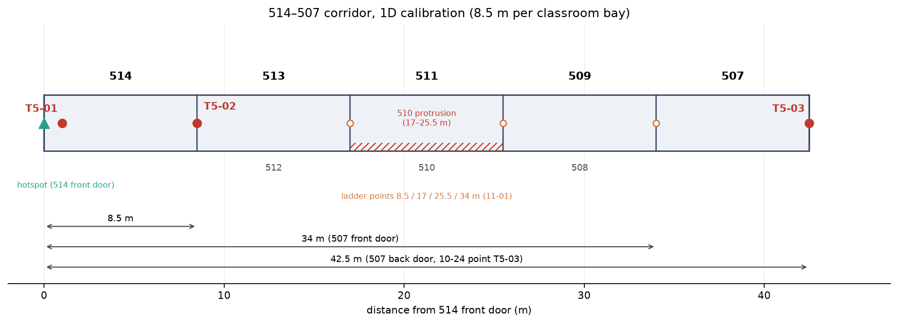
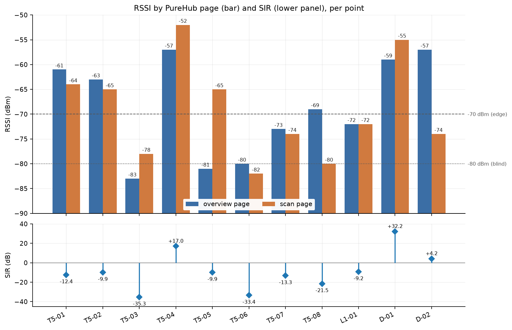
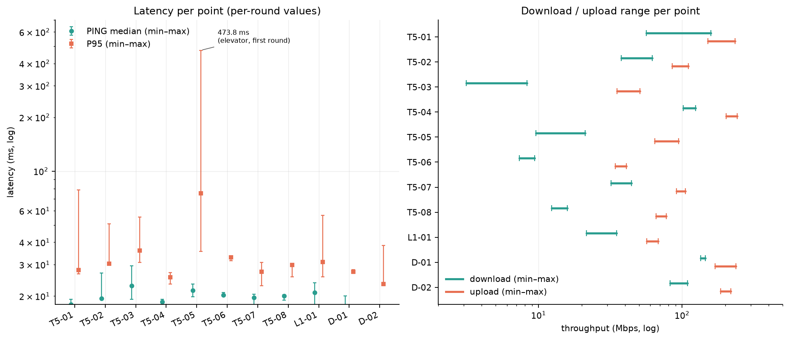
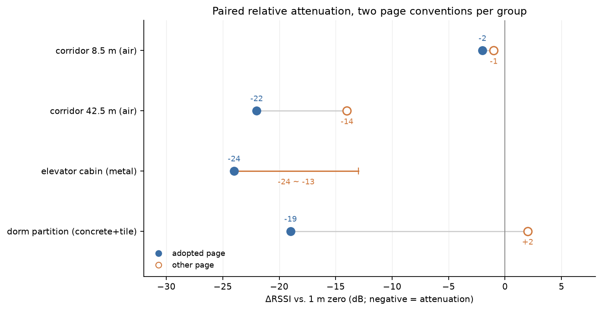
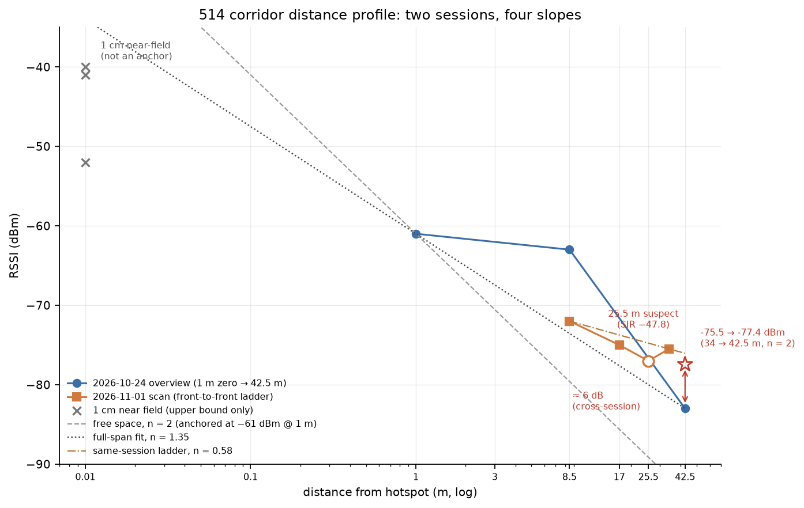

# 课题 3：教学楼与宿舍 2.4 GHz 无线信号盲区测绘

> 版本 v6.0（2026-11-17）
> 采集：2026-10-24 11:39–12:39（教学楼 5F、图书馆 1F）· 2026-10-25 15:30–15:36（1 m 本地零点）· 2026-10-25 20:14–20:21（宿舍 6F）· 2026-11-01 14:45–15:10（走廊距离阶梯与点位复测）
> 规模：8 个测试点位 × 3 轮 = **24 组主数据**；另 16 轮补测与零点，合计 40 轮测速；43 条 PureHub 读数（8 个测试点位 28 条）；74 个采集素材 + 5 张分析图
> 数据：[`raw_data/results.json`](raw_data/results.json)（40 条原始记录，只读）· [`raw_data/delivery_24.csv`](raw_data/delivery_24.csv)（24 组交付明细）· [`raw_data/measurements.csv`](raw_data/measurements.csv)（40 行）· [`raw_data/signal.csv`](raw_data/signal.csv)（43 行）
> 测速工具：[`SpeedMeasurement/`](SpeedMeasurement/README.md)
>
> **导航**：1 摘要 · 2 题面对照 · 3 目标与 RQ · 4 设计 · 5 口径 · 6 数据 · 7 结果 · **8 墙体材质** · **9 多径规律** · 10 盲区 · 11 核验 · 12 局限 · 13 补测 · 14 交付 · 参考文献 · 附录

## 1 摘要

**做了什么。** 以一台 Linux 笔记本同时作 2.4 GHz 热点与测速服务端（SSID `wireless_2.4G`、BSSID `a2:1e:09:30:b6:a3`、信道 7 / 2442 MHz、20 MHz、开放网络），手机连该热点，在教学楼 5F、图书馆 1F、宿舍 6F 的 8 个遮挡特征不同的点位各做 3 轮延迟 / 吞吐测试（24 组），同时用 PureHub 记录点位级 RSSI / SIR；另设 514 走廊、电梯口、617 桌面 3 个 1 m 本地零点，用于组内相对衰减。测速服务端是自写的 axum 服务（局域网上传 / 下载 / PING 各 8 s，32 次 PING）。

**表 1　关键数字**

| 项目 | 结果 |
|---|---|
| 采样规模 | 8 个测试点位 × 3 轮 = 24 组主数据（记录 id 2–37）；另 16 轮补测 / 零点，合计 40 轮 |
| 丢包 | 0 / 40 轮（请求级；单轮分辨率 3.4%） |
| 延迟 | PING 中位 15.9–29.5 ms；P95 22.9–473.8 ms（仅电梯轿厢首轮 473.8 ms 超过 100 ms） |
| 吞吐 | 下载 3.14–158.32 Mbps；有效上传 34.11–242.08 Mbps（2 个失败轮不计） |
| 信号强度 | 8 个测试点位 28 条读数，采用页 RSSI −83 ~ −63 dBm；SIR −35.3 ~ +4.2 dB（含零点为 −35.3 ~ +32.2 dB） |
| 低于 −70 dBm | 6 / 8 个点位：T5-03 −83、T5-05 −81、T5-06 −80、D-02 −74、T5-07 −73、L1-01 −72 |
| 可配对 ΔRSSI | 走廊 8.5 m −2 dB、42.5 m −22 dB；电梯轿厢 −24 dB；宿舍隔墙 −19 dB（扫描页） |
| 距离衰减指数 n | 近段 0.22 / 远段 2.86 / 全程 1.35 / 同会话 0.58（同一走廊，四种口径） |
| 墙体材质 | 10 cm 混凝土 + 瓷砖净穿墙损耗 13–19 dB；金属轿厢总 ΔRSSI −24 dB（扣空气段后净 18–24 dB）；均落在文献量级内 |
| 盲区 | 只列候选：T5-03、T5-06 至少边缘；T5-05、D-02 不稳定；T5-07、L1-01 边缘；T5-08 正常 ~ 边缘（待复核） |

**五条结论**

- **C1 采样层面**：题面的「8 点位 × 3 次」由 24 组延迟 / 吞吐（6.3 节）与每点位 2–6 次无线读数（6.4 节）共同覆盖，24 组全部可回查；但信号强度是点位级快照、不是逐轮同步读数，这是本实验最主要的未达标项（口径见 2.1）。
- **C2 覆盖层面**：6 / 8 个点位低于 −70 dBm；最差是 514 前门 → 507 后门的 42.5 m 同走廊（−83 dBm，下载 3.14–8.27 Mbps，约为 1 m 零点的 2–5%）。走廊不是均匀衰减，近段几乎不掉、远段陡降。
- **C3 多径层面**：走廊 n 分四种口径——近段（1→8.5 m）0.22、远段（8.5→42.5 m）2.86、全程（1→42.5 m）1.35、同会话（11-01，8.5→34 m）0.58；近段、全程与同会话低于自由空间 2，与「两侧教室 + 单端开口」的波导增强一致，远段 2.86 高于自由空间、只在 10-24 那批出现，三个口径不共线、单一幂律拟合不了 1–42.5 m（9.1）；同一位置换页差 0–17 dB，其半极差 8.5 dB 可作为单次快照的**重复性上限**（是半极差，不是置信区间）——**小于 4 dB 的相对差异在本数据上不可分辨**（9.3 M3）。
- **C4 材质层面**：只有 2 组是可配对的穿透测量（宿舍 10 cm 混凝土 + 瓷砖、电梯金属轿厢），净损耗 13–19 dB 与 18–24 dB，与文献量级一致；玻璃、金属防火门、转角、楼梯间缺本地零点，只能报绝对值。跨点位的材质排序会随「概览页 / 扫描页」口径反转，不能当材质排序用（第 8.3 节）。
- **C5 结论强度**：盲区只列候选、不定级；可断言与不可断言的边界写在第 8.5、9.4、12 节。

## 2 题面要求与本报告的对应

**表 2　题面要求的交付对照**

| 题面要求 | 本报告的交付 | 位置 | 状态 |
|---|---|---|---|
| 8 个具不同遮挡特征的校园点位（走廊、转角、电梯口等） | 8 个测试点位覆盖 7 类特征：走廊空气 ×2（近 / 远）、转角、电梯轿厢（金属，电梯口作 1 m 零点）、楼梯间、金属防火门、玻璃隔断、混凝土 + 瓷砖隔墙（D-01 作零点） | 4.2 节点位表 | ✅ 达成，另设 3 个 1 m 零点 |
| 每点位连续测试 3 次信号强度与延迟 | 延迟 / 吞吐：8 × 3 = 24 组（6.3 节）；信号强度：每点位 2–6 条读数，其中 6 / 8 个点位有**第二时段（11-01）复测**，2 个点位只有同会话两页（6.4 节） | 6.3、6.4 节 | 🟡 延迟达成；信号强度为点位级快照，非逐轮同步 |
| 24 组网络测速原始数据 | `results.json` 40 条（24 主 + 16 补测 / 零点）、`delivery_24.csv` 24 组明细、`measurements.csv` 40 行 | `raw_data/` | ✅ 达成，24 组逐组可回查 |
| 点位照片 | 20 张位置照（其中 2 张是热点位置照；测试点位 7 / 8 有位置照），逐点位映射见表 3 | `picture/` | 🟡 7 / 8：T5-03（507 后门）缺位置照，以平面图 + 瓷砖标定替代 |
| 墙体材质分析 | 2 组可配对算净穿透损耗（宿舍隔墙、电梯轿厢）；走廊 2 点作距离对照；其余 4 类遮挡（防火门 / 玻璃 / 转角 / 楼梯间）只报绝对值；全部与文献量级对照 | 第 8 节 | 🟡 只有 2 组是定量结论，其余是绝对值 + 机制解释（8.5） |
| 多径衰减规律 | 6 条规律（波导增强、近场饱和、快衰落、深衰落长尾、吞吐非单调、频率选择性）+ 强度表 + 工程含义 | 第 9 节 | 🟡 规律已给出，但 M4 为单例、M6 仅靠文献，强度见 9.4 |

### 2.1 「3 次采样」的口径

- **延迟 / 吞吐逐轮测**：每个点位连续 3 轮，每轮约 60 s（站定 → 静置 30 s → PureHub 读数 → 测速），轮次间不移动设备。24 组的时间戳、PING / P95 / 抖动 / 丢包 / 上下行全在 6.3 节。
- **信号强度是点位级快照**：PureHub 概览页要攒满 30 个样本、扫描页要跑完一轮扫描，与「一轮 60 s 内测完延迟」互斥。现场方案是「测速前读概览 + 扫描，测速后复读」，同一批轮次共用这一组读数，因此 `measurements.csv` 的 `rssi_dbm` / `sir_db` 在点位内按行重复。**这不是逐轮读数**，逐轮 RSSI 与逐轮延迟的配对分析在本数据上做不了（第 12 节）。
- **24 组怎么选**：取 8 个测试点位各自 `seq` 最小的 3 轮，记录 id 2–37；其余 16 轮（T5-03 第 4 轮与 11-01 补测、L1-01 第 4 轮、3 个零点的 11 轮）不进 24 组，仍保留在 40 行的 `measurements.csv` 与 `results.json` 里。
- **证据强度**：24 组全部有 `results.json` 原始记录（工具落盘，不是事后转录）；其中 11 组另有测速页截图直证（T5-06 / T5-08 / L1-01 全覆盖，T5-07 覆盖 2 / 3）；8 / 8 个点位都有 PureHub 截图。逐点位索引见表 3。

**表 3　点位 → 照片 → 数据证据索引**（路径相对 `picture/`；括号内为该页覆盖的轮次）

| 点位 | 位置照 | 测速页直证 | PureHub 截图 |
|---|---|---|---|
| T5-02 514 后门 | `514(supplementary_survey)/location1–2.jpg`（打卡 11:41 走廊，可见椅面热点） | 无（本点位无测速页） | `514.1/514.2`；`supplementary_data/514-513.1/2` |
| T5-03 507 后门 | **缺**（见 12 节） | 无（第 4 轮与 11-01 补测有页） | `514-507/504-507.1/2`；`supplementary_data/514-507`、`retest.2–4` |
| T5-05 电梯轿厢 | `in_elevator/location1–2.jpg` | 无 | `in_elevator.3/4/5`；`supplementary_data/in_elevator` |
| T5-06 512 转角 | `512(corner)/location1–4.jpg` | `512(corner)/512.5.jpg`（seq 1–3） | `512.1/512.2`；`supplementary_data/512(corner)` |
| T5-07 楼梯间 | `stairs/location1–3.jpg`、`supplementary_data/stairs(localtion).jpg` | `stairs/stairs.5.jpg`（seq 2）、`stairs.6.jpg`（seq 3） | `stairs.3/4`；`supplementary_data/stairs.1/2` |
| T5-08 防火门前 | `fireproof_door/location1–2.jpg`、`supplementary_data/fireproof_door(location).jpg` | `fireproof_door/fireproof_door.3.jpg`（seq 1–3） | `fireproof_door.1/2`；`supplementary_data/fireproof_door` |
| L1-01 图书馆玻璃 | `glass/location.jpg` | `glass/glass.3.jpg`（seq 1–4） | `glass.1/glass.2` |
| D-02 617→618 隔墙 | `dormitory/location1–2.jpg` | 无 | `dormitory-after.1/2` |
| 热点位置 | `datum_mark/514-location.jpg`、`datum_mark/elevator-location.jpg` | — | — |

位置照都是带水印的现场打卡照（今日水印相机，含时间与地点），PureHub 截图为手机原图。打卡照的水印时间与 EXIF 不完全一致（见 12 节），时间以 `results.json` 的时间戳为准。

## 3 目标与研究问题

**目标**：以一台无线电参数可控的笔记本热点为信号源，在教学楼、图书馆、宿舍选取遮挡 / 距离特征不同的点位，采集点位级 RSSI、SIR 与端到端延迟 / 吞吐，识别候选盲区 / 边缘区，并在可配对的组内估算相对衰减。

- **RQ1**：各测试点位的 RSSI / SIR 是多少？哪些低于 7.3 节的阈值？
- **RQ2**：点位级 RSSI / SIR 与延迟（中位数、P95、丢包）是否同向？只在 n = 8 上做探索性描述，不作因果结论。
- **RQ3**：在「同一热点位置 + 本地 1 m 零点」的组内（514 走廊、电梯、宿舍），距离 / 遮挡造成多大相对衰减？其余点位只报绝对值，不做归因。
- **RQ4**（题面要求，新增）：在可配对的组内，墙体材质造成的穿透损耗是多少？与文献量级是否一致？
- **RQ5**（题面要求，新增）：室内多径表现出哪些可复现的规律？这些规律如何解释实测的覆盖与吞吐？

**表 4　原定成功标准的达成情况**

| # | 原定标准 | 状态 | 说明 |
|---|---|---|---|
| 1 | 8 个点位 × ≥ 3 轮，关键字段齐全 | 🟡 | 8 个点位的延迟 / 吞吐全部 ≥ 3 轮；RSSI / SIR 是点位级快照（6 / 8 点位有跨时段复测）；`distance_m` 仍全空 |
| 2 | 点位标注图 + 可复现报告 | 🟡 | 报告、脚本、5 张分析图可复跑；点位标注图为 1D 走廊标定，平面图坐标叠加未产出 |
| 3 | 热点重启 / BSSID 变化 / 100% 丢包有记录 | ✅ | 均未发生；上传为 0 的失败轮见 7.2 |
| 4 | 频段 / 信道 / 热点位置可追溯 | 🟡 | SSID / BSSID / 频段 / 信道 / 功率可追溯；热点随区域移动，未逐点记录坐标 / 高度 / 朝向 |

## 4 实验设计与点位

### 4.1 热点组与本地零点

| 组 | 热点位置 | 手机位置 | 本地 1 m 零点 | 可算 ΔRSSI |
|---|---|---|---|---|
| 514 走廊 | 514 前门，椅面 | T5-01 水平 1 m；T5-02 约 8.5 m；T5-03 约 42.5 m | T5-01 | 是（距离） |
| 电梯 | 电梯口，椅面 | T5-04 水平 1 m；T5-05 轿厢内 | T5-04 | 是（轿厢遮挡） |
| 512 转角 | 512 拐角，椅面 | 转角另一侧 | 无 | 否 |
| 楼梯间 | 5F 楼梯平台，椅面 | 梯段 / 下层平台 | 无 | 否 |
| 防火门 | 门一侧，椅面 | 门另一侧 | 无 | 否 |
| 图书馆玻璃 | 玻璃内侧，椅面 | 玻璃外侧 | 无 | 否 |
| 宿舍 | 617 桌面 | D-01 同一桌面（< 1 m）；D-02 618 侧 | D-01 | 是（隔墙） |

热点位置在同一组内固定、组间移动。移动后没重测 1 m 零点的组（512、楼梯、防火门、图书馆），其「相对 T5-01 的差值」同时含遮挡与热点位置变化，不能当遮挡衰减。T5-04 与 T5-01 相差 4 dB 说明不同位置的近场基准本身有差异，T5-01 不是全楼通用零点。

### 4.2 测试点位（8 个）

| 编号 | 楼层 | 位置 | 遮挡 / 距离特征 | 轮数 | 现场时段 | 热点组 |
|---|---|---|---|---|---|---|
| T5-02 | 教学楼 5F | 514 后门（同走廊） | 空气，约 8.5 m（514 前→后门） | 3 | 10-24 11:40–11:42；11-01 14:46–14:47 重测读数 | 514 走廊 |
| T5-03 | 教学楼 5F | 507 后门（同走廊） | 空气，约 42.5 m（514 前门→507 后门） | 7 | 10-24 11:44–11:47（42.5 m）；11-01 14:55–14:57（34 m） | 514 走廊 |
| T5-05 | 教学楼 5F | 电梯轿厢内 | 金属轿厢 | 3 | 10-24 11:52–12:00 | 电梯 |
| T5-06 | 教学楼 5F | 512 拐角 | 转角（90°，白墙） | 3 | 10-24 12:03–12:05 | 512 转角 |
| T5-07 | 教学楼 5F | 楼梯间（5F 平台 / 梯段） | 楼梯间几何 / 楼板 | 3 | 10-24 12:08–12:10 | 楼梯 |
| T5-08 | 教学楼 5F | 防火门前 | 金属防火门 | 3 | 10-24 12:17–12:18 | 防火门 |
| L1-01 | 图书馆 1F | 玻璃隔断旁 | 玻璃 | 4 | 10-24 12:37–12:39 | 图书馆玻璃 |
| D-02 | 宿舍 6F | 617→618 隔墙后 | 混凝土 + 瓷砖隔断墙（约 10 cm） | 3 | 10-25 20:19–20:21 | 宿舍 |

**轮次构成。** 10-24 的 T5-03、L1-01 各多测 1 轮，都是看到上传为 0 后在同一点位补测。T5-03 的 4 轮为 11:44:13（上传 0）、11:45:47（35.24）、11:46:42（上传 0）、11:47:29（39.30 Mbps）：**R1 / R3 失败（up = 0），R2 与 R4 都是有效值**，代表值取 R4；24 组表（表 6）只取前 3 轮，因此组 5 显示的是 R2 的 35.24。L1-01 的 4 条上传均非 0（56.49 / 63.39 / 58.47 / 68.05 Mbps），失败轮没有保存。

### 4.3 本地零点（3 个）

| 编号 | 位置 | 轮数 | 读数（概览 / 扫描 / SIR） | 备注 |
|---|---|---|---|---|
| T5-01 | 514 前门，水平 1 m | 4（10-24 首条 + 10-25 补 3 轮） | −57 → −61（16/30、23/30）/ −56 → −64 / −3.3 → −12.4 | 同一位置 2 分钟内概览漂 4 dB、扫描漂 8 dB |
| T5-04 | 电梯口，水平 1 m | 4（同上） | −56 → −57 / −64 → −52 / −12.4 → +17.0 | 与 T5-01 相差 4 dB，属不同热点位置 |
| D-01 | 617 桌面，< 1 m | 3（10-25） | −59（2/30）/ −55 / +32.2 | 概览样本不足，采用扫描页 |

三点不是同一零点的重复测量：位置、时段、热点位置都不同，不能合并成「平均零点」，也不能互校；只用于各自组的 ΔRSSI。三点的 PING 中位 16.7–18.6 ms、P95（去冷启动）23.3–29.0 ms 接近，符合 1 m 近场不受覆盖限制的预期；但 RSSI 仍差 4–6 dB（−61 / −57 / −55），不能互换。1 m 处实测 −55 ~ −61 dBm，比常见 −40 dBm@1 m 对数距离模型低 15–21 dB（2.442 GHz 的 1 m FSPL 约 40.2 dB），因此不能用该模型反推距离。

11-01 另有 3 张 514 门前近场截图（`supplementary_data/514-nearfield.*.jpg`，14:45–14:46，扫描 −52 / −41 / −40 dBm，列表 −50 / −43 / −42）。现场记录为**距笔记本约 1 cm**，已进入天线近场（λ/2π ≈ 2 cm），RSSI 接近饱和：1 cm→8.5 m 只降 32 dB，自由空间应降 58.6 dB。这 3 条只当上限参照，不与 10-25 的 1 m 零点合并。

### 4.4 距离标定

- 5F 平面图为 `picture/supplementary_data/plan.jpg`（4096×3072）。单间教室沿走廊 17 块 500 mm 瓷砖 = **8.5 m**（开间）。
- 514 与 507 之间是 513 / 511 / 509 三间北侧教室：514 前门→507 前门 = 4 个开间 = **34 m**；514 前门→507 后门 = 42.5 m（5 个开间）。
- 10-24 的 T5-03 取后者（42.5 m）；11-01 的 8.5 / 17 / 25.5 / 34 m 阶梯都是前门到前门。两者不是同一位置，比较前需按距离折算。
- 旧稿「5–6 个开间 × 9–10 m ≈ 45–60 m」作废。D-01 / D-02 到墙距离与墙厚精度未实测；`distance_m` 全空。



*图 4　514–507 走廊 1D 标定示意：8.5 m/开间，红点为 10-24 点位，空心点为 11-01 阶梯，红色斜线为 510 外凸窗口（17–25.5 m）。不是 5F 平面图叠加，只示意沿走廊的距离关系。*

### 4.5 测量姿态

- 教学楼 / 图书馆组：笔记本放椅面（约 0.45–0.5 m），手机持于腰腹前约 1.0 m；水平间距约 1 m 时斜距约 1.1 m。
- 宿舍组：笔记本与手机都在 617 桌面（约 0.75 m），D-01 手机平放桌面，D-02 移到 618 侧。
- 同一组内保持笔记本位置、屏幕角度、手机握持 / 朝向；组间姿态不同，绝对 RSSI 不跨组比较。

### 4.6 与方案的偏差

| 项 | 方案要求 | 实际 | 影响 |
|---|---|---|---|
| 点位数 | 8 个测试点位 | 8 个：6 个遮挡 + 2 个距离；另 3 个本地零点 | 4 个遮挡点位没有本地零点，ΔRSSI 不可算 |
| 轮次 | 每点连续 3 轮 | 3–7 轮（T5-03 为 4 + 3 轮，跨两个距离） | 满足 ≥ 3 轮，但 T5-03 的 7 轮不是同一位置 |
| 信号强度 | 每点 3 次 | 每点 2–6 条快照（6 / 8 点位有第二时段复测），不是逐轮 | 逐轮 RSSI–延迟配对分析做不了 |
| 采集顺序 | P1→P8 | 514 → 507 → 电梯 → 512 → 楼梯 → 防火门 → 图书馆 → 宿舍 | 不影响点位归属 |
| 本地零点 | 组内基线 | T5-01 / T5-04 / D-01 三个；前两个与测试点位跨日 | ΔRSSI 只在 3 组内成立，零点不确定度 ≥ ±4 dB |
| 热点安全 | WPA2 | 开放网络 | 可追溯性 |
| 热点 MAC | `cloned-mac-address permanent` | AP 本地管理地址 `a2:1e:09:30:b6:a3` | 可追溯性 |
| 信道 | 1 / 6 / 11 中较空闲者 | 固定 7（2442 MHz，20 MHz） | 不能与信道 1 / 11 现场直接比较 |
| 时段 | 单时段采集 | 4 个时段（见文首） | 不能区分位置差与时段负载 |
| 距离 | 现场估测并记录 | 平面图 + 瓷砖推算（8.5 / 42.5 m），非卷尺实测 | 距离衰减只能估算 |
| 进度 | 6 个半天 | 10-24 25 轮；10-25 12 轮；11-01 3 轮 | 补测部分闭合 |

## 5 工具与采集口径

### 5.1 测速口径（SpeedMeasurement）

笔记本同时充当热点与测速服务端，手机连该热点后访问 `http://10.42.0.1:8080`。延迟是「手机 → 笔记本」的局域网 RTT，只经过空口与笔记本协议栈，不含互联网回程。

- 每次发 32 次 `GET /api/ping`，丢弃前 3 次，取剩余 29 次；中位数、P95 与总体标准差（抖动）都直接由原始 RTT 计算。P95 是最近秩，实际取第 28 小的样本（次大值）。
- 丢包率 = 失败请求数 ÷ 29（不是 ÷ 成功样本数），单轮分辨率 3.4%。
- 下载为 4 并发 8 秒窗口平均速率，上传为 4 并发 POST 4 MiB 的 8 秒窗口平均速率，单位 Mbps。
- 延迟与 P95 的 0.1 ms 网格来自 `performance.now()` 的 100 µs 钳制，不是事后加工（见第 11.2 节）。

### 5.2 无线读数口径（PureHub）

- RSSI 取**概览页**连接卡片（含 BSSID / 信道 / 链路速率 / 样本数），SIR 取**扫描页**列表行（列表行同时给出该次扫描的 RSSI，可能不同于顶部卡片）；两页不是同一时刻。
- 扫描页同屏有两个 RSSI：顶部连接卡片与无线列表行，二者可差 0–23 dB；列表行带 SIR，`signal.csv` 的 note 列记录了另取的数值。
- 扫描页不显示 BSSID；`signal.csv` 扫描行的 BSSID 由同一会话的 AP 配置补齐，不是截图直读。
- PureHub 的「距离」是按 RSSI 换算的估计值（约 −40 dBm@1 m），不是测距，不能填 `distance_m`。
- PureHub 只提供 SIR（信干比），不提供 SNR；SIR 与 SNR 不可等同，负值按界面原样记录、不做符号修正。现场曾比对 Cellular-Z 读数一致，但未留截图。
- SIR 是**单次扫描的瞬时值**，不是统计量：负 SIR 与「丢包 0」并不矛盾——负值说明该扫描时刻干扰能量高于信号（开放网络、信道 7；现场**未做频谱扫描**，无法确认干扰源，只能作为机制解释），而 802.11 重传与 TCP 重传会把单个坏帧吸收成一次更长的 RTT，不进入请求级失败计数（7.1 节）。典型的异常样本是 25.5 m 的单次扫描：SIR −47.8、RSSI −77 dBm，**比更远的 34 m（−75.5 dBm）还低**，判为读数异常（9.1 节注）。

### 5.3 采集 SOP

1. 选点：可安全停留 ≥ 3 分钟、位置可复现（有明确参照物）、避开人流高峰与施工区。
2. 建网：`iw list` / `iw reg get` 查能力与监管域；关 WiFi 省电与自动连接；NetworkManager 共享模式建热点并固定 SSID / 频段 / 信道；放行 8080/TCP；记录热点位置照片。
3. 单点：站定、按组内姿态放置手机、静置 30 s；**PureHub 读数每点位测前、测后各一次**（概览 + 扫描；不逐轮重复，原因见 2.1）；接着连续 3 轮测速，每轮约 60 s，记录 PING / P95 / 抖动 / 丢包；标签写 `点位-轮次`；静置 30 s 进下一轮。
4. 收尾：核对 BSSID 与热点状态；上传为 0 或结果异常时补测并写明失败轮；拍点位照片；导出并备份 `raw_data/results.json` 与截图，当天初检。

## 6 数据

### 6.1 文件与规模

| 路径 | 内容 | 规模 |
|---|---|---|
| `raw_data/results.json` | SpeedMeasurement 原始记录（只读，不手改） | 40 条，id 1–40 |
| `raw_data/delivery_24.csv` | **24 组交付明细**：8 个测试点位 × 3 轮，含记录 id、时间与全部读数字段 | 24 行（`src/build_delivery.py` 生成） |
| `raw_data/measurements.csv` | 一次测速一行：点位 + 标签 + 延迟 / 速率 | 40 行 |
| `raw_data/signal.csv` | 一张截图一行：RSSI / SIR / 信道 / 链路速率，附 `source_file` 可逐条回查 | 43 行（29 扫描 + 14 概览） |
| `picture/` | 43 张 PureHub 截图 + 10 张测速页 + 20 张位置照 + 1 张 5F 平面图 | 74 个采集素材 |
| `picture/analysis/` | 图 1–5：RSSI/SIR、延迟/吞吐、距离剖面、走廊 1D 标定、可配对 ΔRSSI | 5 张分析图 |

### 6.2 字段

命名：`点位-轮次`（一行 = 一次测量）；`results.json` 的原始标签存在 `raw_label` 列。

| 字段 | 说明 |
|---|---|
| point_id | T5-01 … T5-08、L1-01、D-01、D-02 |
| building / floor / location | 楼栋、楼层、位置描述 |
| obstruction | 遮挡特征 |
| distance_m | **全空**：只有 1 m 零点与走廊 2 个点位有可信距离（见 4.4 节），其余点位未测，不填估测值。**T5-03 的 seq 5–7 是 11-01 在 34 m 的复测，本列的 −83 / −35.3 仍沿用 42.5 m 的读数（为保持列口径一致）；34 m 的扫描读数 −74 ~ −77 见 `signal.csv`** |
| ssid / bssid / band / channel | 热点连接信息 |
| seq | 点位内按时间戳升序的轮次号 |
| time | 本轮开始时间（CST） |
| rssi_dbm / sir_db | 点位级读数，**不是本轮读数**；RSSI 默认概览页，D-01 / D-02 因概览样本不足取扫描页；SIR 取扫描页 |
| ping_ms / p95_ms / jitter_ms / loss_pct | SpeedMeasurement 读数 |
| down_mbps / up_mbps | 吞吐（Mbps）；T5-03 的 0 是失败，不是有效速率 |
| raw_label | `results.json` 中的原始标签 |
| note | 轮次、异常、口径说明 |

```csv
point_id,building,floor,location,obstruction,distance_m,ssid,bssid,band,channel,seq,time,rssi_dbm,sir_db,ping_ms,p95_ms,jitter_ms,loss_pct,down_mbps,up_mbps,raw_label,note
```

`raw_data/delivery_24.csv` 额外给出 `group_id`（1–24）与 `record_id`（对应 `results.json` 的 id），用于「24 组 → 原始记录」的一对一回查。

### 6.3 24 组交付明细（8 个点位 × 3 轮）

RSSI / SIR 为该点位的采用值（点位级，3 轮共用）；其余字段逐轮。丢包 24 组全为 0。

| 组 | 点位 | 轮 | id | 时间 | RSSI dBm | SIR dB | PING ms | P95 ms | 抖动 ms | 下载 Mbps | 上传 Mbps |
|---|---|---|---|---|---|---|---|---|---|---|---|
| 1 | T5-02 | R1 | 2 | 11:40:52 | −63 | −9.9 | 26.90 | 50.70 | 10.08 | 50.42 | 107.34 |
| 2 | T5-02 | R2 | 3 | 11:41:31 | −63 | −9.9 | 19.10 | 30.40 | 5.08 | 61.70 | 110.40 |
| 3 | T5-02 | R3 | 4 | 11:42:07 | −63 | −9.9 | 19.40 | 29.80 | 4.08 | 37.57 | 85.08 |
| 4 | T5-03 | R1 | 5 | 11:44:13 | −83 | −35.3 | 26.60 | 41.70 | 8.01 | 3.14 | 0（失败） |
| 5 | T5-03 | R2 | 6 | 11:45:47 | −83 | −35.3 | 19.20 | 30.80 | 6.41 | 5.45 | 35.24 |
| 6 | T5-03 | R3 | 7 | 11:46:42 | −83 | −35.3 | 21.10 | 32.70 | 4.77 | 4.48 | 0（失败） |
| 7 | T5-05 | R1 | 10 | 11:52:59 | −81 | −9.9 | 23.40 | 473.80 | 115.14 | 9.55 | 64.58 |
| 8 | T5-05 | R2 | 11 | 11:59:11 | −81 | −9.9 | 21.50 | 75.00 | 19.15 | 21.06 | 94.14 |
| 9 | T5-05 | R3 | 12 | 12:00:21 | −81 | −9.9 | 19.80 | 35.60 | 6.94 | 17.85 | 78.39 |
| 10 | T5-06 | R1 | 13 | 12:03:12 | −80 | −33.4 | 20.30 | 32.90 | 5.72 | 9.38 | 36.11 |
| 11 | T5-06 | R2 | 14 | 12:04:20 | −80 | −33.4 | 20.00 | 31.50 | 5.64 | 7.52 | 34.11 |
| 12 | T5-06 | R3 | 15 | 12:05:10 | −80 | −33.4 | 20.90 | 33.50 | 8.61 | 7.35 | 40.96 |
| 13 | T5-07 | R1 | 16 | 12:08:44 | −73 | −13.3 | 20.50 | 27.40 | 4.48 | 31.85 | 93.40 |
| 14 | T5-07 | R2 | 17 | 12:09:23 | −73 | −13.3 | 16.30 | 22.90 | 3.31 | 44.29 | 105.61 |
| 15 | T5-07 | R3 | 18 | 12:10:01 | −73 | −13.3 | 19.60 | 30.90 | 5.69 | 37.77 | 91.13 |
| 16 | T5-08 | R1 | 19 | 12:17:07 | −69 | −21.5 | 19.00 | 30.20 | 4.64 | 15.86 | 77.66 |
| 17 | T5-08 | R2 | 20 | 12:17:53 | −69 | −21.5 | 20.40 | 29.80 | 4.28 | 12.30 | 65.69 |
| 18 | T5-08 | R3 | 21 | 12:18:28 | −69 | −21.5 | 20.10 | 25.60 | 4.17 | 14.09 | 68.47 |
| 19 | L1-01 | R1 | 22 | 12:37:38 | −72 | −9.2 | 17.00 | 26.60 | 4.76 | 34.88 | 56.49 |
| 20 | L1-01 | R2 | 23 | 12:38:21 | −72 | −9.2 | 23.80 | 35.30 | 5.88 | 21.46 | 63.39 |
| 21 | L1-01 | R3 | 24 | 12:39:03 | −72 | −9.2 | 23.30 | 56.70 | 12.95 | 22.41 | 58.47 |
| 22 | D-02 | R1 | 35 | 20:19:16 | −74 | +4.2 | 15.90 | 23.00 | 3.56 | 82.27 | 185.11 |
| 23 | D-02 | R2 | 36 | 20:19:51 | −74 | +4.2 | 17.00 | 38.30 | 7.55 | 108.52 | 217.81 |
| 24 | D-02 | R3 | 37 | 20:20:33 | −74 | +4.2 | 16.30 | 23.40 | 3.56 | 108.87 | 190.39 |

完整的 24 行（含各列小数位、note 与记录 id）见 [`raw_data/delivery_24.csv`](raw_data/delivery_24.csv)，由 `python3 src/build_delivery.py` 从 `measurements.csv` + `results.json` 生成，脚本会校验「24 行 = 8 点位 × 3 轮」且每条都能回填记录 id。

### 6.4 逐点位无线读数（8 个测试点位 28 条 + 3 个零点）

「采用值」是 `measurements.csv` 实际使用的 RSSI；「对照页」是同点位另一页的读数，用来显示口径差；「复测」是 11-01 的同点位重测。

| 角色 | 点位 | 读数次数 | 采用值（页） | 对照页 | 11-01 复测 | 全部读数极差 | SIR（扫描） |
|---|---|---|---|---|---|---|---|
| 零点 | T5-01 | 7 | −61（概览，测后） | −64（扫描） | −40 ~ −52（1 cm 近场，仅上界） | 24 dB（含近场） | −12.4 |
| 测试 | T5-02 | 4 | −63（概览） | −65（扫描） | −67（概览）/ −72（扫描） | 9 dB | −9.9 |
| 测试 | T5-03 | 6 | −83（概览） | −78（扫描） | −74 ~ −77（34 m） | 9 dB（42.5 m 内 5 dB） | −35.3 |
| 零点 | T5-04 | 4 | −57（概览，测后） | −52（扫描列表；顶部 −56） | — | 12 dB | +17.0 |
| 测试 | T5-05 | 4 | −81（概览） | −65 / −76（扫描两次） | −75 | 16 dB | −9.9 |
| 测试 | T5-06 | 3 | −80（概览） | −82（扫描） | −81 | 2 dB | −33.4 |
| 测试 | T5-07 | 4 | −73（概览） | −74（扫描） | −75 / −78 | 5 dB | −13.3 |
| 测试 | T5-08 | 3 | −69（概览） | −80（扫描） | −73 | 11 dB | −21.5 |
| 测试 | L1-01 | 2 | −72（概览） | −72（扫描） | — | 0 dB | −9.2 |
| 零点 | D-01 | 2 | −55（扫描） | −59（概览，2/30） | — | 4 dB | +32.2 |
| 测试 | D-02 | 2 | −74（扫描） | −57（概览，11/30） | — | 17 dB | +4.2 |

8 个测试点位共 28 条读数：T5-02 / T5-05 / T5-07 各 4 条，T5-03 6 条，T5-06 / T5-08 各 3 条，L1-01 / D-02 各 2 条。按独立时段算：**6 / 8 个点位有第二时段（11-01）复测**（T5-02 / T5-03 / T5-05 / T5-06 / T5-07 / T5-08），L1-01 与 D-02 只有同会话的概览 + 扫描两条。同刻两页不独立，不能当两次采样用。



*图 1　各点位 RSSI（柱：概览页 / 扫描页）与 SIR（下），虚线为 −70 / −80 dBm 阈值；数据来自 `measurements.csv` 与 `signal.csv`。*

### 6.5 逐点位延迟与吞吐

| 角色 | 点位 | 轮数 | PING 中位（范围，ms） | P95 范围（ms） | 下载范围（Mbps） | 上传范围（Mbps） |
|---|---|---|---|---|---|---|
| 零点 | T5-01 | 4 | 17.95（16.1–19.2） | 26.6–78.4 | 56.29–158.32 | 150.96–233.47 |
| 测试 | T5-02 | 3 | 19.40（19.1–26.9） | 29.8–50.7 | 37.57–61.70 | 85.08–110.40 |
| 测试 | T5-03 | 7 | 22.90（19.2–29.5） | 30.8–55.5 | 3.14–8.27 | 0（R1 / R3 失败）；35.24–50.70（其余 5 轮） |
| 零点 | T5-04 | 4 | 18.60（16.2–19.2） | 23.3–27.0 | 102.05–124.39 | 202.95–242.08 |
| 测试 | T5-05 | 3 | 21.50（19.8–23.4） | 35.6–473.8 | 9.55–21.06 | 64.58–94.14 |
| 测试 | T5-06 | 3 | 20.30（20.0–20.9） | 31.5–33.5 | 7.35–9.38 | 34.11–40.96 |
| 测试 | T5-07 | 3 | 19.60（16.3–20.5） | 22.9–30.9 | 31.85–44.29 | 91.13–105.61 |
| 测试 | T5-08 | 3 | 20.10（19.0–20.4） | 25.6–30.2 | 12.30–15.86 | 65.69–77.66 |
| 测试 | L1-01 | 4 | 20.90（17.0–23.8） | 25.6–56.7 | 21.46–34.88 | 56.49–68.05 |
| 零点 | D-01 | 3 | 16.70（16.6–20.1） | 26.8–28.1 | 134.48–144.75 | 169.73–237.16 |
| 测试 | D-02 | 3 | 16.30（15.9–17.0） | 23.0–38.3 | 82.27–108.87 | 185.11–217.81 |

T5-03 的 7 轮里，前 4 轮在 42.5 m、后 3 轮在 34 m，上表延迟与吞吐范围是两处合并的结果。注意：后 3 轮所在的 `measurements.csv` 行（seq 5–7）里 RSSI / SIR 仍填 42.5 m 的 −83 / −35.3（见 6.2 节字段说明），34 m 的扫描读数 −74 ~ −77 只在 6.4 节与 `signal.csv` 里。



*图 2　各点位延迟（左，对数轴；点为该点位轮次中位，须为 min–max）与下载 / 上传范围（右）。T5-03 两个 0 上传为失败轮，不计入上传范围。*

## 7 结果

### 7.1 延迟与丢包

40 轮丢包率全为 0；PING 中位 15.9–29.5 ms；抖动 3.07–115.14 ms；P95 22.9–473.8 ms，仅 T5-05 首轮（473.8 ms）超过 100 ms，后两轮为 75.0 / 35.6 ms。T5-01 的首条（11:39:48）P95 78.4 ms、抖动 23.3 ms，10-25 同位置补测 3 轮为 26.6–29.0 ms、4.1–6.2 ms，可确认首条含冷启动开销。11-01 的 T5-03 三轮 PING 29.5 / 24.8 / 22.9 ms，其中 29.5 ms 是全场最高单轮；首轮 P95 55.5 ms 已落入「边缘」档（50 ~ < 100 ms）。

**0% 的读法**：`loss_pct` 是请求级失败率（失败 `GET /api/ping` ÷ 29，前 3 次的失败也不计），不是空口帧丢失率。单帧丢失由 802.11 重传与 TCP 重传吸收，通常只表现为该次 RTT 变长（对照 T5-05 首轮 P95 473.8 ms、抖动 115.1 ms），不计为失败。按每轮 29 次、40 轮共 1160 次请求 0 失败计，真实失败率低于约 0.3%（95% 上限）；单轮 0% 只能表述为低于约 10%。上传为 0 的失败轮同样报 `loss_pct = 0`，因此 0% 不能证明链路无异常。

### 7.2 吞吐

下载 3.14–158.32 Mbps；有效上传 34.11–242.08 Mbps（T5-03 的 R1 / R3 为 0，按失败处理，不计入有效范围）。下载最高是 T5-01 首条（158.32 Mbps，10-24），上传最高是 T5-04 首条（242.08 Mbps）。同一位置 T5-01 在 10-25 复测只有 56.29–87.68 Mbps，约为首条的 36–55%，说明吞吐受时段负载 / 设备状态影响。宿舍 D-01 为 134.48–144.75 Mbps，隔墙后 D-02 降至 82.27–108.87 Mbps。

**吞吐不能当衰减代理**：−69 dBm 的 T5-08 下载只有 12.30–15.86 Mbps，反而低于 RSSI 更低的 T5-07（−73 dBm，31.85–44.29 Mbps）；开放网络下同频干扰与设备状态的影响大于 RSSI。

**上传失败与补测**：落了盘的失败轮只有 T5-03 两条（`up_mbps = 0` 而 `loss_pct = 0`），note 已标注「上传失败」。L1-01 同为补测，但失败轮未保存，现存 4 条上传均非 0。

### 7.3 换页敏感性：同一批点位换页会得到不同等级

| 点位 | 概览页 | 扫描页 | 稳定结论 |
|---|---|---|---|
| T5-02 | −63 正常 | −65 正常 | 正常 |
| T5-03 | −83 盲区 | −78 边缘（11-01 重测 −74 ~ −77） | 至少边缘（盲区候选需复核） |
| T5-05 | −81 盲区 | −65 正常 / −76 边缘 | 不稳定 |
| T5-06 | −80 边缘 | −82 盲区 | 至少边缘（盲区候选需复核） |
| T5-07 | −73 边缘 | −74 边缘 | 边缘 |
| T5-08 | −69 正常 | −80 边缘 | 正常 ~ 边缘 |
| L1-01 | −72 边缘 | −72 边缘 | 边缘 |
| D-02 | −57 正常（11/30） | −74 边缘 | 不稳定 |

判定阈值：正常 > −70 dBm 且 P95 < 50 ms 且丢包 < 2%；边缘 −80 ~ −70 dBm 或 P95 50 ~ < 100 ms 或丢包 2% ~ < 5%；盲区 < −80 dBm 或 P95 ≥ 100 ms 或丢包 ≥ 5%。以点位中位数 / 采用页判定，单轮极值不直接定级；任一指标落入盲区即列为候选。阈值是工程经验值（−70 dBm 可用、−80 dBm 接近不可用），不是强制标准。丢包列 40 轮全为 0、无区分度，候选名单实际只由 RSSI 与 P95 触发。

### 7.4 可配对 ΔRSSI（只列有本地 1 m 零点的组）

| 组 | 零点（页） | 对照点（页） | 路径 / 遮挡 | 采用页 ΔRSSI | 换页后的 ΔRSSI |
|---|---|---|---|---|---|
| 514 走廊 | T5-01 −61（概览） | T5-02 −63（概览） | 8.5 m 空气 | −2 dB | −1 dB（扫描） |
| 514 走廊 | T5-01 −61（概览） | T5-03 −83（概览） | 42.5 m 空气 | −22 dB | −14 dB（扫描） |
| 电梯 | T5-04 −57（概览） | T5-05 −81（概览） | 金属轿厢 | −24 dB | −13 ~ −24 dB（扫描两张相差 11 dB） |
| 宿舍 | D-01 −55（扫描） | D-02 −74（扫描） | 10 cm 混凝土 + 瓷砖 | −19 dB | +2 dB（概览，方向相反） |

514 走廊与电梯的零点（10-25）与对照点（10-24）跨日；宿舍 D-01 / D-02 同日。512、楼梯、防火门、图书馆没有本地零点，不能算遮挡 ΔRSSI（它们相对 T5-01 的差值同时含热点移动）。



*图 5　四个可配对组的 ΔRSSI：实心点为采用页，空心点 / 区间为另一页。走廊 8.5 m 的 −2 / −1 dB 落在快衰落不确定度内；宿舍隔墙在两种页口径下符号相反（−19 dB 与 +2 dB），这是它不能定稿的直接原因。*

### 7.5 研究问题的回答

- **RQ1（RSSI / SIR 水平）**：8 个测试点位采用页 RSSI 为 −83 ~ −63 dBm，SIR 为 −35.3 ~ +4.2 dB（含 3 个零点则为 −35.3 ~ +32.2 dB）；低于 −70 dBm 的有 6 个：T5-03（−83）、T5-05（−81）、T5-06（−80）、D-02（−74）、T5-07（−73）、L1-01（−72）。换页后 5 个点位的等级会变（T5-03、T5-05、T5-06、T5-08、D-02）。
- **RQ2（RSSI / SIR 与延迟是否同向）**：无法逐轮配对，只能做点位级描述。8 个点位的 PING 中位都在 16–23 ms，几乎没有区分度；P95 只有 T5-05 首轮 473.8 ms 越界；吞吐与 RSSI 不单调（7.2 节）。因此「信号差 → 延迟 / 吞吐差」在本数据上只有弱证据，不能作因果结论。
- **RQ3（组内相对衰减）**：514 走廊 8.5 m −2 dB、42.5 m −22 dB；电梯轿厢 −24 dB（概览）；宿舍隔墙 −19 dB（扫描，概览 +2 dB 方向相反）。512、楼梯、防火门、图书馆没有本地零点，只能报绝对值。
- **RQ4（材质穿透损耗）**：见第 8 节——只有宿舍隔墙与电梯轿厢两组可配对，净损耗 13–19 dB 与 18–24 dB，落在文献区间内。
- **RQ5（多径规律）**：见第 9 节——走廊波导增强、近场饱和、快衰落、深衰落长尾、吞吐非单调、频率选择性六条。

**分析项与产出**

| 分析 | 状态 / 位置 |
|---|---|
| RSSI / SIR 柱状（含两页对照） | 图 1、6.4 节 |
| 延迟 / 吞吐范围 | 图 2、6.5 节 |
| 相对衰减 ΔRSSI | 图 5、7.4 节 |
| 距离衰减 n | 图 3、9.1 节 |
| 穿墙损耗 | 第 8 节 |
| 点位标注图 | 图 4（1D 走廊示意；平面图坐标叠加未产出） |
| RSSI–P95 / SIR–P95 相关 | 未做：n = 8，且点位级快照不能逐轮配对 |
| 连续热力图 | 不做：8 个点位不足以插值 |

## 8 墙体材质与穿透损耗

题面要求「分析墙体材质与多径衰减规律」。本节只回答「材质」这一半：先划清哪些点位算的是穿透、哪些不是（8.1），再给可配对的净损耗（8.2），与文献量级对照（8.3），最后按机制把 7 类遮挡分成穿透 / 屏蔽 / 绕射三类（8.4）。

### 8.1 哪些点位算「穿透损耗」

算穿透损耗需要三个条件：同一热点位置、组内有 1 m 零点、手机与笔记本之间只隔被测材料。8 个点位里只有 2 个同时满足。

| 点位 | 材质（现场观察） | 结构与厚度 | 组内零点 | 能否算净穿透损耗 |
|---|---|---|---|---|
| T5-05 电梯轿厢 | 钢板轿厢 + 门缝 | 未测 | T5-04（跨日） | 能（屏蔽型，见 8.4） |
| D-02 617→618 | 混凝土 + 瓷砖隔断墙 | 约 10 cm（目测，未实测） | D-01（同日） | 能 |
| T5-02 / T5-03 | 空气（同走廊） | — | T5-01 | 能，但算的是**距离**衰减，不是材质 |
| T5-08 防火门前 | 金属防火门 | 未测；门扇开 / 关状态未记录 | 无 | 不能：无零点 + 状态未知 |
| L1-01 玻璃隔断 | 玻璃 | 未测 | 无 | 不能：无零点 |
| T5-06 512 转角 | 白墙转角（90°） | — | 无 | 不能：是绕射，不是穿透 |
| T5-07 楼梯间 | 楼板 / 梯段 | — | 无 | 不能：是遮挡 + 绕射 |

### 8.2 净穿透损耗

| 组 | 总 ΔRSSI（口径） | 空气段估计 | 净损耗 | 备注 |
|---|---|---|---|---|
| 宿舍隔墙 | −19 dB（扫描） | 0–6 dB | **13–19 dB** | 概览口径为 +2 dB，符号相反（8.5） |
| 电梯轿厢 | −24 dB（概览） | 0–6 dB | **18–24 dB** | 扫描两张为 −13 ~ −24 dB |
| 走廊 8.5 m | −2 dB（概览） | ≈ −2 dB | 0 | 距离对照，无材质 |
| 走廊 42.5 m | −22 dB（概览） | ≈ −22 dB | 0 | 距离对照，无材质 |

空气段的估法：两端到墙的水平距离各约 0–1 m，按 n = 2 从 1 m 到 2 m 约 6 dB，贴墙时取 0；入射角未测量。跨日的电梯组还要再计入 ≥ ±4 dB 的零点不确定度。

### 8.3 与文献量级对照

| 材质 | 本实验净损耗 | 2.44 GHz 文献值 | 判断 |
|---|---|---|---|
| 混凝土 10 cm + 瓷砖 | 13–19 dB | 10 cm 8–10 dB、20 cm 15–17 dB（ITU-R P.2040-4 Table 3 参数计算，垂直入射单层）；3GPP TR 38.901 Table 7.4.3-1 经验式 14.6 dB（不区分厚度） | 与「10 cm 混凝土 + 瓷砖 + 非垂直入射」一致，略高于垂直入射单层值 |
| 金属轿厢 | 18–24 dB | 金属本体 > 100 dB（σ ≈ 10⁷ S/m、μr = 1，2.44 GHz 趋肤深度约 3.2 µm）；轿厢实测未找到可靠公开值 | 24 dB 远小于 100 dB，说明能量靠门缝 / 门框泄漏，不是穿金属——与「屏蔽由缝隙决定」的机制一致 |
| 玻璃 | 未测得 | 6 mm 普通玻璃 2–3 dB；多层玻璃 2.5 dB（3GPP） | 玻璃本身损耗很小，L1-01 的 −72 dBm 不能归因于玻璃 |
| 金属防火门 | 未测得（−69 / −80 两页） | 本体 > 100 dB | 现场读数不可能来自穿透，只能来自门缝或门扇开启；门扇状态未记录 |
| 砖 / 加气块 | 未测得 | 砖 10 cm 3–4 dB、24 cm 6–7 dB（P.2040-4） | 512 转角是绕射，不适用 |
| 楼层穿透 | 未测得 | 14 dB / 层（P.1238-13，2.4 GHz 办公室） | 楼梯间点位在 5F 平台，未跨层 |

**关于「防火门 −69 反而好于混凝土转角 −80」**：这是本数据最容易被误读的一处。金属门的理论穿透损耗比混凝土高一个数量级以上，实测绝对值反而更高，原因有三：①换页后顺序几乎抹平（扫描页防火门 −80、转角 −82）；②两个点位的热点位置不同，−11 dB 的跨点差里混着热位移与入射角；③防火门现场可能处于开启或半开状态（未记录），此时测到的是门洞视线而不是穿透。结论：**跨点位的绝对值差不能当材质损耗排序**，只能用组内可配对的 ΔRSSI。

### 8.4 三类机制：穿透 / 屏蔽 / 绕射

- **穿透型（D-02、玻璃）**：单层板材，损耗由介电常数、电导率、厚度、入射角决定。按 P.2040-4 的拟合参数（εr = 5.24、σ = 0.093 S/m）算，2.44 GHz 下混凝土的吸收约 66 dB/m，10 cm 墙的主要贡献是约 6.6 dB 吸收 + 约 1.4 dB 界面反射，合计 8–10 dB。
- **屏蔽型（电梯轿厢、金属防火门）**：金属趋肤深度约 3.2 µm（σ ≈ 10⁷ S/m、μr = 1），本体穿透 > 100 dB，实际能量靠门缝、门框、窗口与开启状态泄漏。同一个轿厢换个缝隙几何就能差 20 dB 以上，所以这类读数对现场状态极其敏感。
- **绕射 / 遮挡型（512 转角、楼梯间）**：不是穿透，损耗随入射角、墙体厚度、菲涅尔区遮挡比例变化，只能表述为「遮挡衰减」，不能写成「材质损耗」。这也是题面「墙体材质」在本数据里只有 2 个点位能真正回答的原因。

### 8.5 本节结论与强度

- **可断言**：宿舍隔墙净损耗 13–19 dB（扫描页）；电梯轿厢 18–24 dB（概览页）。两者都与文献机制一致——混凝土在量级上、金属在「泄漏主导」上。
- **不可断言**：玻璃、金属防火门、512 转角、楼梯间的材质损耗（无组内零点）；D-02 隔墙损耗的符号（概览 +2 dB 与扫描 −19 dB 相反）；任何跨点位的材质排序。
- **未做**：墙厚与入射角实测、门扇开 / 关状态、瓷砖层与金属龙骨的分层贡献。这些是 13 节的补测项。
- **与 RQ4 的对应**：材质穿透损耗只在 2 个点位上有定量答案，其余是绝对值 + 机制解释；引用时请带上口径（哪一页、哪一组）。

## 9 多径与距离衰减规律

### 9.1 走廊距离剖面与衰减指数

**10-24 主数据集（概览页）**：T5-01（1 m）−61 → T5-02（8.5 m）−63 → T5-03（42.5 m）−83。

| 距离 | 1 m | 8.5 m | 42.5 m |
|---|---|---|---|
| RSSI（概览） | −61 | −63 | −83 |
| 段 | 1→8.5 m | 8.5→42.5 m | 1→42.5 m |
| ΔRSSI | −2 dB | −20 dB | −22 dB |
| n | 0.22 | 2.86 | 1.35 |

近段远低于自由空间（封闭端驻波 / 波导增强），远段高于自由空间。三点不共线：以两端点连线（n ≈ 1.35）外推 8.5 m 得 −73.6 dBm，实测 −63 dBm（高 10.6 dB）；三点最小二乘 n ≈ 1.29、预测 −70.0 dBm，实测仍高 7.0 dB。单一幂律拟合不了 1–42.5 m，多径显著。



*图 3　514 走廊距离剖面：10-24 三点（1 / 8.5 / 42.5 m）与 11-01 阶梯（8.5 / 17 / 25.5 / 34 m）；灰色虚线为 n = 2 自由空间参考，黑色点线为全程 n = 1.35，橙色点划线为同会话 n = 0.58，星号为 34→42.5 m 折算值；25.5 m 点以白心方点标为存疑（SIR −47.8）。*

**11-01 同会话重测（扫描页，前门→前门，14:45–15:10）**：

| 距离 | 1 cm（近场） | 8.5 m | 17 m | 25.5 m | 34 m |
|---|---|---|---|---|---|
| RSSI（dBm） | −52 / −41 / −40 | −72 | −75 | −77 * | −74 / −75 / −76 / −77（均 −75.5） |
| 相对前一点 | — | −32 dB | −3 dB | −2 dB | +1.5 dB |

*\*25.5 m 的 −77 dBm 是单次扫描，SIR −47.8 明显异于同批（−19.0 / −29.8 ~ −35.8），且低于更远的 34 m 点（−74 ~ −76），判为存疑，不参与距离拟合；n = 0.58 只用 8.5 m 与 34 m，不受影响。*

同会话 8.5→34 m 的 n = 0.58；以 1 cm 为锚会得到 n ≈ 1.0–1.1，受近场饱和影响，只能当量级参考，不能当绝对 n。

**把两批折算到同一距离**：按 n = 2 把 34 m 的 −75.5 dBm 折到 42.5 m 约 −77.4 dBm，仍比 10-24 的 −83 dBm 高约 6 dB；8.5 m 处同页差 4 dB（−63 vs −67），跨页差 9 dB（−63 vs −72）。因此：

- 走廊全程 n ≈ 1.35、同会话相对段 n ≈ 0.58，都远低于自由空间 2，与「两侧教室 + 单口封闭」的波导增强一致；
- 「远段陡降」（n = 2.86）只在 10-24 那一批出现，同会话阶梯只给 0.58，跨会话无法判定，只能当作一次快照的特征；
- 单点同页跨会话离散度 4 dB（8.5 m）、折算后 6 dB（42.5 m），已不小于 8.5→34 m 阶梯的 3.5 dB 距离差，这是距离衰减不能定稿的直接原因。

### 9.2 510 窗口（候选机制，未定稿）

用教室长度当标尺量平面图：相邻分隔墙距 28 / 30 / 31 个采样格（每格 8 px），取一开间 8.5 m ⇒ 1 格 ≈ 0.29 m。北侧 513 / 511 / 509 分别占 8.5–17 / 17–25.5 / 25.5–34 m；南侧 512 / 510 / 508 与之对齐，**510 落在 511 那一开间**，缺口是一个 **17–25.5 m 的窗口（宽 8.5 m，中心 ≈ 21 m）**。

11-01 阶梯在窗口两侧的采样为 17 m（−75）、25.5 m（−77）、34 m（−75.5）。其中 25.5 m 是单次扫描，SIR −47.8 明显异于同批，且低于更远的 34 m 点（−74 ~ −76），判为存疑（9.1 节注）。剔除该点后，17→34 m 只差 0.5 dB，跨窗没有可测的额外衰减；旧稿据此 2 dB 反演出的「凸出 0.3–0.4 m」也随之失去依据。缺口是否存在仍只由平面图几何支持（510 位于 17–25.5 m 开间），衰减量级未定，需在该窗口内按 1 m 加密重测后再定稿。

### 9.3 六条多径规律

**M1　走廊波导增强：实测 n 显著小于 2。** 同会话 8.5→34 m 的 n = 0.58、全程 1.35、近段 0.22，都低于自由空间 2；文献在同几何的长直走廊实测 α = 1.25（LoS）/ 1.17（NLoS）（41 m 走廊，arXiv:2108.06511），ITU-R P.1238-13 Table 2 的走廊 LoS 距离损耗系数为 1.57，量级一致。机制是两侧墙面与端墙的多次反射相干叠加，使损耗随距离增长慢于自由空间。**适用边界**：长直、单端开口、无人流（P.2040-4 指出波导模型在有人流时失效）；512 转角与楼梯间不适用。

**M2　近场不服从「−40 dBm@1 m」参考。** 三个本地零点在 1 m 处实测 −55 ~ −61 dBm，而 2.442 GHz 的 1 m 自由空间损耗约 40.2 dB，即模型应是 −40 dBm 量级，实测低 15–21 dB。1 cm 处读数（−40 ~ −52 dBm）已接近饱和：λ/2π ≈ 2 cm，1 cm 落在天线近场内，1 cm→8.5 m 只降 32 dB，自由空间应降 58.6 dB。**推论**：不能用 −40 dBm@1 m 反推距离——PureHub 的「距离」列正是这么换算的，所以它不能填 `distance_m`。

**M3　快衰落：同一位置换页差 0–17 dB。** 11 个点位的两页极差为 D-02 17、T5-05 16、T5-04 12、T5-08 11、T5-02 9、T5-03 9（42.5 m 内 5）、T5-01 8（2 分钟内）、T5-07 5、D-01 4、T5-06 2、L1-01 0 dB。2.442 GHz 的 λ/2 = 6.14 cm，按 Clarke / Jakes 的空间相关模型，手持姿态差几厘米就能跨过一个衰落谷；文献在 2.4 GHz 走廊测到 LoS 下 Rician K = 7.19 dB，说明即使直视也有明显的衰落分量。**推论**：单次快照的半极差 8.5 dB 就是重复性上限（半极差，不是置信区间），**小于 4 dB 的差异在本数据上不可分辨**；这条同时解释了 7.3 的换页敏感性与 9.1 的跨会话 4–6 dB 离散。

**M4　深衰落表现为长尾延迟，而不是丢包。** 电梯轿厢首轮 P95 473.8 ms、抖动 115.1 ms，而三轮共用的点位级 RSSI 一直是 −81 dBm（同一张概览页在 3 行里重复，点位上没有变化）；后两轮回落到 75.0 / 35.6 ms。机制是深衰落瞬间触发 802.11 与 TCP 重传，请求级仍成功，RTT 被拉长一个数量级。**推论**：RSSI（平均功率）不预测 P95 长尾；盲区判定必须同时看 P95（7.3 节的阈值就是这么定的）。

**M5　吞吐与 RSSI 非单调。** T5-08（−69 dBm）下载 12.30–15.86 Mbps，反而低于 RSSI 更低的 T5-07（−73 dBm，31.85–44.29 Mbps）。同一批截图的链路速率是 17–286 Mbps（`signal.csv` 的 `link_mbps`），286 ≈ 20 MHz 双流 802.11ax MCS11 的理论值，说明协商档位、重传与同频干扰对吞吐的影响大于平均功率。**推论**：吞吐不能当衰减代理。

**M6　20 MHz 信道内的频率选择性。** 文献在 41 m 走廊实测 τ_rms ≈ 19.67 ns（arXiv:2108.06511），按 Bc ≈ 1/(5τ_rms) 估得 ≈ 10 MHz，小于 20 MHz 信道带宽，即信道内存在频率选择性衰落。本实验只测全信道平均 RSSI，看不到这一层；但它能解释相同的 RSSI 下 P95 与吞吐仍有大幅波动（M4、M5）。

### 9.4 规律强度表

| # | 规律 | 直接证据 | 强度 | 可否外推 |
|---|---|---|---|---|
| M1 | 走廊波导增强（n < 2） | 同会话 n = 0.58、全程 1.35、三点不共线 | 中（两次会话方向一致） | 仅限本走廊几何 |
| M2 | 近场不服从 1 m 参考 | 3 个零点 1 m 处 −55 ~ −61 dBm；1 cm 饱和 | 强（多点一致） | 可外推到同类室内近场 |
| M3 | 快衰落 0–17 dB | 11 个「同点位两页 / 两次读数」极差 | 强（物理必然 + 多点证据） | 可外推 |
| M4 | 深衰落 → 长尾延迟 | T5-05 首轮 473.8 ms，RSSI 不变 | 弱（单例） | 不可外推 |
| M5 | 吞吐非单调 | T5-08 vs T5-07 一对反例 | 中（两点对比） | 不可外推 |
| M6 | 频率选择性 | 文献 τ_rms 19.67 ns → Bc ≈ 10 MHz | 弱（非本实验测量） | 仅作机制解释 |

### 9.5 工程含义（建议，未逐条验证）

- **链路裕量**：覆盖设计留 ≥ 20 dB，覆盖 0–17 dB 的快衰落与电梯的长尾；只按平均 RSSI 设计会低估边缘点的抖动。
- **采样**：每点位 ≥ 3 次取中位；单次读数不作结论（本数据单次快照半极差 8.5 dB，即 0–17 dB 的一半，非置信区间）。
- **布置精度**：同一位置复测时，手机与笔记本的位置差应控制在 λ/4 ≈ 3 cm 以内，否则 RSSI 可差 10 dB 以上（M3）。
- **走廊 AP 间距**：本走廊在 −70 dBm 口径下的可用区间只有 1–2 个开间（8.5 m 处已是 −63 / −72 dBm，42.5 m 处 −83 dBm），单 AP 覆盖不了整条 42.5 m 走廊；建议按 8.5–17 m 间距评估，具体值需现场验证。
- **金属空间**：靠提高发射功率收益有限（金属本体 > 100 dB），电梯 / 防火门区域应做内部覆盖（微站、泄漏电缆或门缝天线）。
- **信道**：20 MHz 内存在频率选择性，MCS 档位建议保守 1–2 档；高吞吐需求交给 5 GHz。

## 10 盲区判定与候选清单

### 10.1 逐点位判定汇总

阈值见 7.3。判定列用采用页；置信度由「两页是否同向 + 是否有组内零点 + 样本数是否采满（按概览页 30/30，扫描页不显示样本数）」三项决定，三项全满足为高、两项为中、一项及以下为低。

| 点位 | 遮挡 / 距离 | RSSI 采用 / 对照 | P95 最大（ms） | 下载最小（Mbps） | 判定（采用页） | 置信 | 整改优先级 |
|---|---|---|---|---|---|---|---|
| T5-02 | 空气 8.5 m | −63 / −65 | 50.7 | 37.57 | 正常 | 高 | — |
| T5-03 | 空气 42.5 m | −83 / −78 | 55.5 | 3.14 | 至少边缘（候选盲区） | 高 | P1 |
| T5-05 | 金属轿厢 | −81 / −65 ~ −76 | 473.8 | 9.55 | 不稳定（候选） | 中 | P1 |
| T5-06 | 512 转角 | −80 / −82 | 33.5 | 7.35 | 至少边缘（候选盲区） | 中 | P2 |
| T5-07 | 楼梯间 | −73 / −74 | 30.9 | 31.85 | 边缘 | 中 | P3 |
| T5-08 | 金属防火门 | −69 / −80 | 30.2 | 12.30 | 正常 ~ 边缘 | 低 | P2 |
| L1-01 | 玻璃隔断 | −72 / −72 | 56.7 | 21.46 | 边缘 | 中 | P3 |
| D-02 | 混凝土隔墙 | −74 / −57 | 38.3 | 82.27 | 不稳定 | 低 | P3 |

### 10.2 候选与优先级

- **P1 优先整改**
  - **T5-03（507 后门，42.5 m 同走廊）**：−83 dBm，下载 3.14–8.27 Mbps（1 m 零点的 2–5%），扫描页仍是 −78 dBm。两页同向、有零点、样本采满，2.4 GHz 覆盖到走廊远端确实掉底。
  - **T5-05（电梯轿厢）**：−81 dBm，首轮 P95 473.8 ms；扫描页两次为 −65 / −76、11-01 复测 −75，同一位置 6 s 内摆 16 dB。金属轿厢的屏蔽（8.4）决定这里无法靠提高热点功率改善；P1 依据是机理与最坏值，不是采样置信。
- **P2 待复核**
  - **T5-06（512 转角）**：−80 ~ −82 dBm，下载 7.35–9.38 Mbps。两页同向，但转角是绕射，损耗对位置强相关，需在转角两侧各补 1 m 零点。
  - **T5-08（金属防火门）**：两页差 11 dB，门扇开 / 关状态未记录。补齐状态前不能定级。
- **P3 边缘可用**
  - **T5-07（楼梯间）**：−73 ~ −74 dBm，下载 31.85–44.29 Mbps。
  - **L1-01（玻璃隔断）**：−72 dBm，下载 21.46–34.88 Mbps。
  - **D-02（宿舍隔墙）**：RSSI 两页反向（−74 / −57），但下载 82.27–108.87 Mbps、上传 185–218 Mbps，体验不差；它的价值在作为「穿透损耗」样本，不在盲区。

**结论**：题面要的「盲区」在本数据上只给 2 个优先整改候选——T5-03 两页同向、有零点、样本采满，置信高；T5-05 的屏蔽机理确定（8.4：−81 dBm、首轮 P95 473.8 ms），但两页不同向（概览 −81 / 扫描 −65 ~ −76，6 s 内差 16 dB），采样置信中等——另加 2 个待复核候选（T5-06、T5-08），**不定级**。这不是回避，而是因为：每个点位只有 1–2 个时段的点位级读数、4 个点位无零点、单次快照的半极差已有 8.5 dB（是半极差，不是置信区间，9.3 M3）。

### 10.3 整改建议（建议，未验证）

| 区域 | 现象 | 建议 |
|---|---|---|
| 514–507 走廊远端 | 42.5 m 处 −83 dBm，下载 3–8 Mbps | 在 507 / 509 之间加 1 个 AP 或中继；或把 AP 移到走廊端头，利用波导增强（M1） |
| 电梯轿厢 / 井道 | −81 dBm，P95 473.8 ms | 轿厢内微站或井道泄漏电缆；提高发射功率收益有限（金属本体 > 100 dB） |
| 512 转角 | −80 ~ −82 dBm | 转角两侧各加 1 个 AP，或用定向天线朝向转角 |
| 宿舍 618 侧 | 扫描 −74 dBm，概览 −57 dBm | 先复核两页差；隔墙内如有金属龙骨，AP 宜靠近门洞 |
| 图书馆玻璃隔断 | −72 dBm | 玻璃损耗仅 2–3 dB，弱覆盖更可能来自距离与同频干扰，先补测 |

## 11 数据核验

### 11.1 方法

1. 重跑 `python3 src/build_dataset.py`，与已提交的 `measurements.csv`、`signal.csv` 逐字节比对。
2. 重跑 `python3 src/build_delivery.py`，核对 24 组 = 8 点位 × 3 轮，且每条都能回填 `results.json` 的 id。
3. 核对 `results.json` 的 id / 时间戳 / 字段完整性，重算全部范围、ΔRSSI 与 n。
4. 核对 `signal.csv` 43 行 `source_file` 是否存在，并与 `picture/` 逐文件对账（分类计数）。
5. 抽查 6 张截图（`504-507.2`、`514-507`、`514.2`、`elevator-after.1`、`514-nearfield.2`、`dormitory-after.2`）的 RSSI / SIR / 样本数 / 链路速率与转录值。
6. 把 10 张测速页逐张对到 `results.json` 的轮次（4 项读数一位小数全等 + 页面显示时间），见 11.2。
7. 重跑 `src/make_figures.py`，确认图 1–5 的数值与两份 CSV 一致。

### 11.2 已核验通过

- **两表可复现**：两份 CSV 与脚本输出逐字节一致；`measurements.csv` 40 行，点位轮数 4 / 3 / 7 / 4 / 3 / 3 / 3 / 3 / 4 / 3 / 3 与 `results.json` 一致，`seq` 在点位内连续。
- **24 组交付可回查**：`delivery_24.csv` 24 行，记录 id 2–37，与 `measurements.csv` 同源，`group_id` 与 `record_id` 一一对应。
- **原始记录完整**：`results.json` 40 条、id 1–40 无缺号；时间戳落在 4 个时段内；`loss_pct` 全 0；`up_mbps = 0` 的两条（id 5、7）与「上传失败」描述一致。
- **截图可回查**：`signal.csv` 43 行的 `source_file` 全部存在；43 张 PureHub 截图与 43 行一一对应（29 扫描 + 14 概览）。
- **文件清单**：`picture/` 74 个采集素材 = 43 PureHub + 10 测速页 + 20 位置照 + 1 平面图（`plan.jpg` 4096×3072）；另有 `picture/analysis/` 5 张分析图。
- **抽查一致**：6 张截图的读数与 `signal.csv` 一致（−83 且 30/30、−77 且列表 −75 / SIR −35.8、−65 / −9.9、−52 且顶部 −56 / SIR +17.0、−41 且列表 −43 / SIR +13.7、−57 且 11/30）。
- **数值复算一致**：PING 15.9–29.5、P95 22.9–473.8、抖动 3.07–115.14、下载 3.14–158.32、有效上传 34.11–242.08；ΔRSSI −2 / −22 / −24 / −19；n = 0.22 / 2.86 / 1.35 / 0.58；34→42.5 m 折算 +1.9 dB。
- **0.1 ms 网格**：PING 与 P95 的 40/40 全部落在 0.1 ms 网格上（最大偏离 4.8×10⁻⁸ ms）；抖动 0/40、下载 0/40、上传 2/40 落在网格（仅 id 5、7 的 0.00 上传），其余都不在——与「PING / P95 受 `performance.now()` 钳制、其余是原始计算值」的判断一致。
- **设备与连接**：各页的 BSSID（扫描页不显示）、信道 7 / 2442 MHz、20 MHz 与开放网络与 AP 配置一致；测速页显示 `10.42.0.1:8080`。
- **测速页对应**：10 张测速页覆盖 40 条记录中的 **25 条完整行**（id 8、13–15、17–34、38–40）；24 组中有 11 组有完整直证——T5-06 / T5-08 / L1-01 全覆盖，T5-07 覆盖 2 / 3。另有 1 条半行需单独声明：`514-507(retest).1.jpg` 页面底部露出「宿舍隔墙3」（id 37 = D-02 R3），PING 16.3 / P95 23.4 / 抖动 3.6 可辨，下载与上传被屏幕底边裁切，**不计入上面的完整行计数**。因此 T5-02、T5-05 没有测速页，D-02 只有这半行。
- **发现 1 处标签笔误**：`514-507/504-507.5.jpg` 页面标签写「514前-514后-4」，`results.json` 同读数行的 label 为「514前-507后-4」。按时间戳（11:47:29）与四项读数全等，该页归 T5-03 第 4 轮，以点位表归属为准；文件名 `504-507` 与该点（514→507）也不一致。

### 11.3 核验覆盖不到的项

现场未记录的状态（门扇开 / 关、墙厚、入射角、人行流量）无法从截图或脚本回查，只能靠补测；这些列在 12 节。

## 12 局限与不确定性

### 12.1 采样与配对（影响最大）

- **RSSI / SIR 不是逐轮读数**：每个测试点位只有 1–2 个时刻的 2–6 张截图，3–7 轮测速共用同一点位级读数，不能做逐轮 RSSI–延迟分析。这是本实验相对题面「每点位 3 次信号强度」最主要的差距。
- **RSSI 与 SIR 不能同时读**：RSSI 取概览页、SIR 取扫描页，两页不是同一时刻，同点位两页差 0–17 dB（7.3、9.3 M3）。
- **热点不是全程固定**：只有 514 走廊、电梯、宿舍三处有本地零点；512、楼梯、防火门、图书馆不能算遮挡 ΔRSSI。
- **跨日零点**：T5-01 / T5-04 的零点与 10-24 测试点位跨日，跨日误差未量化；D-01 / D-02 同日同组。
- **组间同时变化距离、遮挡、楼栋 / 楼层、时段**，不是严格单因素设计。

### 12.2 几何与材质

- `distance_m` 全空；距离由平面图 + 瓷砖推算（8.5 / 42.5 m），不是卷尺实测。
- 墙厚（约 10 cm）是目测；入射角、瓷砖层厚度、金属龙骨均未记录，因此 D-02 的 13–19 dB 不能再往下分解。
- T5-08 的门扇开 / 关状态未记录，直接导致该点位无法定性（8.3）。
- `picture/` 的目录名沿用房间号（512、514）而不是点位号，且 T5-03 无位置照；点位→照片的映射靠表 3，不靠文件名。

### 12.3 证据与记录

- 测速页只覆盖 25 / 40 条完整记录（24 组中 11 组）；T5-02、T5-05 没有测速页，D-02 只在另一页底部露出半行（id 37），下载 / 上传不可辨。
- 存在 1 处现场标签笔误（`504-507.5.jpg`），已在 11.2 标注。
- 电梯组首轮 P95 473.8 ms、3 轮跨度 7 分 22 秒，可能包含轿厢运行，未复测。
- 位置照 EXIF 不可靠（OnePlus 原图 EXIF 比水印晚约 2 小时；水印相机无 EXIF；宿舍两张「未授权位置」）；`signal.csv` 的 11:55:29/32/35 秒级时间无法独立核验，按分钟级使用。

### 12.4 外推边界

单设备、单热点、单手机、4 个时段、校园室内环境；开放网络、信道 7、BSSID 非 permanent，与方案不同。不能外推到其他网卡 / 手机 / 建筑 / 频段；n 值与材质损耗只在「本走廊几何 + 本热点高度」内成立。

## 13 补测建议

| 缺口 | 最少补什么 | 对应问题 |
|---|---|---|
| **逐轮信号强度** | 每轮测速后截 1 张概览页（8 × 3 = 24 张；若前后各 1 张则为 48 张），新增 `rssi_round` 列 | 12.1，题面「3 次信号强度」 |
| 走廊距离剖面 | 514 前门→507 后门每 2 m 一点（约 22 点），510 窗口（17–25.5 m）按 1 m 加密；卷尺量凸出深度 | n 定稿、9.1、9.2 |
| 本地零点不完整 | 为 512、楼梯、防火门、图书馆各补 1 m 零点（30/30 概览 + 扫描） | 4.1、8.1 |
| 热点位置 / 姿态 | 每区域记录热点坐标 / 高度 / 朝向 / 屏幕角度；手机高度与握持 | 距离 / 衰减定稿 |
| 1 m 零点重复性 | 每个零点采满 30/30，同一会话内测完对应点位，同点重复 3 次 | 零点不确定度、跨日 |
| 电梯首轮离群 | 轿厢静止时补 1–2 轮 | 7.1 |
| 两页一致性 | 每点位概览 / 扫描各 3 次，记录两个 RSSI 与样本数 | 5.2、7.3 |
| 上传失败留痕 | 失败轮保存并在 note 标注，补测轮单独标 | 7.2 |
| 点位标注图 | 用 `plan.jpg` 标定点位坐标 | 交付物 |
| 墙面参数 | 卷尺测 T5-02、T5-03、D-01 / D-02 到墙距离；记录入射角与墙厚 | 8.2、9.1 |
| 门扇状态 | 防火门点位记录开 / 关与开度 | 8.3 |
| D-02 位置照 / 宿舍概览 | 拍 618 侧站位；等概览样本到 30/30 后重拍 | D-02 定稿 |

`514-507`（T5-03）无位置照：现场距离远、光线暗，难以拍清，作为限制说明，不列为补测项。

## 14 交付物与复现

| 交付物 | 位置 | 状态 |
|---|---|---|
| 原始数据 | `raw_data/results.json` | 已交付（40 条） |
| **24 组交付明细** | `raw_data/delivery_24.csv` | 已交付（24 行，`src/build_delivery.py` 生成） |
| 汇总表 | `raw_data/measurements.csv`、`raw_data/signal.csv` | 已交付（40 / 43 行） |
| 分析图 | `picture/analysis/`（图 1–5） | 已交付（`src/make_figures.py` 生成） |
| 点位标注图 | `picture/analysis/fig4_corridor.png` | 部分：1D 走廊标定示意；5F 平面图坐标叠加未产出 |
| 实验报告 | 本文 | 已交付（含 11 节数据核验） |
| 复现说明 | 本文第 5、11、14 节、附录 A / B | 已交付 |

```bash
cd 01-Field-Discovery/topic_3
python3 src/build_dataset.py    # 重新生成 measurements.csv / signal.csv
python3 src/build_delivery.py   # 由 measurements.csv + results.json 生成 delivery_24.csv（校验 24 组）
python3 src/make_figures.py     # 重新生成 picture/analysis/ 的 5 张图（需 matplotlib，本机用 ../topic_8/.venv/bin/python）
```

脚本只读 `raw_data/results.json` 与脚本内的人工转录表，不修改原始数据；截图的 RSSI / SIR / 信道 / 链路速率可在 `signal.csv` 的 `source_file` 逐条回查。图 1–3、图 5 的数据点由两份 CSV 直接读取，图 4 按 4.4 节的几何标定绘制。测速服务端见 [`SpeedMeasurement/`](SpeedMeasurement/README.md)（`cargo run --release`，默认监听 `0.0.0.0:8080`，可用 `PORT` 覆盖）。

## 参考文献

1. ITU-R P.1238-13, *Propagation data and prediction methods for the planning of indoor radiocommunication systems and radio local area networks in the frequency range 300 MHz to 450 GHz*, 2023. https://www.itu.int/rec/R-REC-P.1238/en （室内距离损耗系数、楼层穿透损耗）
2. ITU-R P.2040-4, *Effects of building materials and structures on radiowave propagation above about 100 MHz*, 2023. https://www.itu.int/rec/R-REC-P.2040/en （混凝土 / 砖 / 玻璃 / 石膏板的介电参数、走廊波导模型适用条件）
3. 3GPP TR 38.901 v18, *Study on channel model for frequencies from 0.5 to 100 GHz*, Table 7.4.3-1. https://www.3gpp.org/ftp/Specs/archive/38_series/38.901/ （混凝土 / 玻璃的穿透损耗经验式）
4. ITU-R P.1407, *Multipath propagation and parameterization of its characteristics*, 2023. https://www.itu.int/rec/R-REC-P.1407/en （时延扩展与相干带宽定义）
5. arXiv:2108.06511（2.4 GHz 室内走廊信道测量：41 m 走廊 τ_rms 19.67 ns、α = 1.25 / 1.17、Rician K = 7.19 dB）. https://ar5iv.labs.arxiv.org/html/2108.06511
6. arXiv:2412.08752（建筑材质穿透损耗测量：4 cm 混凝土板 13–27 dB、双层玻璃 3.0 dB）. https://arxiv.org/html/2412.08752v1
7. IEEE Std 802.11n-2009, Table 20-23 起（20 MHz 单流 65 / 72.2 Mbps）. https://doi.org/10.1109/IEEESTD.2009.5307322

引用时的三个坑（摘自资料核实过程）：①「混凝土」的文献定义差异极大（P.2040-4 是拟合参数、38.901 不标厚度、4 cm 板实测跨 4–16 GHz），引用时必须带厚度 / 配筋 / 含水率；②Bc 的 1/(5τ) 与 1/(50τ) 两个口径差 10 倍，本文用 1/(5τ)；③PHY 速率 ≠ 应用层吞吐，本实验的 158 Mbps 是应用层数值。

## 附录 A：Linux 热点启动（示例）

以下为通用示例，**不是本次实际命令**。本次接口为 `wlp0s20f3`、信道 7、开放网络、BSSID 为 AP 本地管理地址；示例中的 WPA2、信道 6、`cloned-mac-address permanent` 与实际不同。实际使用前用 `nmcli device status` 换成实际网卡名。

```bash
# 1. 能力检查
iw list | sed -n '/Supported interface modes/,/Band/p'
iw reg get

# 2. 关闭 WiFi 省电
sudo iw dev wlan0 set power_save off

# 3. 建热点（共享模式，无需 Internet）
nmcli connection add type wifi ifname wlan0 con-name sm-hotspot autoconnect no ssid Hotspot-Study
nmcli connection modify sm-hotspot 802-11-wireless.mode ap
nmcli connection modify sm-hotspot 802-11-wireless.band bg
nmcli connection modify sm-hotspot 802-11-wireless.channel 6
nmcli connection modify sm-hotspot wifi.cloned-mac-address permanent
nmcli connection modify sm-hotspot wifi-sec.key-mgmt wpa-psk
nmcli connection modify sm-hotspot wifi-sec.psk '12345678'
nmcli connection modify sm-hotspot ipv4.method shared
nmcli connection modify sm-hotspot ipv6.method ignore

# 4. 启动与查地址
nmcli connection up sm-hotspot
ip -4 addr show wlan0

# 5. 放行 8080（按发行版二选一）
sudo firewall-cmd --add-port=8080/tcp
sudo ufw allow 8080/tcp
```

若 NetworkManager 版本较老不支持 `band` / `channel` 属性，改用 `nmcli device wifi hotspot band bg channel 6 ssid ... password ...` 或 hostapd，并记录实际方案。

## 附录 B：设备与软件环境

| 项 | 值 |
|---|---|
| 发行版 | Fedora 44（`fc44`） |
| 内核 | `7.2.11-power1.lto.fc44.x86_64`（自行编译，COPR `binarytree/linux-power-lto`） |
| 无线网卡 | Intel Arrow Lake CNVi WiFi `[8086:7740]`，`iwlwifi`，接口 `wlp0s20f3`（热点态 `type AP`） |
| 发射功率 | 22.00 dBm（AP 态与 5G 连接态相同） |
| 监管域 | `country CN`；global 2.4G 20 dBm，`phy#0` 2.4G / 5G 22 dBm |
| 信道 7 合法性 | 2442 MHz 落在 `phy#0` 的 `2422–2462 @ 40 MHz` 段内，上限 22 dBm |
| NetworkManager | `nmcli 1.56.1-2.fc44` |
| 热点参数 | `type AP`、SSID `wireless_2.4G`、BSSID `a2:1e:09:30:b6:a3`、信道 7、20 MHz、开放网络、端口 8080 |
| 手机 | OnePlus Ace 5，Android 16（ColorOS 16.0.2.400） |
| PureHub | `1.0.0-beta.58` |
| 测速服务端 | 提交 `f0ca34b`，运行 `target/release/SpeedMeasurement` |
| 页面渲染环境 | Android WebView `134.0.6998.135` |
| 分析脚本 | Python 3.13 + matplotlib 3.11（`../topic_8/.venv/bin/python`） |

说明：22 dBm 是该网卡在 CN 域下的上限，覆盖范围不能归因于「功率被调低」；20 MHz 带宽下链路速率 17–286 Mbps（`signal.csv` 的 `link_mbps`），286 对应双流 802.11ax MCS11。


