# 课题 08 实验报告：多姿态步态加速度特征采集与对比（v1 → v7）

> **任务**：课题要求 4 类——平地慢走 / 快跑 / 上下楼梯 / 静止；另把「上下楼梯」拆成上楼、下楼做 5 类扩展分析；只用一个手机加速度传感器。
> **采集**：本人；OnePlus Ace 5（`PKG110`，Android 16）+ Phyphox 1.2.1；加速度约 403 Hz，重力约 201.6 Hz。
> **数据**：6 组 85 段，全部本人采集，无他人 / 他机数据；4 类交付用 `data_1`，5 类分析用 `data_2` + 跨日数据。
> **交付**：4 份原始 CSV + 8 张可视化图 + 全部代码 + 逐窗结果 + 本文。

## 一页结论

| 项目 | 结果 |
|---|---|
| **4 类交付（v1）** | **346/355 = 97.5 %**；`data_1` 全量 1049/1058 = 99.15 %，记录级 11/11 |
| 5 类同集（v6） | 98.0 %（`data_2`）/ 98.9 %（2026-10-24） |
| 留一 16 段（v6） | 95.86 % |
| 跨日 2026-10-25 | v6 **94.5 %**、v5.1 94.6 %，记录级 9/9 |
| 三天标准段（10-30～11-01） | v5.1 93.3 %、v6 92.7 %，记录级 23/23 |
| 2026-11-17 标准段 | v6 87.8 %、v7 **94.5 %**，记录级 8/8 |
| 2026-11-17 不摆臂 | v6 37.1 %（记录级 2/5）、v7 **94.5 %**（记录级 5/5） |

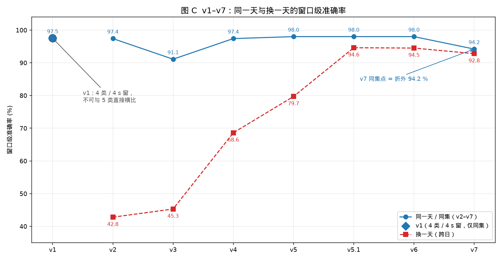

**图 C**　v1–v7 同一天与换一天的窗口级准确率；v1 以菱形单独画出（4 类 / 4 s 窗），不与 5 类连线；v7 的同集点是折外结果。

## 1 课题交付：4 份 CSV（[`output/v1/csv/`](output/v1/csv/)）+ 8 张图（[`output/v1/figures/`](output/v1/figures/)）

### 1.1 提交文件

| 文件 | 源记录 | 状态 | 时长 | 4 s 窗 | 判对 |
|---|---|---|---|---|---|
| `01_walk_flat.csv` | `walk-1` | 平地慢走 | 111.4 s | 211 | 211 |
| `02_run.csv` | `run` | 快跑 | 15.6 s | 21 | 21 |
| `03_stairs.csv` | `go_downstairs-1` | 上下楼梯（下楼样本） | 28.4 s | 47 | 47 |
| `04_static.csv` | `stand` | 静止 | 45.3 s | 76 | 67 |
| **合计** | — | — | **200.7 s** | **355** | **346（97.5 %）** |

md5 与源文件逐字节一致：`01` `c539aebd…`、`02` `175fdc76…`、`03` `0b2bfc26…`、`04` `b1084e0b…`。CSV 为 Phyphox 原始导出，列为 `Time (s)` / `ax` / `ay` / `az` / `|a|`；`01`/`02` 是 201.6 Hz 的去重力 `Linear Acceleration`，`03`/`04` 是 403.1 Hz 的含重力 `Acceleration`。因此 02 的 `|a|` 峰值可达 124.6 m/s²，03/04 的 `|a|` 在 9.8 m/s² 基线附近波动；v1 统一对 `|a|` 取阈值，σ 不受常量偏置影响。`03` 取 `go_downstairs-1`；同一套阈值对 `data_1` 的 3 段上楼（169 窗）也全部判为「上下楼梯」。

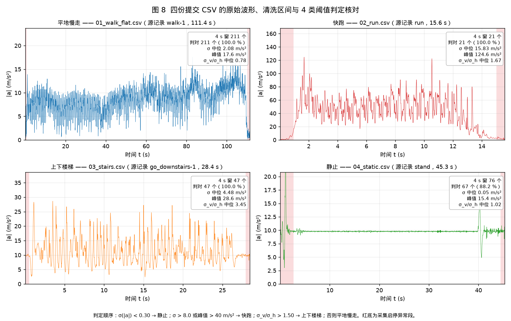

**v1 图 8**　四份提交 CSV 的波形、清洗区间与判定核对；静止段 76 窗中 9 窗误判，来自录制中段拿起手机（真实运动，未剔除）。

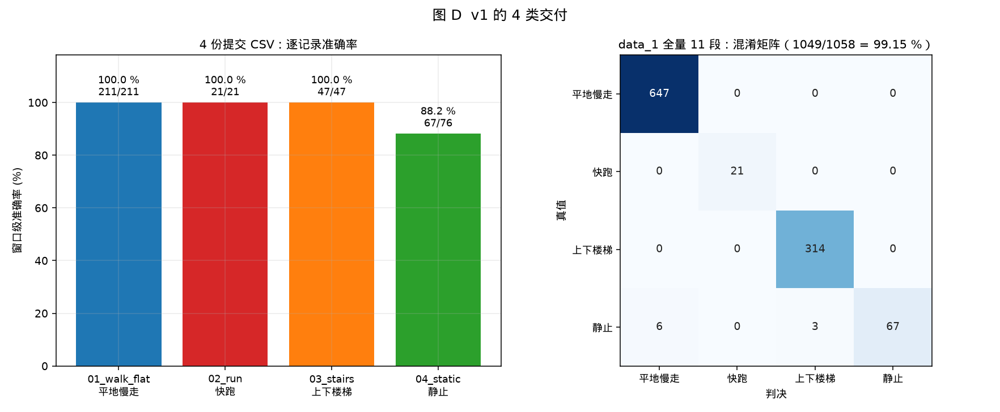

**图 D**　v1 的 4 类交付：逐记录准确率 + `data_1` 全量混淆矩阵（1049/1058 = 99.15 %）。

### 1.2 阈值规则（4 类，4 s 窗 / 0.5 s 步长）

| 顺序 | 条件 | 判定 |
|---|---|---|
| 1 | `σ(\|a\|) < 0.30 m/s²` | 静止 |
| 2 | `σ(\|a\|) > 8.0 m/s²` 或峰值 `\|a\| > 40 m/s²` | 快跑 |
| 3 | `σ_v / σ_h > 1.50` | 上下楼梯 |
| 4 | 其余 | 平地慢走 |

顺序不能交换：快跑的 `σ_v/σ_h` 中位也有 1.67，会越过第 3 条，必须先用 σ / 峰值把快跑判走。4 份提交记录的 σ 中位为静止 0.05、慢走 2.08、楼梯 4.48、快跑 15.83 m/s²，三条阈值两侧的最近余量约 1.8 倍。4 类口径的跨日：把 v6 的 `up` / `down` 合并（`output/v6/windows.csv`），10-25 为 **95.45 %**（672/704），v5.1 为 96.02 %（676/704）。

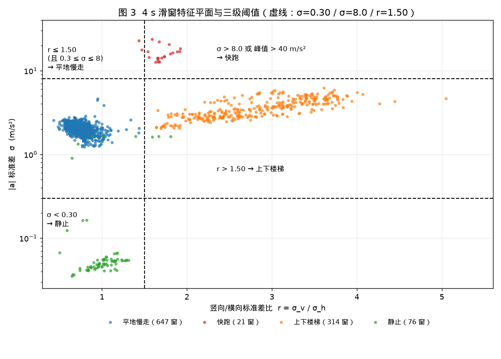

**v1 图 3**　4 s 窗特征平面与三条阈值；点到阈值线的距离即规则余量。

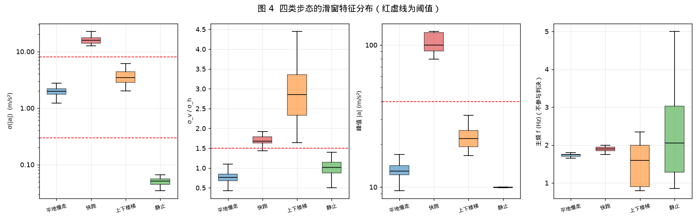

**v1 图 4**　四类滑窗特征分布（红虚线为阈值）。

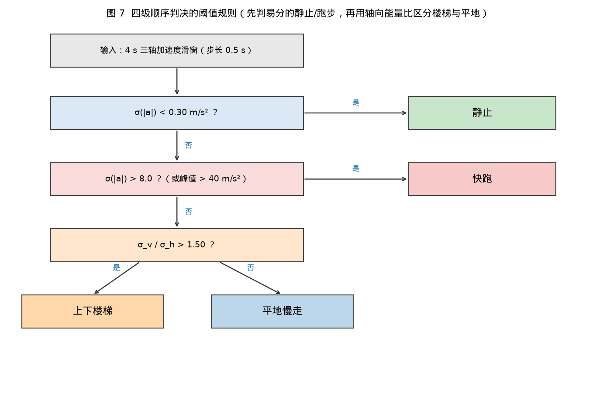

**v1 图 7**　四级顺序判决树。

其余两张 v1 图：图 5 四类功率谱、图 6 四类逐窗判决时间线，文件在 [`output/v1/figures/`](output/v1/figures/)。

## 2 数据与采集

| 项 | 值 |
|---|---|
| 手机 / 系统 | OnePlus Ace 5，`PKG110`，Android 16 |
| 传感器 | `icm456xx` 加速度计（量程 156.9 m/s²）；QTI `gravity`（201.6 Hz） |
| 采集 App | Phyphox 1.2.1（build 1020105，fileFormat 1.20） |
| 姿态 | 自然摆臂；另有两批刻意不摆臂（18 段，`-noswing`） |

| 数据集 | 日期 / 时段 | 段数 | 8 s 窗 | 角色 |
|---|---|---|---|---|
| `raw_data/legacy/data_1/` | 10-23 15:33–16:25 | 11 | —（4 s 窗 1058） | v1 的 4 类验证 |
| `raw_data/calib/data_2/` | 10-24 17:51–18:33 | 7 | 302 | 主标定集 |
| `raw_data/calib/2026-10-24/` | 10-24 07:58–08:38 | 9 | 640 | 标定集 |
| `raw_data/blind/2026-10-25/` | 10-25 09:42–10:06 | 9 | 704 | 跨日 1（曾参与 v5.1/v6 方向） |
| `raw_data/blind/2026-10-30/`、`10-31/`、`11-01/` | 10-30～11-01 | 36 | 2785 | 跨日 2；v7 训练集 |
| `raw_data/blind/2026-11-17/` | 11-17 08:47–09:20 | 13 | 1078 | 跨日 3（完全未参与选型） |

每段保留原始 CSV 与 `meta/device.csv`、`meta/time.csv`；每个数据集目录下另有 `_zips/`（每段一个 zip 原始导出）。`data_1`、`data_2` 另有现场照片与 Phyphox 截图。

> 历史版本脚本与产物中的 `data_routine` 标签即上表 `raw_data/calib/2026-10-24/`（640 窗 / 9 段）；取数路径已写死为该目录。

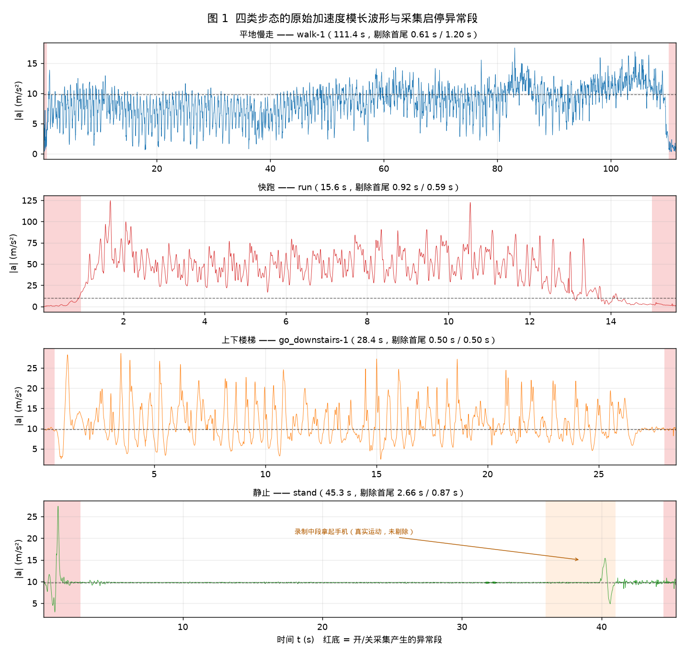

**v1 图 1**　四类原始波形；红底为采集启停异常段，已剔除。

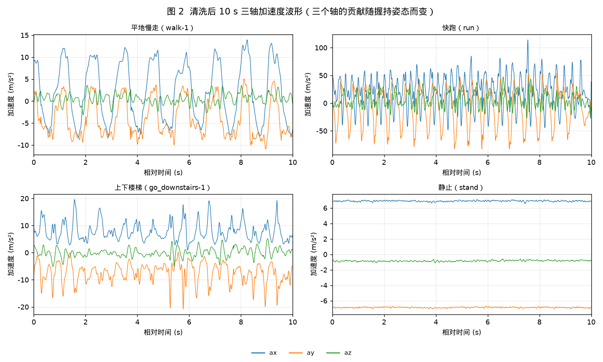

**v1 图 2**　清洗后 10 s 三轴波形：三个轴的贡献随握持姿态而变。

## 3 方法

```
Accelerometer + Gravity
  → 重力插值 / 逐样本解耦（a_v, a_h）
  → 首尾清洗（掉零、启停瞬态、0.5 s 保护带）
  → 8 s 窗 / 1 s 步长（4 类交付为 4 s / 0.5 s）
  → 窗特征 → 分位标定 → 分层规则 → 段级解码
```

| 特征 | 对零偏 `s→s+c` | 对增益 `s→a·s` | 用途 |
|---|---|---|---|
| `rob_skew = (q95+q05−2q50)/(q95−q05)` | 不变 | 不变 | 判下楼 |
| `acp` / `zcr` | 不变 | 不变 | 慢走 / 上楼打分 |
| `sigma = std(\|a−g\|)` | 会变 | 随增益线性变 | 只做静止 / 快跑门限 |

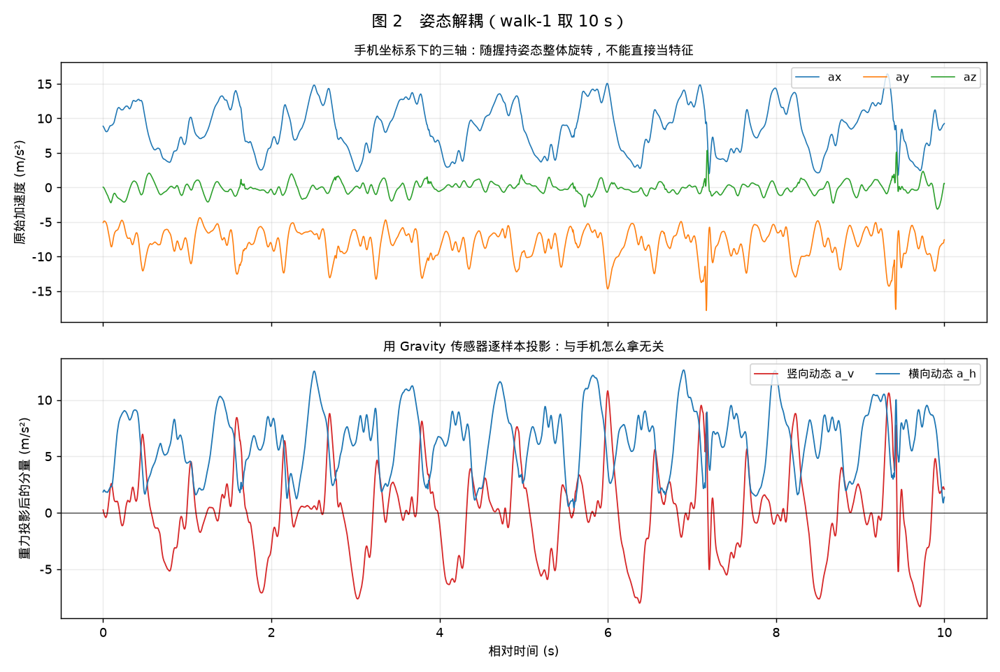

**v2 图 2**　姿态解耦：`ax/ay/az` 随握持姿态旋转，`a_v` / `a_h` 与「手机怎么拿」无关。

## 4 版本对比

图 A–F 是横向对比编号，与版本内部的图 1–26 分开；图 9–20 是历史版本的过程图（图 12 除外），未在正文展开。

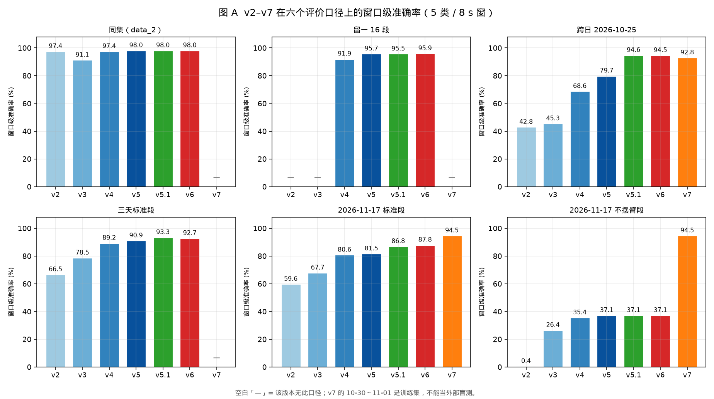

**图 A**　v2–v7 在六个评价口径上的窗口级准确率；空白「—」表示该版本无此口径，v7 的 10-30～11-01 是训练集、不能当外部盲测；v7 的同集 94.2 % 是 5 折折外，不与 v2–v6 的 in-sample 同列，故 panel 1 留空。

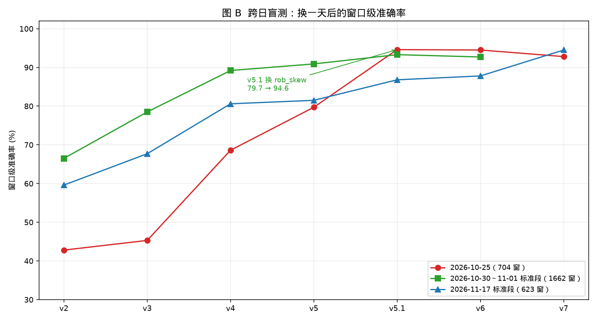

**图 B**　跨日盲测：v5.1 把 `ptn` 换成 `rob_skew`（并改用算术中点），10-25 就从 79.7 % 跳到 94.6 %。

| 版本 | 判决量 | 关键改动 | 同集 | 跨日 10-25 |
|---|---|---|---|---|
| v1 | `σ`、`σ_v/σ_h` | 4 类阈值 | 97.5 %（4 类） | — |
| v2 | `σ`、`σ_v`、`p99` | 重力解耦 + 绝对能量 | 97.4 % | 42.8 % |
| v3 | `f_dom`、`r = σ_v/σ_h` | 步频阶梯 + 能量比 | 91.1 % | 45.3 % |
| v4 | `pt`、`acp` | 波形峰谷 + 窗自相关 | 97.4 % | 68.6 % |
| v5 | `ptn` | 零偏校正 + 分位标定 | 98.0 % | 79.7 % |
| **v5.1** | **`rob_skew`** | **只换一个判决量** | 98.0 % | **94.6 %** |
| **v6** | `rob_skew` + Viterbi | 不变性自检 + 段级解码 | 98.0 % | 94.5 % |
| v7 | RBF-SVM（10 维） | 监督学习分支 | 94.2 %（折外） | 92.8 % |

## 5 跨日结果

| 口径 | 窗 / 段 | v5.1 | v6 | v7 | 记录级（v6 / v7） |
|---|---|---|---|---|---|
| 2026-10-25 | 704 / 9 | 94.6 % | 94.5 % | 92.8 % | 9/9 / 9/9 |
| 10-30～11-01 标准段 | 1662 / 23 | 93.3 % | 92.7 % | —（训练集） | 23/23 / — |
| 2026-11-17 标准段 | 623 / 8 | 86.8 % | 87.8 % | 94.5 % | 8/8 / 8/8 |
| 2026-11-17 不摆臂段 | 455 / 5 | 37.1 % | 37.1 % | 94.5 % | 2/5 / 5/5 |

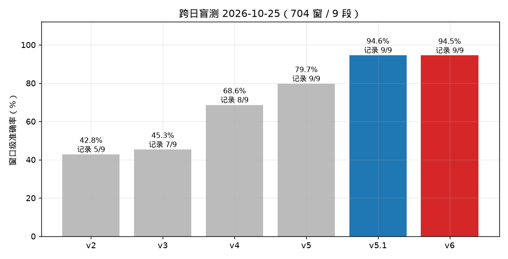

**图 23**　2026-10-25 跨日：在 v2–v6 中，v5.1 与 v6 是仅有的两个窗口级 > 90 % 的版本，记录级都是 9/9。

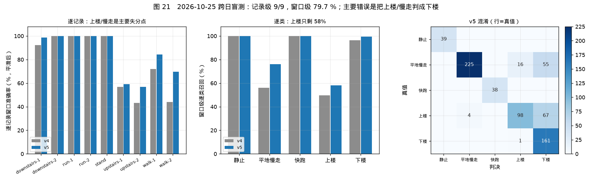

**图 21**　v5 在 10-25 上的失分：79.7 % 的窗口级准确率，错窗集中在上楼 / 慢走被判成下楼。

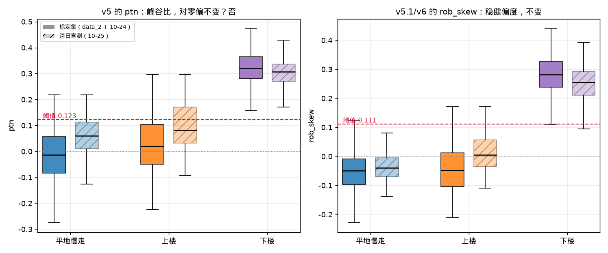

**图 22**　`ptn`（左）与 `rob_skew`（右）的类条件分布；换成 `rob_skew` 后，盲测的上尾重新落到阈值下方。

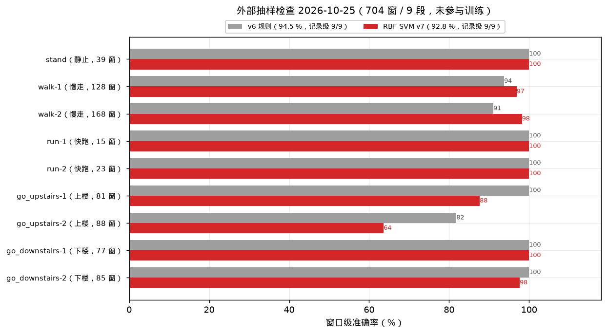

**图 25**　v7 在 10-25 的逐段结果：92.8 %，记录级 9/9，差距集中在 `go_upstairs-2`。

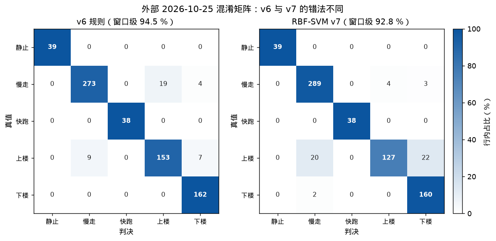

**图 26**　10-25 混淆矩阵（左 v6 / 右 v7）：v7 把更多上楼窗判成慢走与下楼，但慢走→上楼从 19 窗降到 4 窗。

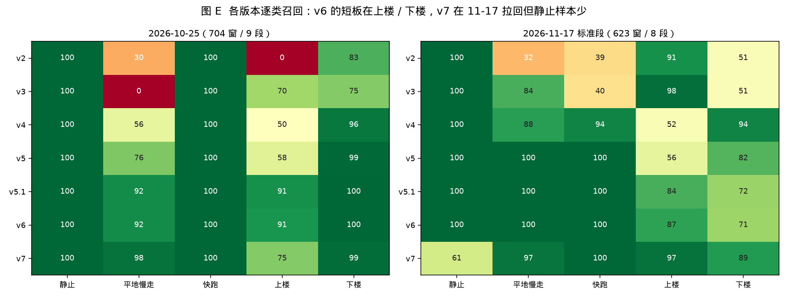

**图 E**　各版本逐类召回（左 10-25，右 11-17 标准段，颜色越绿越好）：v6 的短板集中在上楼 / 下楼；v7 在 11-17 把上楼拉到 97 %、下楼 89 %，但静止只有 18 窗、掉到 61 %（记录级仍对）。

## 6 不摆臂与 v7

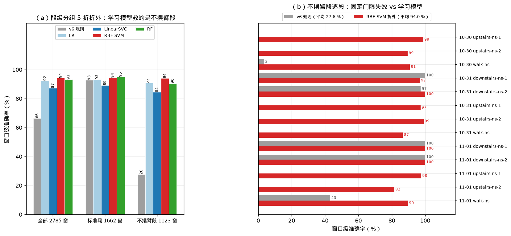

**图 24**　折外对比：固定门限在不摆臂段失效，学习模型把它从 27.6 % 拉到 84–94 %（RBF-SVM 94.0 %）。

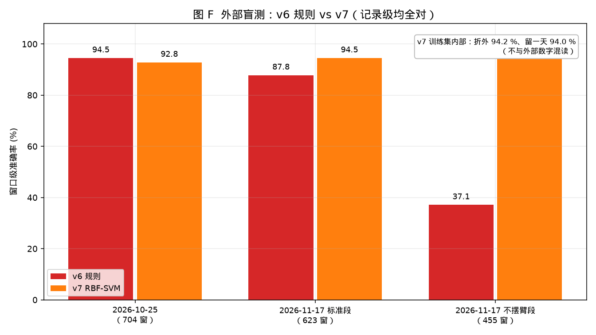

**图 F**　外部盲测 v6 vs v7：10-25 低 1.7 点，11-17 标准段高 6.7 点、不摆臂段高 57.4 点；记录级 v7 全对、v6 不摆臂 2/5。

| 方法 | 10-25 | 11-17 标准 | 11-17 不摆臂 |
|---|---|---|---|
| v5.1 | 94.6 % | 86.8 % | 37.1 % |
| v6 | 94.5 % | 87.8 % | 37.1 % |
| **v7** | 92.8 % | **94.5 %** | **94.5 %** |

## 7 局限与结论

1. **一人一机**：全部数据来自本人、同一台 PKG110；跨设备、跨人未验证。
2. **4 类 97.5 % 是同集标定结果**，只能当拟合度；真正有泛化意义的是 5 类跨日。
3. **2026-10-25 曾用于 v5.1 / v6 方向选择**；2026-11-17 完全未参与任何版本选择。
4. **不摆臂是协议外变量**，引用跨日数字时只用标准段。
5. **跨日窗口级 86.8–94.6 %**，记录级全对；失分集中在上楼 / 下楼 / 慢走互混。
6. **v7 训练集是一人一机三天**，换手机或换人必须重训、重验。
7. **窗重叠 7/8**：704 个 8 s 窗去重叠后只剩 90 个；4 类交付里 run 只有 15.6 s（21 窗，约 3 个独立 4 s 窗），引用时以记录级为主。
8. **照片证据只覆盖 `data_1`、`data_2`**；后续跨日数据只有 `meta/` 可回查。
9. **4 份 CSV 的导出流不同**：01/02 为 201.6 Hz 去重力线性加速度，03/04 为 403.1 Hz 含重力；v1 的 σ 不受常量偏置影响，但 `σ_v/σ_h` 在 01/02 上由窗均值方向估计，不是真实重力（v2 起改用 Gravity 传感器解耦）。03 只含下楼梯样本，上楼样本在 `data_1` 的 `go_upstairs-*`（169 窗，v1 全部判对）。

**结论**：课题要求的 4 类已完整交付并可复现——4 份原始 CSV、8 张图、4 条顺序阈值，窗口级 346/355 = 97.5 %，记录级 4/4。扩展分析表明：5 类同集可到 98 %，跨日窗口级 86.8–94.6 %、记录级全对；跨日失效的根源是 `ptn` 一类非平移不变量的零偏漂移，换成 `rob_skew` 后回到 94 %。不摆臂场景由固定门限造成：训练集不摆臂段 v6 27.6 %、外部 11-17 37.1 %，v7 折外 94.0 %、外部 94.5 %。

## 8 复现

```bash
# 4 类交付：4 份 CSV + 图 1–8 + 评估
.venv/bin/python src/v1/gait_analysis.py
.venv/bin/python src/v1/make_figures.py
.venv/bin/python src/v1/make_delivery_figure.py

# 5 类主线：不变性自检 + 全口径评估
.venv/bin/python src/v6/invariants.py
.venv/bin/python src/v6/evaluate.py

# v7：训练 + 外部盲测（10-25 / 11-17）
.venv/bin/python src/svm/train_svm.py
.venv/bin/python src/svm/blind_svm.py --input raw_data/blind/2026-10-25
.venv/bin/python src/svm/blind_svm.py --input raw_data/blind/2026-11-17

# 版本对比图 A–F
.venv/bin/python src/make_comparison_figures.py
```

```
topic_8/
├── raw_data/{calib,blind,legacy}/  ← 标定 / 跨日 / 早期数据
├── picture/                        ← 现场照片与 Phyphox 截图
├── src/
│   ├── v1/ … v6/                   ← 各版本规则与作图
│   ├── v5_1/                       ← v5.1 规则（rob_skew + 算术中点）
│   ├── svm/                        ← v7 训练 / 盲测 / 作图
│   ├── blind_test.py               ← v2 / v3 / v4 盲测对比 + 独立性检查
│   ├── eval_stats.py               ← 置信区间 / macro-F1 / 去重叠估计
│   ├── make_comparison_figures.py  ← 图 A–F
│   └── blind_eval.py               ← 六版同表盲测
└── output/
    ├── v1/{csv,features,figures}/  ← 4 份提交 CSV、逐窗结果、图 1–8
    ├── v2/ … v6/、v5_1/             ← 各版本 windows.csv / report.txt / figures
    ├── compare/figures/            ← 图 A–F
    ├── reports/                    ← 六版逐日盲测、blind_test、stats_2026-10-25
    └── svm/                        ← v7 模型、折外 / 外部逐窗结果、图 24–26、predict/
```

**环境**：Python 3.14.8 / 3.13.16、numpy 2.5.4 / 2.5.5、matplotlib 3.11.2、scikit-learn 1.9.1（11-17 复跑时容器内 3.14 不可用，用 3.13 重建 venv）；依赖见 [`requirements.txt`](requirements.txt)。

## 附录 A：设备

| 项 | 值 |
|---|---|
| 手机 | OnePlus Ace 5，`PKG110`，Android 16 |
| 加速度计 | `icm456xx`（TDK-Invensense），量程 156.9064 m/s² |
| 重力 | `gravity`（QTI），量程 156.91 m/s² |
| 采集 App | Phyphox 1.2.1（build 1020105，fileFormat 1.20） |
| 分析环境 | Python 3.14.8（11-17 复跑 3.13.16）、numpy 2.5.4 / 2.5.5、matplotlib 3.11.2、scikit-learn 1.9.1 |
