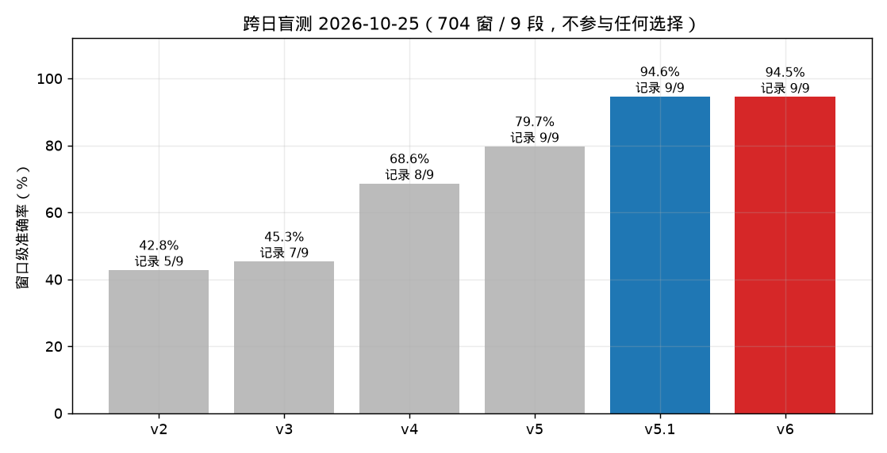
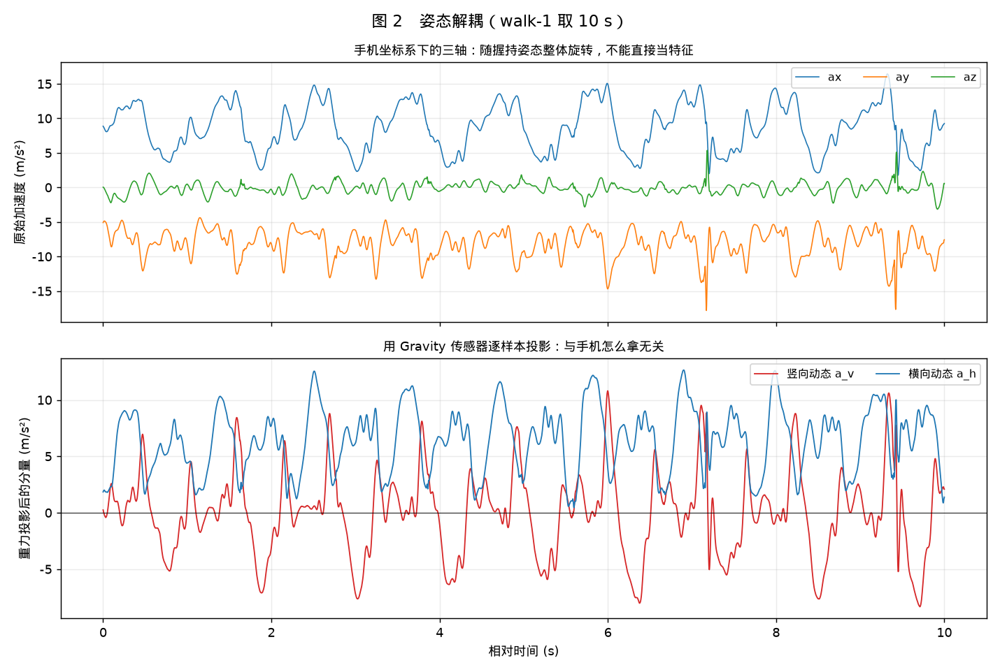
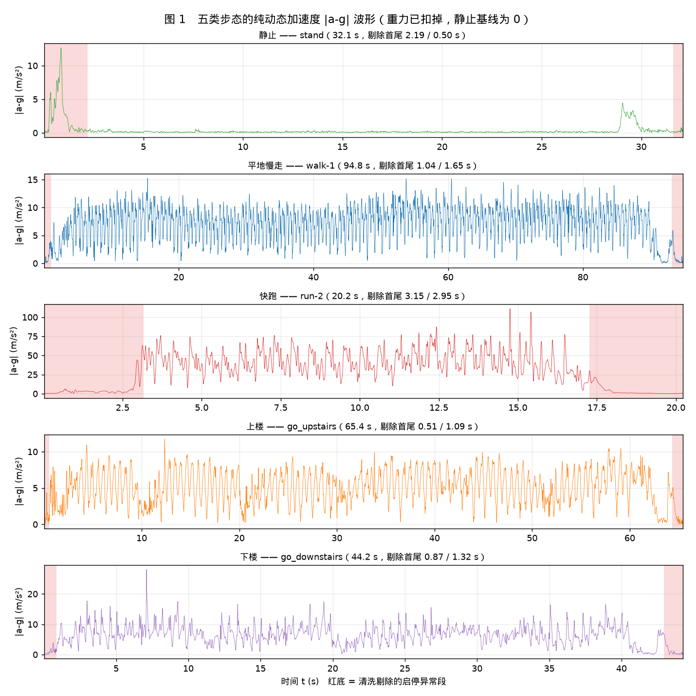
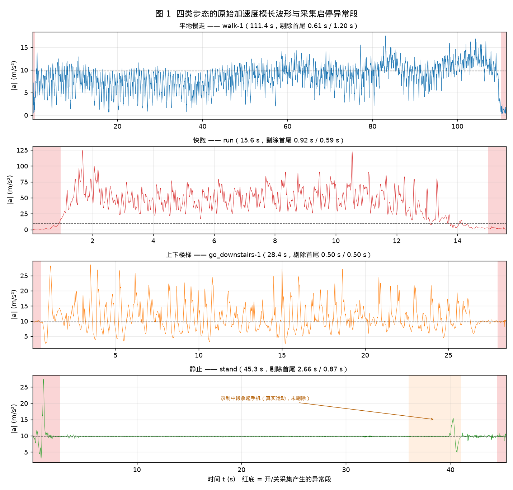
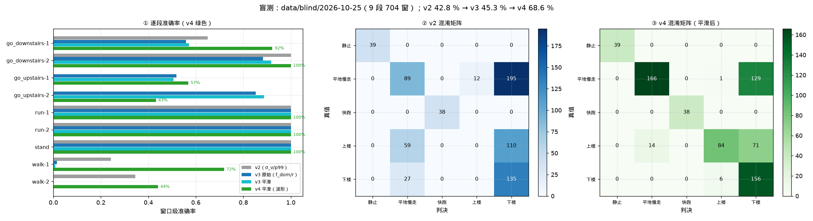
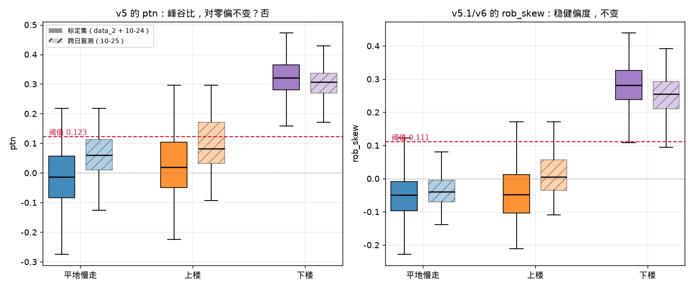
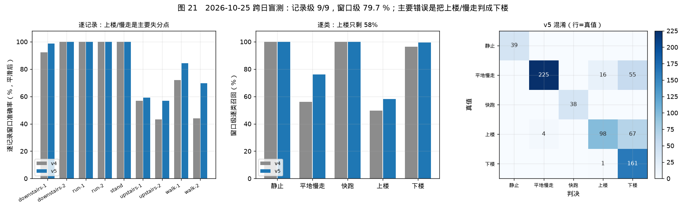
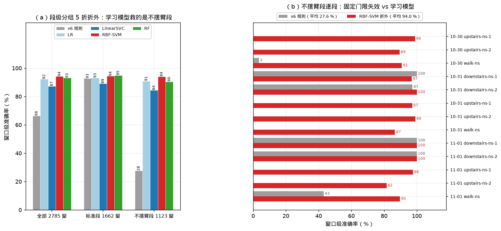
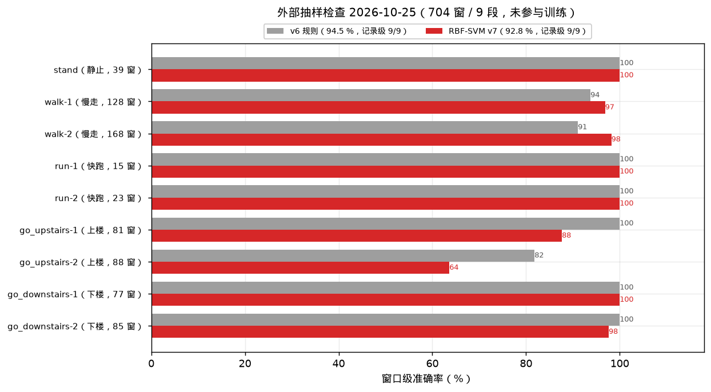
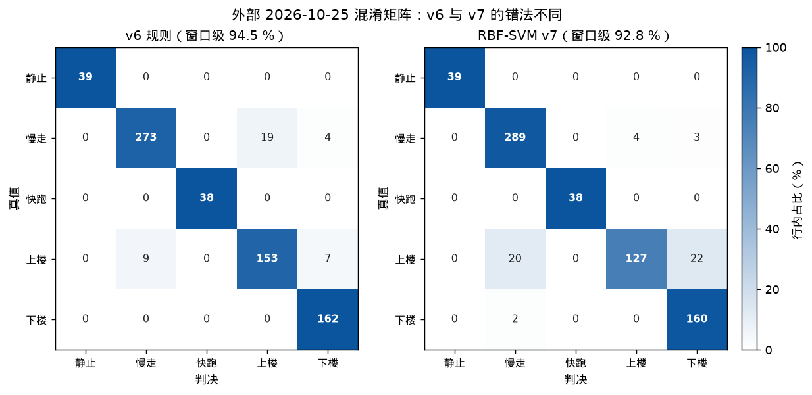

# 课题 8 实验报告：多姿态步态加速度判别（v1 → v7）

> **任务**：只用一个手机加速度传感器，把「静止 / 平地慢走 / 快跑 / 上楼 / 下楼」从加速度波形里判出来。
> **采集**：本人。OnePlus Ace 5（`PKG110`，Android 16），Phyphox 1.2.1；加速度约 403 Hz，Gravity 约 201.6 Hz。
> **数据**：5 组 72 段，全部本人采集，无他人 / 他机数据。61 段 / 4431 个 8 s 窗参与评估；另 11 段早期数据用于 v1 的 4 类验证。
> **交付**：课题要求的 4 份原始 CSV（[`output/v1/csv/`](output/v1/csv/)）+ 全部代码（[`src/`](src/)）+ 逐窗结果（[`output/`](output/)）+ 本文。
> **版本**：v7.0（2026-11-01）。规则主线 v6；监督学习分支 v7。

## 摘要

课题原始要求是 4 类：平地慢走、快跑、上下楼梯、静止。本报告先按 4 类交付原始数据：4 段、355 个 4 s 窗，判对 346 个（97.5 %）；再把「上下楼梯」拆成上楼、下楼，用同一个 8 s 窗做 5 类分析。

难点不在同一天。v2 / v4 / v5 在本人同批数据上做到 97–99 %，换一天（同一台 PKG110）只剩 42.8–79.7 %（v5 最好，79.7 %）。原因不是特征不够多，而是判下楼的 `ptn = (峰−谷)/(峰+谷)` 会随窗内残余零偏平移，跨日漂移的正是零偏；换成对零偏与增益都不变的稳健偏度 `rob_skew` 后，同一个分位标定就把跨日拉回 **94.6 %（v5.1）/ 94.5 %（v6）**，记录级 9/9。

三天后补采的 23 段标准段（1662 窗）给出第二组跨日复核：v5.1 93.3 %、v6 92.7 %，与 94.6 / 94.5 的置信区间重叠，记录级 23/23。同一批 13 段「不摆臂」采集把 v6 打到 27.6 %：失效点是固定门限 `stand = 1.100` 与 `rob_skew` 的切分，不是特征缺失。用这 36 段训练的 RBF-SVM（v7）在段级分组折外 94.2 %、留一天 94.0 %；把模型用到 2026-10-25 上，窗口级 92.8 %、记录级 9/9，比 v6 低 1.7 个点——学习模型买的是换持机方式的鲁棒性，不是无条件的准确率。

三个边界先说清楚：**一人一机**（PKG110，两组跨日数据仍同一人同一手机）；**「不摆臂」是协议外变量**，引用跨日数字时只用标准段；**2026-10-25 曾用于 v5.1/v6 选型**，对 v7 也只能算外部抽样复核，不是完全未看过。

**关键词**：步态识别；加速度；不变性；跨日泛化；分位标定；段级解码

**关键结果速览**

| 项目 | 结果 |
|---|---|
| 课题 4 类交付（v1，355 窗） | 346/355 = 97.5 %；`data_1` 全量 1049/1058 = 99.15 %，记录级 11/11 |
| 5 类同集（v6） | `data_2` 98.0 %；2026-10-24 98.9 % |
| 5 类留一（16 段 942 窗） | 95.86 %（v6） |
| 跨日盲测 2026-10-25（704 窗 / 9 段） | **94.5 %**（v6）、94.6 %（v5.1），记录级 9/9 |
| 三天复核标准段（1662 窗 / 23 段） | 92.7 %（v6）、93.3 %（v5.1），记录级 23/23 |
| 不摆臂段（1123 窗 / 13 段） | 27.6 %（v6，固定门限失效）；v7 留一天 91.9 % |
| 学习模型 v7（36 段） | 折外 94.2 %、留一天 94.0 %（记录级 36/36）；外部 2026-10-25 92.8 %（记录级 9/9） |
| 4 类口径的跨日（v6，10-25） | 95.45 %（672/704） |

**本文结构与评审维度对照**

| 评审维度 | 对应章节 | 状态 |
|---|---|---|
| 选题与目标 | §1（4 类要求 → 5 类拆分、RQ1–RQ4、成功标准） | 完成 |
| 设计与变量控制 | §2.1 采集条件，§3.6 四种评价协议，§4.6 跨日与不摆臂分列 | 完成（不摆臂为协议外变量，单列） |
| 数据采集与质量 | §2.2 数据集、§2.3 类别分布、§2.4 预处理、§2.5 证据链 | 完成（照片仅覆盖前两组） |
| 处理与判定 | §3.2 重力解耦、§3.3 不变性、§3.4 判决、§3.5 窗长，§5.2 关键节点 | 完成 |
| 结果与结论 | §4 全部口径、§6 讨论 | 完成 |
| 图表 | 正文图 1 / 2 / 12 / 21 / 22 / 23 / 24–26 + v1 图 1，§7.5 图集索引（图 1–26） | 完成 |
| 局限与改进 | §6（13 条） | 完成 |
| 复现与交付 | §7（一条命令、目录、换新数据、交付物清单） | 完成 |



**图 23**　跨日盲测 2026-10-25（704 窗 / 9 段，不参与任何阈值或权重选择）：v5.1 与 v6 是仅有的两个窗口级 > 90 % 的版本，记录级都是 9/9。

---

## 1 任务与目标

### 1.1 课题要求与本报告的对应

课题原始要求是 4 类：**平地慢走 / 快跑 / 上下楼梯 / 静止**。这 4 类全部保留，交付 4 份原始 CSV：

| 提交文件 | 对应记录 | Phyphox 导出列 | 时长 | 4 s 窗 | 判对 |
|---|---|---|---|---|---|
| `01_walk_flat.csv` | `walk-1` | `Linear Acceleration`（去重力） | 111.4 s | 211 | 211 |
| `02_run.csv` | `run` | `Linear Acceleration`（去重力） | 15.6 s | 21 | 21 |
| `03_stairs.csv` | `go_downstairs-1` | `Acceleration`（含重力） | 28.4 s | 47 | 47 |
| `04_static.csv` | `stand` | `Acceleration`（含重力） | 45.3 s | 76 | 67 |
| **合计** | — | — | **200.7 s** | **355** | **346（97.5 %）** |

4 份文件都在 [`output/v1/csv/`](output/v1/csv/)，与 [`data/legacy/data_1/`](data/legacy/data_1/) 下对应记录的 `Raw Data.csv` **逐字节一致**（md5 已核对）。01/02 与 03/04 的列名不同，是 `data_1` 的导出设置不同；v1 直接对 `|a|` 取阈值，而 `data_2` 全部是含重力的 `Acceleration`，这套口径搬过去就失效（§5.2）。

课题要求的是 4 类，但「上下楼梯」在加速度波形上有明确的物理差别：上楼与下楼的峰谷不对称方向相反（`rob_skew` 在 `s → −s` 下变号，§3.3）。因此主分析把楼梯拆成上楼、下楼做 5 类，同时保留 4 类口径的结果（§4.2，跨日合并后 95.45 %），两边不脱节。

### 1.2 研究问题

- **RQ1**：同人同机、同一批数据上，5 类能做到多少？换折（留一记录）掉多少？
- **RQ2**：换一天还能不能分？两组跨日数据（2026-10-25、2026-10-30～11-01）分别给出多少？
- **RQ3**：哪些特征在「换一天」这件事上不变？能不能用代码证明，而不是事后解释？
- **RQ4**：换一种持机方式（刻意不摆臂）时，失效发生在哪一层？

### 1.3 成功标准（本报告自定）与达成情况

| # | 标准 | 结果 | 状态 |
|---|---|---|---|
| 1 | 交付 4 类原始数据，逐字节可追溯 | `output/v1/csv/` 4 份与源文件 md5 一致 | 达成 |
| 2 | 判别流程可复现 | `src/v6/evaluate.py` 一条命令跑完同集 / 留一 / 盲测 / 因果 / 去重叠 | 达成 |
| 3 | 同人同机留一 ≥ 90 % | 95.9 %（16 段 942 窗） | 达成 |
| 4 | 跨日窗口级 ≥ 90 %，记录级 9/9 | 94.5 % / 9/9（2026-10-25） | 达成 |
| 5 | 第二组跨日复核 | 92.7 % / 23-23（2026-10-30～11-01 标准段） | 达成 |
| 6 | 说明失效边界 | 不摆臂 27.6 %，机制定位到两个固定切分（§4.6） | 达成 |

---

## 2 数据

### 2.1 采集条件

| 项 | 值 |
|---|---|
| 手机 | OnePlus Ace 5，机型 `PKG110`，Android 16 |
| 加速度计 | `icm456xx`（TDK-Invensense），量程 156.9 m/s²，分辨率 0.0048 m/s² |
| 重力 | `gravity`（QTI），量程 156.91 m/s²，分辨率 0.01 m/s² |
| 采集 App | Phyphox 1.2.1（build 1020105，fileFormat 1.20） |
| 采样率 | Accelerometer ≈ 403 Hz；Gravity / Orientation ≈ 201.6 Hz |
| 姿态 | 手机握在手中自然摆臂；另有一组刻意不摆臂（13 段，目录名带 `-noswing`） |
| 场地 | 平地与楼梯（同一人往返） |
| 时段 | 2026-10-23 早期；10-24 早间 07:58–08:38、晚间 17:51–18:33；10-25 09:42–10:06；10-30 17:33、10-31 07:57、11-01 17:31 |

**数据真实性。** 全部 72 段由本人用同一台手机采集，仓库内没有他人或他机数据。每段一个目录，`meta/device.csv` 记录机型、品牌与传感器参数，`meta/time.csv` 记录 START / PAUSE 墙钟（带时区）；2026-10-23 与 2026-10-24 两组另有现场照片与 Phyphox 截图（[`picture/`](picture/)）。后两组跨日数据没有拍照，这是本报告的证据缺口（§6）。

### 2.2 五组数据集

| 目录 | 日期 / 时段 | 状态数 | 段数 | 8 s 窗 | 角色 |
|---|---|---|---|---|---|
| [`data/legacy/data_1/`](data/legacy/data_1/) | 10-23 15:33–16:25 | 4 | 11 | —（4 s 窗 1058） | v1 的 4 类验证集 |
| [`data/calib/data_2/`](data/calib/data_2/) | 10-24 17:51–18:33 | 5 | 7 | 302 | 主标定集 |
| [`data/calib/2026-10-24/`](data/calib/2026-10-24/) | 10-24 07:58–08:38 | 5 | 9 | 640 | 标定集（v4 起） |
| [`data/blind/2026-10-25/`](data/blind/2026-10-25/) | 10-25 09:42–10:06 | 5 | 9 | 704 | **跨日盲测**（不参与阈值 / 权重） |
| [`data/blind/2026-10-30/`](data/blind/2026-10-30/)、[`2026-10-31/`](data/blind/2026-10-31/)、[`2026-11-01/`](data/blind/2026-11-01/) | 10-30～11-01 | 5 | 36 | 2785 | **第二组跨日复核**（23 标准段 + 13 不摆臂段）；v7 训练集 |

> 日期取自各段 `meta/time.csv`。`data_2` 与 `2026-10-24` 同为 10-24（晚间 / 早间，相隔约 9 小时），两者之间是「同日跨时段」，不是跨天；真正的跨天是 10-25 与 10-30～11-01 两组。10-30～11-01 在目录上是三天三个文件夹，文中合称「三天复核」。

- 采样与时间轴：`Gravity` / `Orientation` 约 201.6 Hz，分析前把重力向量线性插值到加速度时间轴。
- `jogging`（慢跑）与 `sprint`（短跑）都按「快跑」计；`jogging` 的 σ 只有 4.84–7.22 m/s²，比 `data_2` 的快跑（8.48–16.47）低一截，是留一里最弱的一类。
- `_zips/` 保留手机导出的原始 zip；`Gyroscope.csv` / `Orientation.csv` 本版未使用。

### 2.3 类别分布（8 s 窗）

| 数据集 | 静止 | 平地慢走 | 快跑 | 上楼 | 下楼 | 合计 |
|---|---|---|---|---|---|---|
| `data_2` | 22 | 180 | 9 | 56 | 35 | 302 |
| 2026-10-24 | 38 | 196 | 148 | 94 | 164 | 640 |
| 2026-10-25（盲测） | 39 | 296 | 38 | 169 | 162 | 704 |
| 10-30～11-01 标准段 | 110 | 380 | 342 | 344 | 486 | 1662 |
| 10-30～11-01 不摆臂段 | — | 272 | — | 567 | 284 | 1123 |

`data_2` 的快跑只有 9 个窗（`run-1` 11.9 s、`run-2` 20.2 s），这是后文长窗实验里快跑整类消失的原因（§6）。不摆臂段没有静止与快跑记录，只有慢走、上楼、下楼。

### 2.4 预处理与清洗

1. **重力插值**：把 201.6 Hz 的 `Gravity` 线性插值到 403 Hz 的加速度时间轴。
2. **首尾清洗**：清洗作用在 `|a−g|` 上（含 g 的模式下 `|a|` 永远不会掉到 2 以下，v1 的掉零规则无效）。两端 0.5 s 滚动标准差 < 全段中位数的 0.3 倍时判为首尾静止段丢弃（仅当全段中位数 > 0.5 时启用）；两端 0.5 s 标准差 > 中位数的 3 倍时判为拿起 / 放下瞬态丢弃；两端再各留 0.5 s 保护带。清洗只处理首尾，中段的真实动作保留（如 `stand` 在 27 s 拿起手机）。
3. **分窗**：8 s 窗、1 s 步长，重叠 7/8。

### 2.5 证据链

| 证据 | 位置 | 覆盖范围 |
|---|---|---|
| 现场照片 | `picture/data_1/photos/`（8 张）、`picture/data_2/photos/`（4 张 + 1 段视频） | 10-23、10-24 晚间 |
| Phyphox 截图 | `picture/data_1/screenshots/`（9 张）、`picture/data_2/screenshots/`（7 张） | 10-23、10-24 晚间 |
| 设备 / 时间 | 每段 `meta/device.csv`、`meta/time.csv` | 全部 72 段 |
| 原始导出 | 每段 `_zips/` | 全部 72 段 |

2026-10-24 早间、2026-10-25、2026-10-30～11-01 没有照片；设备与时间仍可从 `meta/` 逐段回查。

---

## 3 方法

### 3.1 总流程

```
Accelerometer.csv + Gravity.csv
   → 重力插值、逐样本解耦（a_v / a_h，§3.2）
   → 首尾清洗（§2.4）
   → 8 s 窗 / 1 s 步长
   → 窗特征（不变核 + 诊断量，§3.3）
   → 分位标定 → 分层规则 → 段级解码（§3.4）
   → 窗级 / 记录级评估（§3.6）
```

### 3.2 逐样本重力解耦

手机握在手里摆臂时，「窗口内三轴均值方向 = 重力方向」这个假设不成立（§5.2）。本报告用 Phyphox 同时导出的 `Gravity` 传感器逐样本解耦。设 `g(t)` 为重力读数，`ĝ = g/|g|`：

```
a_v = a·ĝ − |g|                    竖向动态加速度（扣掉 9.8 常量）
d   = a − g                        动态加速度向量
a_h = |d − (d·ĝ)ĝ|                 横向动态幅值（= √(|d|² − a_v²)）
```

静止时 `d ≈ 0`，运动时 `|d|` 就是不含重力的动态加速度。



**图 2**　姿态解耦：上图的 `ax/ay/az` 随握持姿态整体旋转，下图的 `a_v`、`a_h` 才与「手机怎么拿」无关。



**图 1**　五类状态的纯动态加速度 `|a−g|` 波形，红底为清洗剔除的首尾段。

### 3.3 特征：先分不变性，再谈判别力

这是全报告的方法论主线：**先问一个量在「换一天」时会不会变，再问它判别力强不强。**

| 类别 | 特征 | 对零偏 `s→s+c` | 对增益 `s→a·s` | 用途 |
|---|---|---|---|---|
| **不变核** | `rob_skew = (q95 + q05 − 2·q50) / (q95 − q05)` | 不变 | 不变 | 判下楼 |
| | `acp`：0.30–1.20 s 内窗自相关峰 | 不变 | 不变 | 慢走 / 上楼打分 |
| | `zcr`：过零率 | 不变 | 不变 | 慢走 / 上楼打分 |
| 协变量 | `rob_skew` 在 `s→−s` 下变号 | — | — | 符号即上 / 下楼的物理差别 |
| **非不变** | `sigma = std(\|a−g\|)` | — | 随增益线性变 | 只做静止 / 快跑两个门限 |
| 诊断量 | `cadence`、`i_cv`、`ac_lag`、`bias` | — | — | 只输出，不进判决 |

为什么较真：v5 判下楼的 `ptn = (mean(pv) − mean(tv)) / (mean(pv) + mean(tv))` 看起来是「比值」，但分子分母都含 `pv + tv`。给窗内所有样本加常数 `c` 时，峰抬 `c`、谷的绝对值降 `c`，`ptn` 随之改变——它**不是平移不变**的。窗内减中位数只能压掉当天的 `c`；估偏或 `c` 随手持变，判决就漂。跨日漂的正是这个量。`rob_skew` 加 `c` 时三个分位各加 `c`，分子分母同时不变；乘 `a` 时分子分母同乘 `a`。**加性零偏与增益都进不了判决。**

早期版本的绝对幅值特征（v2/v3 的 `σ`、`p99`、`σ_v`、`f_dom`、`r`）在同集上判别力很强，但换一天整体偏移就失效（§4.1、§5.2），是「先看判别力、后看不变性」的代价。

### 3.4 判决：分位标定 → 分层规则 → 段级解码

1. **分位标定**：所有阈值取两个类 2 % / 98 % 分位之间的中点，不用 `max/min`——单个异常窗就能把极值阈值拖走。有符号量（`rob_skew`）用算术中点；绝对值量（`sigma`）用几何中点。
2. **分层规则**（顺序与 v4 一致）：`sigma` 低于静止门限 → 静止；高于快跑门限 → 快跑；`rob_skew` 高于下楼门限 → 下楼；`−z(acp) − z(zcr)` 高于门限 → 上楼；否则慢走。权重固定为 1，不在测试集上调。
3. **段级解码**：逐窗判决是「观测」，解码在状态图（`walk` 在中心，其余四类只在走路时进出）上最小化 `Σ 观测代价（判对 0 / 判错 1） + Σ 切换代价（penalty × 图上距离）`。`penalty` 只在留一上选（v6 得 1.0），离线整段解码；因果模式（只看过去窗）也实现了（§4.8）。

**最终判决参数**（`data_2 + 2026-10-24` 标定，2 % / 98 % 分位；完整报告见 [`output/v6/report.txt`](output/v6/report.txt)）：

| 判决 | 特征 | 阈值 |
|---|---|---|
| 静止 | `sigma` | 1.100 |
| 快跑 | `sigma` | 4.121 |
| 下楼 | `rob_skew` | +0.1108 |
| 上楼 | `−z(acp) − z(zcr)` | +0.633 |
| 其余 | — | 平地慢走 |
| 段级解码 | Viterbi | penalty = 1.0（只在留一上选） |

`sigma` 是唯一保留的绝对幅值量，只用于静止 / 快跑两个门限；`rob_skew` 与 `acp` / `zcr` 对零偏、增益不变（§3.3）；up score 的 z 归一化参数在标定集上固定，权重为 1。

### 3.5 窗长与步长

**8 s 窗 / 1 s 步长**。4 s 在 1.7 Hz 步频下只有约 7 步，`σ_v` / `σ_h` 的估计方差大。同一套 v2 流程在 `data_2` 上：4 s 91.8 %、6 s 94.9 %、8 s 97.4 %、10 s 99.7 %（10 s 时 `run-1` 不足一个窗被整体丢掉，只剩 6 段 288 窗，与前三档不可比，故取 8 s）。

「加长窗就涨」在跨日上会反过来咬人：16 s 窗在跨日盲测上能到 99.7 %，但留一掉到 84.3 %——`data_2/run-1` 只有 11.9 s，长窗下快跑整类消失（§6）。

### 3.6 四种评价协议

| 协议 | 做法 | 读法 |
|---|---|---|
| 同集 | 标定集自身 | 只当拟合度，不能当泛化 |
| 留一记录 | 16 段轮留，每折重标定全部阈值 | 最严格的**同人同机**协议 |
| 盲测 | 标定集固定，测试集不参与任何选择 | 跨日两组（同人同机） |
| 因果 | 只允许看过去窗 | 接近在线；结果见 §4.8 |

另外三种口径用于读区间：**Wilson 95 %**（把窗当独立样本，偏窄）、**记录级 bootstrap**（按段重采样 B=2000，偏保守）、**去重叠**（每段每 8 窗取 1 窗，704 → 90）。8 s 窗 / 1 s 步长使相邻窗重叠 7/8，点准确率不能按独立样本数读，引用时以记录级为主。

---

## 4 结果

### 4.1 主表

| 口径（窗数） | v2 | v3 | v4 | v5 | v5.1 | v6 |
|---|---|---|---|---|---|---|
| `data_2` 同集（302） | 97.4 % | 91.1 % | 97.4 % | 98.0 % | 98.0 % | **98.0 %** |
| 2026-10-24 同集（640） | — | — | 98.9 % | **99.1 %** | **99.1 %** | 98.9 % |
| 留一 walk/run（189） | 90.5 % | 74.6 % | 95.8 % | **98.4 %** | **98.4 %** | **98.4 %** |
| 留一 16 段（942） | — | — | 91.9 % | 95.65 % | 95.54 % | **95.86 %** |
| **跨日 2026-10-25（704）** | 42.8 % | 45.3 % | 68.6 % | 79.7 % | **94.60 %** | 94.46 % |
| 跨日 10-25 记录级（9 段） | 5/9 | 7/9 | 8/9 | 9/9 | 9/9 | 9/9 |
| 跨日 10-25 去重叠（90） | 42.2 % | 44.4 % | 71.1 % | 78.9 % | 92.2 % | 92.2 % |
| **三天标准段（1662）** | 66.5 % | 78.5 % | 89.2 % | 90.9 % | **93.3 %** | 92.7 % |
| 三天标准段 记录级（23 段） | — | — | — | — | 23/23 | 23/23 |
| 三天不摆臂段（1123） | 7.6 % | 25.0 % | 27.2 % | 27.5 % | 27.9 % | **27.6 %** |

- 「同集」行（含 v4 之后的 2026-10-24）都是 in-sample，只当拟合度看。2026-10-24 对 v2/v3 不是同集（它们只用 `data_2` 标定），跨数据集数字在 §4.4。
- 真正的留出 / 盲测是「留一」行、2026-10-25 四行与 10-30～11-01 三行。
- 2026-10-25 在 v5 定稿后才进仓库，v5.1 / v6 只用它验证过「不变性」这一个假设，没有用它调参；但这仍意味着 94.6 / 94.5 需要另一天复核，第二组在 §4.6。
- 2026-10-30～11-01 同时改变了「日期」与「是否摆臂」两个变量：标准段当跨日复核，不摆臂段只能当协议外边界，**不能混入跨日数字**。

### 4.2 课题的 4 类口径

4 类交付的直接结果（v1，4 s 窗 / 0.5 s 步长）：**346/355 = 97.5 %**；`data_1` 全量 11 段 1049/1058 = 99.15 %，记录级 11/11。这 4 段都是同集，只能当拟合度。

真正有泛化意义的是 4 类口径的跨日数字：把 v6 在 2026-10-25 上的 `up` / `down` 合并成「上下楼梯」，**95.45 %（672/704）**；按 `pred_smooth` 统计，逐窗结果见 [`output/v6/windows.csv`](output/v6/windows.csv)。v5.1 同口径为 96.02 %（676/704）。

v1 的四级阈值（4 s 窗 / 0.5 s 步长）：

| 判决 | 条件（按顺序） |
|---|---|
| 静止 | `σ(\|a\|) < 0.30 m/s²` |
| 快跑 | `σ(\|a\|) > 8.0 m/s²` 或峰值 `\|a\| > 40 m/s²` |
| 上下楼梯 | `σ_v / σ_h > 1.50` |
| 平地慢走 | 其余 |



**v1 图 1**　四类原始波形：平地慢走 / 快跑 / 下楼 / 静止（红底为启停异常段，已剔除）。

### 4.3 跨日盲测 2026-10-25（最严格的一组）

704 窗 / 9 段，同一人、同一台 PKG110，比标定集晚一天。v5 定稿后才进仓库，不参与任何阈值 / 权重选择；v5.1 / v6 只在这组上验证过「不变性」这一个假设。

| 方法（平滑后） | 窗口级 | 记录级 | 去重叠（90 窗） |
|---|---|---|---|
| v2 | 42.8 % | 5/9 | 42.2 % |
| v3 | 45.3 % | 7/9 | 44.4 % |
| v4 | 68.6 % | 8/9 | 71.1 % |
| v5 | 79.7 % | 9/9 | 78.9 % |
| **v5.1** | **94.6 %** [92.7, 96.0] | **9/9** | 92.2 % |
| v6 | 94.5 % [92.5, 95.9] | 9/9 | 92.2 % |

逐类召回（v5.1 / v6）：静止 100 %（39/39）、慢走 92.2 %（273/296）、快跑 100 %（38/38）、上楼 91.1 %（154/169）/ 90.5 %（153/169）、下楼 100 %（162/162）。

逐记录（窗口级，v5 → v5.1 → v6）：

| 记录 | 真值 | 窗数 | v5 | v5.1 | v6 |
|---|---|---|---|---|---|
| go_downstairs-1 | 下楼 | 77 | 98.7 % | 100 % | 100 % |
| go_downstairs-2 | 下楼 | 85 | 100 % | 100 % | 100 % |
| go_upstairs-1 | 上楼 | 81 | 59.3 % | 96.3 % | 100 % |
| go_upstairs-2 | 上楼 | 88 | 56.8 % | 86.4 % | 81.8 % |
| run-1 / run-2 | 快跑 | 15 / 23 | 100 % | 100 % | 100 % |
| stand | 静止 | 39 | 100 % | 100 % | 100 % |
| walk-1 | 平地慢走 | 128 | 84.4 % | 93.8 % | 93.8 % |
| walk-2 | 平地慢走 | 168 | 69.6 % | 91.1 % | 91.1 % |



**图 12**　跨日盲测 2026-10-25 的逐段结果（v2 / v3 / v4，704 窗 / 9 段）：v2 把 195 个慢走窗和 110 个上楼窗判成下楼，v4 把慢走 / 上楼召回拉回 56.1 % / 49.7 %，但慢走仍有 129 个窗落到下楼。

**为什么 v5 掉到 79.7 %。** 主因是 `ptn` 的类条件基线在新一天整体上移：被下楼误吞的慢走 / 上楼窗共 55 + 67 = 122 个；换成 `rob_skew` 后只剩 4 + 10 = 14 个。



**图 22**　ptn（左）与 rob_skew（右）在标定集与跨日盲测上的类条件分布。左栏 10-25 的慢走 / 上楼箱体上缘越过 0.123，右栏盲测的上须（0.06 / 0.11）仍在 0.111 之下。

| 数据 | 慢走 ptn 中位 / 95 分位 | 上楼 ptn 中位 / 95 分位 | 下楼 ptn 中位 / 5 分位 | 阈值 |
|---|---|---|---|---|
| `data_2` + 2026-10-24（标定） | -0.049 / 0.062；-0.094 / 0.029 | -0.065 / 0.072；-0.042 / 0.072 | 0.344 / 0.268；0.335 / 0.222 | 0.123 |
| 2026-10-25（盲测） | 0.060 / 0.163 | 0.082 / 0.235 | 0.307 / 0.151 | 0.123 |

标定集里「慢走 / 上楼 98 分位 < 下楼 2 分位」（0.095 < 0.158），新一天变成「上楼 95 分位 0.235 > 下楼 5 分位 0.151」——类别间隔反号，**任何单一 `ptn` 阈值都分不开**。

第二层原因是 `acp` 也漂移：新一天上楼的 `acp` 中位 0.659（标定集 0.515 / 0.559），更接近慢走。v6 的混淆矩阵里，上楼仍有 9 个窗落到慢走、7 个窗落到下楼：

| 真值 ↓ / 判决 → | 静止 | 平地慢走 | 快跑 | 上楼 | 下楼 |
|---|---|---|---|---|---|
| 静止 | **39** | 0 | 0 | 0 | 0 |
| 平地慢走 | 0 | **273** | 0 | 19 | 4 |
| 快跑 | 0 | 0 | **38** | 0 | 0 |
| 上楼 | 0 | 9 | 0 | **153** | 7 |
| 下楼 | 0 | 0 | 0 | 0 | **162** |

**怎么读。** 记录级 9/9 说明每段的多数票仍然判对；窗口级 94.5 % 说明单窗特征在新一天可用，但慢走↔上楼那一段真重叠没有消失，而且成段出现（`walk-2` 第 0–4 / 48–52 窗、`walk-1` 第 73–80 窗）——那是握姿 / 节奏变了，不是随机噪声。

### 4.4 同日跨时段（`data_2` ↔ `2026-10-24`）

两批数据同为 10-24，早间 07:58–08:38 与晚间 17:51–18:33 相隔约 9 小时，同一人、同一台 PKG110。v4 起两批都进标定，所以 §4.1 里的 2026-10-24 是 in-sample；下面改成「留一批、标另一批」，用来看同一台手机在同一天不同时段漂移有多大。

| 训练 → 测试 | v4 | v5 | v5.1 |
|---|---|---|---|
| `data_2` → 2026-10-24 | 93.1 % | 94.8 % | 94.8 % |
| 2026-10-24 → `data_2` | 97.0 % | 96.4 % | 94.4 % |

只拿 `data_2` 标定时，v2 / v3 在 2026-10-24 上只有 73.9 % / 82.2 %，v4 的波形特征把同一时段的漂移基本压住（93.1 %）；但同一套 v4 换到次日只剩 68.6 %（§4.3），可见「同日跨时段」与「跨日」不是同一难度。v5 的零偏校正 + 分位标定把晚→早补到 94.8 %，早→晚从 97.0 % 退到 96.4 %；v5.1 换成 `rob_skew` 后早→晚退到 94.4 %，即 §5.2 记下的「代价」。两批都是标定数据，这一节只作分布漂移的对照，不能当盲测读。

### 4.5 留一记录（16 段，942 窗）

| 版本 | 留一 | 逐类（静止 / 慢走 / 快跑 / 上楼 / 下楼） |
|---|---|---|
| v4 | 91.9 % | — |
| v5 | 95.65 % | 59/60、368/376、137/157、139/150、198/199 |
| v5.1 | 95.54 % | 59/60、368/376、137/157、139/150、197/199 |
| v6 | **95.86 %** | 58/60、368/376、**146/157**、135/150、196/199 |

最弱的一类是快跑：留掉 `jogging` 后训练集只剩 `data_2` 的 9 个快跑窗和 `sprint` 的 10 个窗，而 `jogging` 的 σ 只有 4.84–7.22 m/s²，部分窗落回重新标定的快跑门限以下。v6 的段级解码把快跑从 137 救到 146，代价是上楼与静止各差 1–2 个窗。

**段级解码的消融**（`penalty` 只在留一上选）：

| 解码 | 留一（942 窗） |
|---|---|
| 不平滑 | 94.48 % |
| ±2 窗多数票（v5 / v5.1 口径） | 95.54 % |
| Viterbi，penalty = 0.3 | 94.48 % |
| Viterbi，penalty = 0.6 | 95.12 % |
| **Viterbi，penalty = 1.0（选中）** | **95.86 %** |

`penalty = 1.0` 意味着「切一次」与「错一窗」等价，于是解码只抹掉孤立的单窗跳变，不会像 ±2 多数票那样把真实的两窗切换也抹平。

### 4.6 第二组跨日：2026-10-30～11-01（含不摆臂）

三天新增 36 段（23 标准段 + 13 不摆臂段，共 2785 窗），同一人、同一台 PKG110，与标定集、2026-10-25 均无时间重叠。

**标准段（有摆臂，1662 窗 / 23 段）**

| 日期 | 窗数 / 段数 | v5.1 | v6 | 记录级（v5.1 / v6） |
|---|---|---|---|---|
| 2026-10-30 | 718 / 9 | 93.3 % | 92.6 % | 9/9 / 9/9 |
| 2026-10-31 | 441 / 6 | 95.9 % | 95.7 % | 6/6 / 6/6 |
| 2026-11-01 | 503 / 8 | 90.9 % | 90.3 % | 8/8 / 8/8 |
| **合计** | **1662 / 23** | **93.3 %** [92.0, 94.4] | 92.7 % [91.4, 93.9] | 23/23 / 23/23 |

与 2026-10-25 的 94.6 % / 94.5 %（[92.7, 96.0] / [92.5, 95.9]）区间重叠，跨日稳定性得到第二组数据支持。失分仍是上 / 下楼互混与上楼→慢走：v5.1 在标准段共 112 个错窗，其中下楼→上楼 38、下楼→慢走 15、上楼→下楼 5、上楼→慢走 38、慢走→下楼 2、慢走→上楼 14；静止与快跑零错。v6 同口径 121 个错窗（下楼→上楼 39、下楼→慢走 21、上楼→下楼 3、上楼→慢走 45、慢走→下楼 2、慢走→上楼 11）。注意 2026-10-31 没有有摆臂上楼段，当天标准段不含 up。



**图 21**　2026-10-25 跨日盲测（v5 单独运行）：记录级 9/9，窗口级 79.7 %；失分集中在上楼 / 慢走的 8 s 窗被判成下楼。第二组跨日在 v5.1 / v6 上补做。

**不摆臂段（1123 窗 / 13 段）**

| 方法 | 窗口级 | 记录级 |
|---|---|---|
| v5.1 | 27.9 % | 4/13 |
| v6 | 27.6 % | 4/13 |

失败机制是固定门限，不是特征缺失：

1. `stand = 1.100` 的门限把 σ ≈ 1.04 的不摆臂上楼先判成静止（up-noswing 的 σ 中位 1.037，P10–P90 0.93–1.17）；
2. 少数跨过门限的窗继续往下走，`rob_skew ≈ 0.24` 与下楼相同（down-noswing 0.249），又被判成下楼。

不摆臂上下楼本身可分：up-noswing 6 段 σ 0.98–1.12、`i_cv` 0.08–0.12；down-noswing 4 段 σ 1.48–2.43、`i_cv` 0.15–0.68；段级 AUC：σ = 1.000、`i_cv` = 1.000、`cadence` = 0.979、`n_steps` = 0.979。反过来，`rob_skew` 在不摆臂域 AUC 只有 0.548（摆臂域 0.981），说明它的上下楼判别力主要来自摆臂。

**怎么读。** 这三天同时改变了「日期」和「是否摆臂」两个变量：标准段可以当跨日复核，不摆臂段只能当协议外边界，不能混入跨日数字。§4.7 用学习模型验证换掉固定门限后不摆臂能否救回。

### 4.7 学习模型分支（v7）

用这 36 段、10 维 v6 窗特征（`rob_skew` / `acp` / `ac_lag` / `zcr` / `n_steps` / `cadence` / `i_cv` / `std` / `bias` / `sigma`）做四个基线与 v6 规则的对照。验证一律按段分组：`StratifiedGroupKFold(5)` 取折外，另有留一天（LODO，训练另两天、测试留出天）。模型超参固定、未在测试日上调。

| 方法 | 窗口·全部 | 窗口·标准 | 窗口·不摆臂 | 记录级（全部） | macroF1 |
|---|---|---|---|---|---|
| v6 规则 | 66.5 % | 92.7 % | 27.6 % | 27/36 | 0.659 |
| LR | 92.3 % | 93.2 % | 90.9 % | 36/36 | 0.934 |
| LinearSVC | 87.3 % | 89.2 % | 84.4 % | 35/36 | 0.888 |
| **RBF-SVM（v7）** | **94.2 %** | 94.3 % | **94.0 %** | **36/36** | **0.955** |
| RF | 93.1 % | 94.9 % | 90.5 % | 35/36 | 0.946 |

留一天（LODO）复核：RBF-SVM 94.0 / 95.4 / 91.9 %（三天分别 93.8 % 12/12、94.5 % 11/11、93.5 % 13/13），RF 94.4 / 96.0 / 92.0 %，LR 92.1 / 93.7 / 89.8 %，LinearSVC 88.8 / 90.4 / 86.4 %；RBF-SVM 与 LR 记录级都是 36/36。训练集自评 98.38 % 只作 sanity check，不引用。



**图 24**　v7 与 v6 的对照。左：段级分组 5 折折外，五种方法 × 三种段类型；学习模型在不摆臂段从 27.6 % 提到 90–94 %，标准段与 v6 持平。右：13 段不摆臂逐段，v6 的上楼段全部被判成静止（0 %）、下楼段仍有 97–100 %；RBF-SVM 每段 82–100 %。

**外部抽样检查。** 把全量 36 段训练的 RBF-SVM 直接用到 2026-10-25（9 段 704 窗，未参与训练）：窗口级 **92.8 %**（653/704，Wilson 95 % [90.6, 94.4]）、记录级 **9/9**、macroF1 0.944；v6 规则同一天 94.5 %。差距集中在 `go_upstairs-2`（63.6 %，56/88：18 窗判慢走、14 窗判下楼），段级多数票仍为上楼。逐段报告见 [`output/svm/blind_2026-10-25/report.txt`](output/svm/blind_2026-10-25/report.txt)。



**图 25**　外部 2026-10-25 逐段：v6 规则 94.5 %、v7 92.8 %，记录级都是 9/9；差距集中在 `go_upstairs-2`（82 % → 64 %）与 `go_upstairs-1`（100 % → 88 %）。



**图 26**　外部 2026-10-25 混淆矩阵（左 v6 / 右 v7）：v7 把更多上楼窗判成慢走（9 → 20）与下楼（7 → 22），但慢走→上楼从 19 窗降到 4 窗。

读到四点：

1. **学习模型最大的收益在不摆臂段**（27.6 % → 90–94 %）：超平面绕开了 `stand` 门限与 `rob_skew` 的固定切分，这正是 §4.3、§4.6 里规则模型的结构性失效点。
2. **标准段 93–96 %，与 v6 持平或略高**；线性模型已到 92–94 %，非线性只值 1–2 个点。
3. **外部 10-25 反而比 v6 低 1.7 个点**：学习模型不是无条件更强，它买的是换持机方式的鲁棒性，代价是跨日上少一点余量。
4. **口径限制**：折外 / LODO 都是训练集内部数字；外部 92.8 % 用的是曾参与 v5.1/v6 选型的那一天，只能算外部抽样复核。训练集一人一机三天，换设备或换持机方式必须重训、重验。

v7 与 v6 并列，不互相替代：v6 零训练、可解释、可审计，是零重训基线；v7 依赖 36 段训练数据与一个模型文件，换手机或换人必须重训。复现见 §7.3。

### 4.8 因果与在线

跨日盲测上，只允许看过去窗时 v6 是 **93.32 %**（离线 94.46 %），v5.1 的尾随 5 窗多数票是 93.75 %。也就是说**段级解码的收益目前只出现在离线 / 整段场景，在线反而略低**；要上线应当用 causal Viterbi 或加大切换代价再验一次，不能直接套离线数字。

---

## 5 版本演进

### 5.1 一张表

| 版本 | 判决量 | 关键改动 | 同集 | 跨日 10-25 | 结论 |
|---|---|---|---|---|---|
| v1 | `σ(\|a\|)`、`σ_v/σ_h` | 4 类阈值 | — | — | 重力方向假设失效 |
| v2 | `σ`、`σ_v`、`p99` | 重力解耦 + 绝对能量 | 97.4 % | 42.8 % | 绝对幅值过不了漂移 |
| v3 | `f_dom`、`r = σ_v/σ_h` | 步频阶梯 + 能量比 | 91.1 % | 45.3 % | 比值 ≠ 不变量 |
| v4 | `pt`、`acp` | 波形峰谷 + 窗自相关 | 97.4 % | 68.6 % | 波形救回同日跨时段 |
| v5 | `ptn` | 零偏校正 + 分位标定 + 打分 | 98.0 % | 79.7 % | `ptn` 非平移不变 |
| v5.1 | `rob_skew` | 只换一个判决量 | 98.0 % | **94.6 %** | 不变性 |
| v6 | `rob_skew` + Viterbi | 不变性写成自检 + 段级解码 | 98.0 % | 94.5 % | 可执行的不变量 |
| v7 | RBF-SVM（10 维） | 监督学习分支 | 94.2 %（折外） | 92.8 %（外部） | 补不摆臂，非取代 v6 |

### 5.2 四个关键节点

**v1：重力假设失效。** v1 把「窗口内三轴均值方向」当作重力方向。手机拿在手里摆臂时该假设不成立：`stand` 的 `|mean(a)|` 是 9.78 m/s²，而 `walk-1` 是 11.97、`go_upstairs` 10.84、`go_downstairs` 11.05、`run-2` 24.76——只有静止段落在 9.807 上。于是 `r` 对慢走是 2.43–2.51、对上楼是 2.40，完全缠在一起；改用真实重力后顺序恢复正常（慢走 1.23–1.34、上楼 1.05、下楼 1.99）。四条阈值原样搬到 `data_2` 只有 39.7 %，179/180 个慢走窗被判成楼梯。

**v4：从窗统计量转向波形。** 0.08 s 低通后检测峰 / 谷（局部极大 + 全窗最大值 ×0.3 高度门限 + 0.30 s 最小间距），用峰谷比 `pt` 判下楼、窗内自相关峰 `acp` 判慢走 / 上楼，后接 ±2 窗多数票。这是第一次用相对量把跨日从 45.3 % 拉到 68.6 %；但 `pt` 是极值之比，不是不变量的比值，埋下了 v5 的坑。

**v5.1：只换一个判决量。** `ptn` 的分子分母都含 `pv + tv`，加常数 `c` 时峰抬 `c`、谷的绝对值降 `c`，`ptn` 随之改变。换成 5 % / 95 % 分位的 `rob_skew` 后，加 `c` 时三个分位各加 `c`、分子分母同时不变，乘 `a` 时同乘 `a`。同一条流水线只改这一处，跨日 79.7 % → 94.6 %，被下楼误吞的窗从 122 个降到 14 个。代价明确记下：只用 10-24 标定、测 `data_2` 的那一折，v5.1 比 v5 低 2 个点（94.4 vs 96.4），因为 `rob_skew` 在两组之间也有约 0.07 的数据级偏移（`ptn` 只有 0.03），只是它离下楼的间隔更大；两个方向的平均 v5 95.6 % / v5.1 94.6 %。

阈值估计器也一并修了一处：有符号量上继续用 v4 的几何中点会被 0 附近的 q98 拉到多数类一侧（只拿 10-24 标定、测 `data_2` 时，walk/up q98 只有 +0.001，几何中点给出 0.013 的阈值，而 `data_2` 慢走上尾是 0.062，准确率只有 83.4 %）；改成 2 % / 98 % 分位间隔的**算术中点**后 94.4 %。v5 的 `ptn` 仍用几何中点，历史数字保持可复现。

**v6：把不变性写成自检。** 四层：`src/v6/invariants.py` 对 `s→s+c`、`s→a·s`、`s→a·s+c` 逐特征断言不变（RTOL 1e-9），对 `s→−s` 断言 `rob_skew` 变号，对 `std` 断言「它确实会变」；`features.py` 把不变核 / 诊断量 / 非不变量显式分列；`model.py` 做分位标定 + 分层规则 + Viterbi；`evaluate.py` 一次跑完同集 / 留一 / 跨日 / 因果 / 去重叠 / bootstrap。这个自检不是形式主义：**如果它早存在，v5 的 `ptn` 在写下的当天就会被判不合格，79.7 % 这个数字根本不会出现。**

v6 同时用段级解码把留一推到 95.86 %（`penalty = 1.0`，只在留一上选）。它没有做三件事，也是结论：不把 `sigma` 换成不变量（试过 `acp`、谱熵、8–20 Hz 能量占比、峰度，静止与运动的间隔都会从「0.06 vs 2.0 m/s²」掉到 0.37 vs 0.43 这种不可用的重叠区）；不加长窗（16 s 窗留一掉到 84.3 %）；不做会话级归一化（单段记录只有一种状态，减段内中位数会把唯一的状态也减掉）。

### 5.3 外部评审逐条核查

v4 之后有一份外部评审，核心意见是：峰谷检测升级（prominence / 最小高度 / 最小宽度 / `scipy.signal.find_peaks`）、加周期性质量指标、对 `pt` 归一化、把硬阈值链改成打分制、加步频约束、阈值标定用留一 / 分位数、盲测前做零偏 / 佩戴对齐。逐条核查如下——能用的进 v5，不能用的给反例。

| # | 意见 | 结论 | 证据与处理 |
|---|---|---|---|
| 1 | 峰谷检测升级到 prominence / 高度 / 宽度 | 方向对，不是瓶颈 | 自实现 prominence（k = 1.0–4.0）替换后 n_steps 中位 15（v4 是 13），`ptn` 与 v4 版相关仅 0.78–0.80；留一 95.6 % → 87.5–90.0 %。残余错误在 up/walk 边界与记录首尾，不是漏检峰。**不替换。** |
| 2 | 周期性质量指标（`ac_lag` 落 0.5–3 Hz；`i_cv` 大时降权） | 部分成立，但给出的量不判别 | `acp` 搜索范围已是 0.83–3.33 Hz，慢走主峰常落 1.1 s（≈0.9 Hz）仍在范围内，剔不掉任何窗。`i_cv` 权重 0.6 → 留一 94.8 %；`cadence` 权重 0.3 / 0.6 → 94.7 % / 95.0 %（v5 是 95.7 %）。**改用 `zcr`，`i_cv` / `cadence` 只作诊断。** |
| 3 | `pt` 归一化：`(pv−tv)/(pv+tv)` 或除以窗 σ | 方向对，「除以 σ」无益，真问题是零偏 | `(pv−tv)/(pv+tv)` 是 `pt` 的单调变换，单阈值下等价；窗内 `a_v` 中位数绝对值中位 0.36、最大 6.19，`pt` 被这个直流系统性压低。**采用「减中位数 + 归一化」，不除以 σ。** |
| 4 | 判决改打分制 | 采纳，但只用于真正重叠的 up/walk | stand/run 间隔很大（σ 0.784 vs 1.545；3.354 vs 5.064），down 的 `ptn` 也已分开，给它们打分只增加参数。**只有 up/walk 用 `−z(acp)−z(zcr)`，等权、不调参。** |
| 5 | 加步频约束（`cadence` / `ac_lag` / σ 联合） | 不采纳为主判决 | 见 #2：`cadence` 让留一降到 94.7 % / 95.0 %——8 s 窗在记录首尾只有半步，真实慢走的 `cadence` 被拉低，当「上楼」证据会制造假上楼。**只输出，不判决。** |
| 6 | 阈值标定加鲁棒性（留一、分位数 / 中位数） | 采纳 | 极值 → 2 % / 98 % 分位：stand 1.100、run 4.121、`ptn` 0.123。留一从 v4 的「只留 4 段」扩到 16 段：v4 91.93 %，v5 95.65 %。 |
| 7 | 盲测前做零偏 / 佩戴对齐 | 部分采纳：零偏；不做幅值缩放 | 零偏已采用；σ 只用于 stand/run，其余都是比值或无量纲量，跨日「快跑」38/38 说明绝对量级在门限上仍可用；重力由 Gravity 传感器逐样本给出。**但跨日盲测说明「窗内减中位数」还不够。** |

**总体判断**：评审的大方向（从硬阈值转向波形 + 形态 + 周期 + 后处理）与 v4 一致，但「核心瓶颈在峰谷检测鲁棒性」不成立；真正有效的三条按贡献排序是**零偏 / 归一化 > 分位标定 > up/walk 打分**，其余未通过留一验证。

---

## 6 讨论与局限

1. **一人一机。** 全部 72 段来自本人、同一台 PKG110；两组跨日数据也没有换人或换机。跨设备、跨人的泛化未验证。
2. **2026-10-25 不是完全没看过。** 它在 v5 定稿后才进仓库，但 v5.1 / v6 的「不变性」方向是在看到它之后确认的，只能当回归集回看；第二组复核（10-30～11-01）补上了这一点，但仍是同一人同一机。
3. **候选类重叠是 5 类的真瓶颈。** 慢走夹在上楼与下楼之间；2026-10-25 的 39 个错窗里有 28 个是慢走↔上楼（v5.1 是 24/38）。靠加单窗特征换不来，要么补更多天 / 更多场景，要么把输出单位从「窗口」改成「段」（记录级已 9/9）。
4. **「不摆臂」是协议外变量，不是跨日变量。** 13 段不摆臂采集同时改变了日期与摆臂方式：v5.1 / v6 只有 27.9 % / 27.6 %，但特征上不摆臂上下楼可分（段级 σ / `i_cv` AUC 1.000）；失效来自 `stand = 1.100` 与 `rob_skew` 的固定切分，不是特征不足。引用跨日数字时只能用标准段。
5. **学习模型（v7）的收益与代价不对称。** 不摆臂段 27.6 % → 90–94 %，但外部 2026-10-25 比 v6 低 1.7 个点；折外 / LODO 都是训练集内部口径，训练集一人一机三天。
6. **绝对加速度值不能当人体加速度读。** 快跑峰值 111 m/s² ≈ 11.3 g，来自手机在掌中拍击 / 翻转，只作为「区分快跑」的信号特征。
7. **静止门限的验证面很窄。** 2026-10-25 有 39 个静止窗、2026-10-24 有 38 个、三天复核 110 个，`stand = 1.100` 全部判对，但都是手持采集；站立时手臂静止、不存在「摆臂」变量，若改用口袋 / 支架 / 不同握持，该门限与学习模型都未验证。
8. **窗口重叠放大样本量。** 8 s 窗 / 1 s 步长使 704 个窗去重叠后只剩 90 个；点准确率应结合 Wilson 区间、记录级 bootstrap 与去重叠一起读，不宜按独立样本数比较。
9. **在线场景需要重验。** 因果模式下 v6 93.32 %、v5.1 93.75 %，段级解码的离线收益没有带到在线。
10. **v5.1 与 v6 只差 1 个窗。** 94.60 vs 94.46。v6 的收益在留一（95.86 vs 95.54）与「以后不会再出同类错」（可执行自检），不在跨日；同集 98.9 % 反而比 v5.1 的 99.1 % 低一点。
11. **照片证据只覆盖早期数据。** `data_1`、`data_2` 有照片 / 截图；2026-10-24、2026-10-25、10-30～11-01 没有。
12. **快跑样本少且短。** `data_2/run-1` 只有 11.9 s；长窗（16 s）下快跑整类消失，留一掉到 84.3 %，这是选择 8 s 窗的原因之一。
13. **训练集内部数字不能当盲测。** 折外与 LODO 都按段分组避免同段窗泄漏，但同一人、同一手机、同一批采集环境；外部检查也只有一天。

---

## 7 复现与交付

### 7.1 目录

```
topic_8/
├── README.md                     ← 本文
├── data/
│   ├── calib/                    ← 标定集（本人 PKG110）
│   │   ├── data_2/               ← 主数据集（7 段，302 窗）
│   │   └── 2026-10-24/           ← 早间数据（9 段，640 窗，v4 起参与标定）
│   ├── blind/
│   │   ├── 2026-10-25/           ← 跨日盲测（9 段，704 窗）
│   │   ├── 2026-10-30/           ← 12 段（9 标准 + 3 不摆臂）
│   │   ├── 2026-10-31/           ← 11 段（6 标准 + 5 不摆臂）
│   │   └── 2026-11-01/           ← 13 段（8 标准 + 5 不摆臂）
│   └── legacy/
│       └── data_1/               ← v1 的 4 类数据（11 段）
├── picture/                      ← 打卡照与 Phyphox 截图
├── src/
│   ├── blind_test.py             ← 跨日盲测（v2/v3/v4）+ 独立性检查
│   ├── blind_eval.py             ← 通用盲测：v2/v3/v4/v5/v5.1/v6，一条命令
│   ├── eval_stats.py             ← 置信区间 / macro-F1 / 去重叠（v2–v5）
│   ├── v1/ … v5/                 ← 各版本的规则、作图、回归脚本
│   ├── v5_1/gait_analysis_v5_1.py ← v5 + 稳健偏度 + 算术中点阈值
│   ├── v6/                       ← invariants / features / model / evaluate / make_figures_v6
│   └── svm/                      ← svm_data / baseline_compare / train_svm / blind_svm / predict_svm / make_figures_v7
└── output/
    ├── v1/ … v6/                 ← 各版本 features（windows.csv、report）+ figures
    ├── v5/blind_2026-10-25/      ← v5 单独跑的跨日盲测（图 21）
    ├── v5_1/
    │   ├── features/{windows.csv,report.txt}
    │   └── blind_2026-10-25/{windows.csv,report.txt}
    ├── v6/report.txt、windows.csv、figures/（图 22、23）
    ├── reports/
    │   ├── blind_2026-10-25/     ← 六版同表盲测（report.txt + windows.csv）
    │   ├── blind_2026-10-30/、10-31/、11-01/ ← 三天复核
    │   ├── blind_test/           ← 跨日盲测（v2/v3/v4）+ 独立性检查（图 12）
    │   └── stats_2026-10-25/     ← 统计口径报告
    └── svm/                      ← v7：report.txt、train_report.txt、model_rbf.joblib、
                                     cv_windows.csv、external_2026-10-25_windows.csv、
                                     blind_2026-10-25/、predict/、figures/
```

### 7.2 环境

```bash
cd 01-Field-Discovery/topic_8
python3 -m venv .venv
.venv/bin/pip install -i https://pypi.tuna.tsinghua.edu.cn/simple numpy matplotlib scikit-learn
export MPLCONFIGDIR=/tmp/mplcfg   # 指向可写目录，避免容器内字体缓存报错
```

实测版本：Python 3.14.8、numpy 2.5.4、matplotlib 3.11.2、scikit-learn 1.9.1（完整清单见附录 A）。

### 7.3 命令

```bash
# v6：不变性自检 → 全口径评估 → 图
.venv/bin/python src/v6/invariants.py       # 失败非零退出
.venv/bin/python src/v6/evaluate.py
.venv/bin/python src/v6/make_figures_v6.py

# v5.1：只把下楼判据换成 rob_skew
.venv/bin/python src/v5_1/gait_analysis_v5_1.py
.venv/bin/python src/v5_1/gait_analysis_v5_1.py \
    --blind data/blind/2026-10-25 --out output/v5_1/blind_2026-10-25

# 六版盲测（推荐）：换测试集只改 --test
.venv/bin/python src/blind_eval.py \
    --test data/blind/2026-10-25 --out output/reports/blind_2026-10-25
.venv/bin/python src/blind_eval.py \
    --test data/blind/2026-10-30 --out output/reports/blind_2026-10-30
.venv/bin/python src/blind_eval.py \
    --test data/blind/2026-10-31 --out output/reports/blind_2026-10-31
.venv/bin/python src/blind_eval.py \
    --test data/blind/2026-11-01 --out output/reports/blind_2026-11-01

# v7：训练 → 有真值盲测 → 无真值预测 → 四基线
.venv/bin/python src/svm/train_svm.py
.venv/bin/python src/svm/blind_svm.py --input data/blind/2026-10-25
.venv/bin/python src/svm/predict_svm.py --input data/blind/2026-10-25
.venv/bin/python src/svm/baseline_compare.py
.venv/bin/python src/svm/make_figures_v7.py

# 历史版本（各自出同集 / 留一 / 图）
.venv/bin/python src/v2/gait_analysis_v2.py
.venv/bin/python src/v3/gait_analysis_v3.py --eval data/calib/data_2 data/calib/2026-10-24
.venv/bin/python src/v4/gait_analysis_v4.py
.venv/bin/python src/v5/gait_analysis_v5.py
.venv/bin/python src/v5/make_figure_date.py
```

`blind_eval.py` 默认 `--calib data/calib/data_2 data/calib/2026-10-24`（v4 之后）、`--calib-v23 data/calib/data_2`（v2/v3）；换标定集就传 `--calib ...` / `--calib-v23 ...`。输出 `report.txt`（窗口 / 记录 / 逐类 / 混淆 / Wilson / 记录 bootstrap / 去重叠）与 `windows.csv`（v5 / v5.1 特征 + 六版逐窗判决）。

### 7.4 换新数据：再采一天怎么采

现有盲测覆盖四天四个目录：2026-10-25（9 段 704 窗）、2026-10-30 / 10-31 / 11-01（合计 36 段 2785 窗，含 13 段不摆臂）。要再复核 §4.3、§4.6 的跨日数字，再采一天：

- 换一天（与 `data_2`、2026-10-24、10-25、10-30～11-01 不同日期）、换地点（非同一走廊 / 楼梯），仍由本人采集；
- 5 类各 ≥ 2 段：静止 ≥ 20 s，其余每段 ≥ 30 s；`meta/device.csv` 会记录手机型号；
- 目录结构与 `data/blind/2026-10-25/` 一致：`data/blind/<日期>/<记录>/{Accelerometer,Gravity}.csv` + `meta/{device,time}.csv`（同一 Phyphox 实验导出格式）；
- 不要与旧数据同时段采集；`src/blind_test.py` 会做时间重叠检查，`blind_eval.py` 只在报告开头打印设备与最早 START。

```bash
# 六版 + 统计
.venv/bin/python src/blind_eval.py \
    --test data/blind/2026-10-26 --out output/reports/blind_2026-10-26

# 旧脚本仍可单独跑（可选）
.venv/bin/python src/blind_test.py --test data/blind/2026-10-26 --out output/reports/blind_2026-10-26
.venv/bin/python src/eval_stats.py --test data/blind/2026-10-26 --out output/reports/stats_2026-10-26
```

只有「无时间重叠」时，这组数字才能作为跨日证据。现有结论：2026-10-25 上 v5 是 79.7 %、v5.1 / v6 是 94.6 / 94.5 %（记录级都 9/9）；10-30～11-01 标准段 v5.1 93.3 %、v6 92.7 %（记录级 23/23），与前者区间重叠；同批 13 段不摆臂 v5.1 / v6 只有 27.9 % / 27.6 %（§4.6），v7 留一天 91.9 %（§4.7）。

### 7.5 交付物与图集索引

| 交付物 | 位置 | 状态 |
|---|---|---|
| 原始数据（5 组） | `data/calib/`、`data/blind/`、`data/legacy/` | 已交付（72 段） |
| 课题 4 类 CSV | `output/v1/csv/`（4 份） | 已交付（与源文件 md5 一致） |
| 代码 | `src/`（v1–v6 + svm） | 已交付 |
| 逐窗结果 | `output/*/windows.csv`、`output/reports/*/windows.csv`、`output/svm/` | 已交付 |
| 分析图 | `output/*/figures/` 等共 33 张（全局图 1–26 + v1 自己的图 1–7） | 已交付（见下表） |
| 实验报告 | 本文 | 已交付 |

| 图 | 文件 | 内容 |
|---|---|---|
| 1 | `output/v2/figures/fig1_waveforms.png` | 五类 `\|a−g\|` 波形 |
| 2 | `output/v2/figures/fig2_decompose.png` | 姿态解耦 `a_v` / `a_h` |
| 3 | `output/v2/figures/fig3_feature_plane.png` | `σ_v`–`p99` 平面 |
| 4 | `output/v2/figures/fig4_distribution.png` | 四个判决特征分布 |
| 5 | `output/v2/figures/fig5_spectrum.png` | 五类功率谱 |
| 6 | `output/v2/figures/fig6_timeline.png` | v2 逐窗判决时间线 |
| 7 | `output/v2/figures/fig7_rule.png` | v2 判决树 |
| 8 | `output/v2/figures/fig8_gravity.png` | v1 重力假设失效 |
| 9 | `output/v3/figures/fig9_compare.png` | v2 / v3 跨数据集对比 |
| 10 | `output/v3/figures/fig10_plane.png` | `f_dom`–`r` 平面 |
| 11 | `output/v3/figures/fig11_confusion.png` | v3 混淆矩阵 |
| 12 | `output/reports/blind_test/blind_test.png` | 跨日盲测逐段（v2/v3/v4） |
| 13 | `output/v4/figures/fig13_steps.png` | 峰 / 谷检测与步间隔 |
| 14 | `output/v4/figures/fig14_acp.png` | 窗内自相关 |
| 15 | `output/v4/figures/fig15_blind.png` | 跨日三版对比 |
| 16 | `output/v4/figures/fig16_v4_blind.png` | v4 跨日逐窗 |
| 17 | `output/v4/figures/fig17_compare.png` | v4 与 v2/v3 对比 |
| 18 | `output/v5/figures/fig18_ptn.png` | 零偏校正前后 |
| 19 | `output/v5/figures/fig19_score.png` | up/walk 两特征打分 |
| 20 | `output/v5/figures/fig20_compare.png` | v4 → v5 对比 |
| 21 | `output/v5/blind_2026-10-25/fig21_date_blind.png` | 10-25 跨日盲测（v5） |
| 22 | `output/v6/figures/fig22_asym.png` | ptn vs rob_skew 分布 |
| 23 | `output/v6/figures/fig23_versions.png` | 六版跨日对比 |
| 24 | `output/svm/figures/fig24_v7_methods.png` | v7 方法对比 + 不摆臂逐段 |
| 25 | `output/svm/figures/fig25_v7_blind.png` | 外部 10-25 逐段（v6 vs v7） |
| 26 | `output/svm/figures/fig26_v7_confusion.png` | 外部 10-25 混淆矩阵（v6 vs v7） |

v1 另有自己的图 1–7（`output/v1/figures/`），不参与本文的全局编号。

---

## 附录 A：设备与软件环境

| 项 | 值 |
|---|---|
| 手机 | OnePlus Ace 5，`PKG110`，Android 16 |
| 加速度计 | `icm456xx Accelerometer Non-wakeup`（TDK-Invensense），量程 156.9064 m/s²，分辨率 0.0047884034 |
| 重力传感器 | `gravity Non-wakeup`（QTI），量程 156.91 m/s²，分辨率 0.01 |
| 陀螺仪 | `icm456xx Gyroscope Non-wakeup`（TDK-Invensense），本版未使用 |
| 采集 App | Phyphox 1.2.1（build 1020105，fileFormat 1.20） |
| 采样率 | Accelerometer ≈ 403 Hz；Gravity / Orientation ≈ 201.6 Hz |
| 分析环境 | Python 3.14.8、numpy 2.5.4、matplotlib 3.11.2、scikit-learn 1.9.1 |

## 附录 B：符号与术语

| 符号 | 含义 |
|---|---|
| `a`、`g`、`ĝ` | 加速度读数、重力读数、单位重力方向 |
| `a_v`、`a_h`、`d` | 竖向 / 横向动态加速度、动态加速度向量 |
| `sigma` | `std(\|a−g\|)`，绝对幅值量，只作静止 / 快跑门限 |
| `ptn` | v5 的峰谷归一化比，**非平移不变**（§3.3） |
| `rob_skew` | 稳健偏度 `(q95+q05−2·q50)/(q95−q05)`，对零偏与增益不变 |
| `acp`、`zcr` | 窗自相关峰、过零率，用于慢走 / 上楼打分 |
| 留一（LORO） | 留一段记录做测试、其余重标定的协议 |
| LODO | 留一天：训练另两天、测试留出天 |
