# 课题 08：多姿态步态加速度判别（v1 → v6）

> 采集：手机加速度传感器（Phyphox）· 静止 / 平地慢走 / 快跑 / 上楼 / 下楼 五种状态
> 数据：`data/calib/data_2/` 7 段（本人，PKG110）+ `data/calib/2026-10-24/` 9 段（本人，PKG110）+ `data/blind/2026-10-25/` 9 段（本人跨日盲测，PKG110）+ `data/legacy/data_1/` 11 段（本人早期，PKG110）。全部数据均由本人采集。
> 证据：`data/legacy/data_1`、`data/calib/data_2` 有照片/截图（`picture/`）；`2026-10-24`、`2026-10-25` 没有照片。设备与时间来自各段 `meta/device.csv`、`meta/time.csv`。

## 0 摘要

同一个 8 s 窗里，用手机的加速度能不能判出「静止 / 平地慢走 / 快跑 / 上楼 / 下楼」？能，但难点不在同一天：v2/v4/v5 在同一批数据上做到 97–99 %，**换一天（同一台 PKG110）只剩 79.7 %**。v5.1 与 v6 把这个数字拉回 **94.6 % / 94.5 %**，记录级 9/9。

原因不是"特征不够多"，而是**一个特征少了一条不变性**：判下楼的 `ptn=(峰−谷)/(峰+谷)` 会随窗内残余零偏平移，而跨日漂移的正是零偏。换成对零偏与增益都不变的稳健偏度 `rob_skew`，同一个分位标定就分得开了。

| 口径 | v2 | v3 | v4 | v5 | v5.1 | v6 |
|---|---|---|---|---|---|---|
| `data_2` 同集（302 窗） | **97.4 %** | 91.1 % | **97.4 %** | **98.0 %** | **98.0 %** | **98.0 %** |
| `data_2` 记录级（7 段） | 7/7 | 7/7 | 7/7 | 7/7 | 7/7 | 7/7 |
| `data_2` 留一（walk/run，189 窗） | 90.5 % | 74.6 % | 95.8 % | **98.4 %** | **98.4 %** | **98.4 %** |
| 留一全部记录（16 段，942 窗） | — | — | 91.9 % | 95.7 % | 95.5 % | **95.9 %** |
| `2026-10-24`（640 窗） | 73.9 % | 82.2 % | 98.9 % | **99.1 %** | **99.1 %** | 98.9 % |
| `2026-10-24` 记录级（9 段） | 8/9 | 8/9 | 9/9 | 9/9 | 9/9 | 9/9 |
| **`2026-10-25` 跨日盲测（704 窗）** | 42.8 % | 45.3 % | 68.6 % | 79.7 % | **94.6 %** | 94.5 % |
| 跨日盲测 记录级（9 段） | 5/9 | 7/9 | 8/9 | 9/9 | 9/9 | 9/9 |
| 跨日盲测 去重叠（90 窗） | — | — | 71.1 % | 78.9 % | 92.2 % | 92.2 % |

> “同集”行（含 v4 之后的 `2026-10-24`）都是 in-sample，只当拟合度看。真正的留出/盲测是“留一”行与 2026-10-25 四行。2026-10-25 在 v5 定稿后才进仓库，v5.1/v6 只用它验证过“不变性”这一个假设，没有用它调参——但这仍意味着 94.6 % / 94.5 % 需要另一天复核（§5）。


**图 23**　跨日盲测 2026-10-25（704 窗 / 9 段，不参与任何选择）：v5.1 与 v6 是仅有的两个窗口级 > 90 % 的版本，记录级都是 9/9。

五条结论：

1. **绝对幅值类规则过不了时间漂移。** v2 在本人同一天数据上 97.4 %，同日晚间→早间掉到 73.9 %，次日只有 42.8 %；v3 换步频/比值也救不回来（45.3 %）。
2. **波形类特征救回同日跨时段。** v4 改用峰/谷检测 + 窗内自相关后，同日晚间→早间 93.1 %、跨日 68.6 %。
3. **v5 的零偏校正 + 分位标定 + 打分把同人同机推到 98–99 %，跨日仍是 79.7 %。** 差距的来源不是阈值没调好，而是 `ptn` 这个量本身不是平移不变的。
4. **v5.1 只换这一个判决量（122 → 14 个窗不再被下楼误吞），跨日 79.7 % → 94.6 %，其余口径基本持平（同日反向 -2 点，见 §4.6）；v6 把这条不变性写成可执行的自检，并用段级解码把留一推到 95.9 %。**
5. **剩下的 5.4 % 是慢走↔上楼的真重叠与切换窗**，靠加单窗特征换不来：要么补更多天/更多场景的数据，要么把输出单位从“窗口”改成“段”（记录级已经 9/9）。

---

## 1 任务与数据

### 1.1 五类状态

静止、平地慢走、快跑、上楼、下楼。手机握在手里摆臂采集，因此"窗口内三轴均值方向 = 重力方向"这个假设不成立（§4.1），必须用 Phyphox 同时导出的 Gravity 传感器做逐样本解耦。

### 1.2 四个数据集

| 目录 | 状态数 | 段数 | 8 s 窗 | 设备 / 采样率 | 日期 | 用途 |
|---|---|---|---|---|---|---|
| `data/calib/data_2/` | 5 | 7 | 302 | PKG110 / 403 Hz | 10-24 17:51–18:33 | 主标定集 |
| `data/calib/2026-10-24/` | 5 | 9 | 640 | PKG110 / 403 Hz | 10-24 07:58–08:38 | 标定集（v4 起） |
| `data/blind/2026-10-25/` | 5 | 9 | 704 | PKG110 / 403 Hz | 10-25 09:42–10:06 | **跨日盲测**（不参与标定） |
| `data/legacy/data_1/` | 4 | 11 | — | PKG110 | 10-23 | v1 标定集（保留） |

> 日期取自各段 `meta/time.csv`：`data_1` = **10-23**，`data_2` = **10-24**；`data_2` 与 `2026-10-24` 同为 10-24（晚间 17:51–18:33 / 早间 07:58–08:38），两者之间是"同日跨时段"，不是跨天。真正的跨日盲测是 `2026-10-25`。

- `Accelerometer` 约 403 Hz，`Gravity` / `Orientation` 约 201.6 Hz；分析前把重力向量线性插值到加速度时间轴。
- `jogging`（慢跑）与 `sprint`（短跑）都按"快跑"计；`jogging` 的 σ 只有 4.84–7.22，比 `data_2` 的快跑（8.48–16.47）低一截，是留一里最弱的一类。
- `_zips/` 保留手机导出的原始 zip；`Orientation.csv` 本版未使用。

### 1.3 三个评价协议

| 协议 | 做法 | 读法 |
|---|---|---|
| 同集 | 标定集自身 | 只当拟合度，不能当泛化 |
| 留一记录 | 16 段轮留，每折重标定全部阈值 | 最严格的**同人同机**协议 |
| 盲测 | 标定集固定，测试集不参与任何选择 | 跨日一组（同人同机） |

另外三组口径用于读区间：**Wilson 95 %**（把窗当独立样本，偏窄）、**记录级 bootstrap**（按段重采样 B=2000，偏保守）、**去重叠**（每段每 8 窗取 1 窗，704 → 90）。8 s 窗 / 1 s 步长使相邻窗重叠 7/8，点准确率不能按独立样本数读。

### 1.4 课题的 4 类口径与交付物

课题原始要求是 4 类：**平地慢走 / 快跑 / 上下楼梯 / 静止**。本仓库主分析把"上下楼梯"拆成上楼、下楼（§1.1），因此主线是 5 类；4 类口径由 v1 保留，提交的 4 份原始 CSV 就是这 4 段：

| 提交文件 | 对应记录 | Phyphox 导出列 | 时长 |
|---|---|---|---|
| `01_walk_flat.csv` | `walk-1` | `Linear Acceleration`（去重力） | 111.4 s |
| `02_run.csv` | `run` | `Linear Acceleration`（去重力） | 15.6 s |
| `03_stairs.csv` | `go_downstairs-1` | `Acceleration`（含重力） | 28.4 s |
| `04_static.csv` | `stand` | `Acceleration`（含重力） | 45.3 s |

4 份文件都在 `output/v1/csv/`，与 `data/legacy/data_1/<记录>/Raw Data.csv` 逐字节一致。01/02 与 03/04 的列名不同，是 `data_1` 的导出设置不同；v1 直接对 `|a|` 取阈值，而 `data_2` 全部是含重力的 `Acceleration`，这套口径搬过去就失效（§4.1 的主因是"窗口均值 = 重力方向"的假设）。03 号只覆盖下楼；`data_1` 的 `go_upstairs-1/2/3` 是上楼记录，已参与 11 段评估。

v1 的四级阈值（4 s 窗 / 0.5 s 步长）：

| 判决 | 条件（按顺序） |
|---|---|
| 静止 | `σ(\|a\|) < 0.30 m/s²` |
| 快跑 | `σ(\|a\|) > 8.0 m/s²` 或 `峰值 \|a\| > 40 m/s²` |
| 上下楼梯 | `σ_v / σ_h > 1.50` |
| 平地慢走 | 其余 |


**v1 图 1**　四类原始波形：慢走 / 快跑 / 下楼 / 静止（红底为启停异常段，已剔除）。

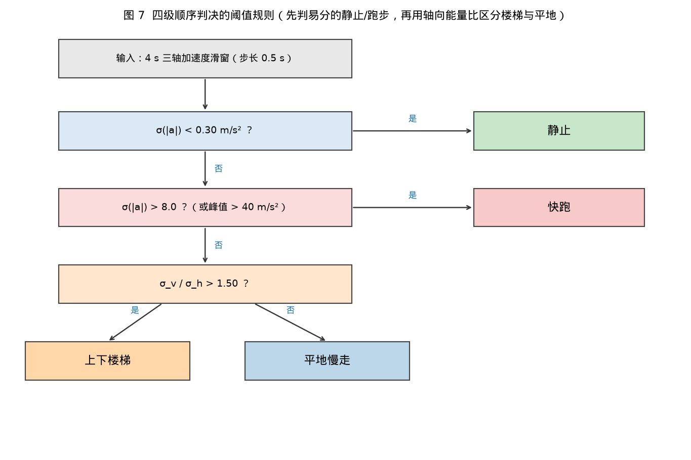

**v1 图 7**　四级阈值判决树。

结果：这 4 段合计 **346/355 = 97.5 %**（同集）；`data_1` 全量 11 段 **99.15 %**（记录级 11/11）。同一套阈值原样搬到 `data_2` 只有 **39.7 %**（§4.1），所以 v2 起改用 Gravity 逐样本解耦，最终 v6 是 5 类模型。若按课题的 4 类口径把上/下楼合并，v6 在 `2026-10-25` 跨日盲测上是 **95.45 %（672/704）**（按 `pred_smooth` 合并 `up`/`down`）；逐窗结果见 `output/v6/windows.csv`。

---

## 2 方法

### 2.1 逐样本重力解耦与清洗

`g(t)` 为 Gravity 读数，`ĝ = g/|g|`：

```
a_v = a·ĝ - |g|                 竖向动态加速度（扣掉 9.8 常量）
d   = a - g                     动态加速度向量
a_h = |d - (d·ĝ)ĝ|              横向动态幅值（= √(|d|² - a_v²)）
```

静止时 `d ≈ 0`，运动时 `|d|` 就是不含重力的动态加速度。


**图 2**　姿态解耦：上图的 `ax/ay/az` 随握持姿态整体旋转，下图的 `a_v`、`a_h` 才与"手机怎么拿"无关。

清洗作用在 `|a-g|` 上（含 g 的模式下 `|a|` 永远不会掉到 2 以下，v1 的掉零规则无效）：两端 0.5 s 滚动标准差 < 全段中位数的 0.3 倍时判为首尾静止段丢弃（仅当全段中位数 > 0.5 时启用）；两端 0.5 s 标准差 > 中位数的 3 倍时判为拿起/放下瞬态丢弃；两端再各留 0.5 s 保护带。清洗只处理首尾，中段的真实动作保留（如 `stand` 在 27 s 拿起手机）。


**图 1**　五类状态的纯动态加速度 `|a-g|` 波形，红底为清洗剔除的首尾段。

### 2.2 特征：先分不变性，再谈判别力

v6 把特征按**变不变**分成四类，这是全仓库的方法论主线：

| 类别 | 特征 | 对零偏 `s→s+c` | 对增益 `s→a·s` | 用途 |
|---|---|---|---|---|
| **不变核** | `rob_skew = (q95+q05−2·q50)/(q95−q05)` | 不变 | 不变 | 判下楼 |
| | `acp`：0.30–1.20 s 内自相关峰 | 不变 | 不变 | 慢走/上楼打分 |
| | `zcr`：过零率 | 不变 | 不变 | 慢走/上楼打分 |
| 协变量 | `rob_skew` 在 `s→−s` 下变号 | — | — | 符号即上/下楼的物理差别 |
| **非不变** | `sigma = std(\|a−g\|)` | — | 随增益线性变 | 只做静止/快跑两个门限 |
| 诊断量 | `cadence`、`i_cv`、`ac_lag`、`bias` | — | — | 只输出，不进判决 |

为什么较真：v5 判下楼的 `ptn=(mean(pv)−mean(tv))/(mean(pv)+mean(tv))` 看起来是"比值"，但分子分母都含 `pv+tv`，给窗内所有样本加常数 `c` 时峰抬 `c`、谷的绝对值降 `c`，`ptn` 随之改变。窗内减中位数只能压掉当天的 `c`；估偏或 `c` 随手持变，判决就漂。跨日漂的正是这个量。

早期版本的绝对幅值特征（v2/v3 的 `σ`、`p99`、`σ_v`、`f_dom`、`r`）在同集上判别力很强，但一旦换一天整体偏移就失效（§3.2、§3.3），是“先看判别力、后看不变性”的代价。

### 2.3 判决：分位标定 → 分层规则 → 段级解码

1. **分位标定**：所有阈值取两个类 2 %/98 % 分位之间的中点，不用 `max/min`——单个异常窗就能把极值阈值拖走。有符号量（`rob_skew`）用算术中点；绝对值量（`sigma`）用几何中点。
2. **分层规则**（顺序与 v4 一致）：`sigma` 低于静止门限 → 静止；高于快跑门限 → 快跑；`rob_skew` 高于下楼门限 → 下楼；`−z(acp)−z(zcr)` 高于门限 → 上楼；否则慢走。权重固定为 1，不在测试集上调。
3. **段级解码**：逐窗判决是"观测"，解码在状态图（`walk` 在中心，其余四类只在走路时进出）上最小化
   `Σ 观测代价（判对 0 / 判错 1） + Σ 切换代价（penalty × 图上距离）`。
   `penalty` 只在留一上选（v6 得 1.0），离线整段解码；因果模式（只看过去窗）也实现了。

### 2.4 窗长与步长

**8 s 窗 / 1 s 步长**。4 s 在 1.7 Hz 步频下只有约 7 步，`σ_v`/`σ_h` 的估计方差大。同一套 v2 流程在 `data_2` 上：4 s 91.8 %、6 s 94.9 %、8 s 97.4 %、10 s 99.7 %（10 s 时 `run-1` 不足一个窗被整体丢掉，只剩 6 段 288 窗，与前三档不可比，故取 8 s）。这个"加长窗就涨"的现象在跨日盲测上会反过来咬人：16 s 窗能到 99.7 %，但留一掉到 84.3 %，因为 `data_2/run-1` 只有 11.9 s，长窗下快跑整类消失（§4.7）。

---

## 3 结果

### 3.1 主表

见 §0。六个版本同一套数据切分、同一套留一流程，差异只来自方法本身。

### 3.2 跨日盲测 2026-10-25（最严格的一组）

704 窗 / 9 段，同一人、同一台 PKG110，比标定集晚一天。v5 定稿后才进仓库，不参与任何阈值/权重选择；v5.1/v6 只在这组上验证过"不变性"这一个假设。

| 方法（平滑后） | 窗口级 | 记录级 | 去重叠（90 窗） |
|---|---|---|---|
| v2 | 42.8 % | 5/9 | 42.2 % |
| v3 | 45.3 % | 7/9 | 44.4 % |
| v4 | 68.6 % | 8/9 | 71.1 % |
| v5 | 79.7 % | 9/9 | 78.9 % |
| **v5.1** | **94.6 %** [92.7, 96.0] | **9/9** | 92.2 % |
| v6 | 94.5 % [92.5, 95.9] | 9/9 | 92.2 % |

逐类召回（v5.1 / v6）：静止 100 %（39/39）、慢走 92.2 %（273/296）、快跑 100 %（38/38）、上楼 91.1 %（154/169）/ 90.5 %（153/169）、下楼 100 %（162/162）。

逐记录（窗口级，v5 → v5.1 → v6）：

| 记录 | 真值 | 窗数 | v5 | v5.1 | v6 |
|---|---|---|---|---|---|
| go_downstairs-1 | 下楼 | 77 | 98.7 % | 100 % | 100 % |
| go_downstairs-2 | 下楼 | 85 | 100 % | 100 % | 100 % |
| go_upstairs-1 | 上楼 | 81 | 59.3 % | 96.3 % | 100 % |
| go_upstairs-2 | 上楼 | 88 | 56.8 % | 86.4 % | 81.8 % |
| run-1 / run-2 | 快跑 | 15 / 23 | 100 % | 100 % | 100 % |
| stand | 静止 | 39 | 100 % | 100 % | 100 % |
| walk-1 | 平地慢走 | 128 | 84.4 % | 93.8 % | 93.8 % |
| walk-2 | 平地慢走 | 168 | 69.6 % | 91.1 % | 91.1 % |


**图 12**　跨日盲测 2026-10-25 的逐段结果（v2 / v3 / v4，704 窗 / 9 段）：v2 把 195 个慢走窗和 110 个上楼窗判成下楼，v4 把慢走/上楼召回拉回 56.1 % / 49.7 %，但慢走仍有 129 个窗落到下楼。

**为什么 v5 掉到 79.7 %。** 主因是 `ptn` 的类条件基线在新一天整体上移：被下楼误吞的慢走/上楼窗共 55+67=122 个；换成 `rob_skew` 后只剩 4+10=14 个。


**图 22**　ptn（左）与 rob_skew（右）在标定集与跨日盲测上的类条件分布。左栏 10-25 的慢走/上楼箱体上缘越过 0.123，右栏盲测的上须（0.06 / 0.11）仍在 0.111 之下。

| 数据 | 慢走 ptn 中位 / 95 分位 | 上楼 ptn 中位 / 95 分位 | 下楼 ptn 中位 / 5 分位 | 阈值 |
|---|---|---|---|---|
| `data_2` + 2026-10-24（标定） | -0.049 / 0.062；-0.094 / 0.029 | -0.065 / 0.072；-0.042 / 0.072 | 0.344 / 0.268；0.335 / 0.222 | 0.123 |
| 2026-10-25（盲测） | 0.060 / 0.163 | 0.082 / 0.235 | 0.307 / 0.151 | 0.123 |

标定集里"慢走/上楼 98 分位 < 下楼 2 分位"（0.095 < 0.158），新一天变成"上楼 95 分位 0.235 > 下楼 5 分位 0.151"——类别间隔反号，**任何单一 `ptn` 阈值都分不开**。

第二层原因是 `acp` 也漂移：新一天上楼的 `acp` 中位 0.659（标定集 0.515 / 0.559），更接近慢走。v6 的混淆矩阵里，上楼仍有 9 个窗落到慢走、7 个窗落到下楼：

| 真值 ↓ / 判决 → | 静止 | 平地慢走 | 快跑 | 上楼 | 下楼 |
|---|---|---|---|---|---|
| 静止 | **39** | 0 | 0 | 0 | 0 |
| 平地慢走 | 0 | **273** | 0 | 19 | 4 |
| 快跑 | 0 | 0 | **38** | 0 | 0 |
| 上楼 | 0 | 9 | 0 | **153** | 7 |
| 下楼 | 0 | 0 | 0 | 0 | **162** |

**怎么读。** 记录级 9/9 说明每段的多数票仍然判对；窗口级 94.5 % 说明单窗特征在新一天可用，但慢走↔上楼那一段真重叠没有消失，而且成段出现（`walk-2` 第 0–4 / 48–52 窗、`walk-1` 第 73–80 窗）——那是握姿/节奏变了，不是随机噪声。

### 3.3 同日跨时段（`data_2` ↔ `2026-10-24`）

两批数据同为 10-24，早间 07:58–08:38 与晚间 17:51–18:33 相隔约 9 小时，同一人、同一台 PKG110。v4 起两批都进标定，所以 §3.1 里的 `2026-10-24` 是 in-sample；下面改成“留一批、标另一批”，用来看同一台手机在同一天不同时段漂移有多大。

| 训练 → 测试 | v4 | v5 | v5.1 |
|---|---|---|---|
| `data_2` → `2026-10-24` | 93.1 % | 94.8 % | 94.8 % |
| `2026-10-24` → `data_2` | 97.0 % | 96.4 % | 94.4 % |

只拿 `data_2` 标定时，v2/v3 在 `2026-10-24` 上只有 73.9 % / 82.2 %（§4.2、§4.3），v4 的波形特征把同一时段的漂移基本压住（93.1 %）；但同一套 v4 换到次日只剩 68.6 %（§3.2），可见“同日跨时段”与“跨日”不是同一难度。v5 的零偏校正 + 分位标定把晚→早补到 94.8 %，早→晚从 97.0 % 退到 96.4 %；v5.1 换成 `rob_skew` 后早→晚退到 94.4 %，即 §4.6 记下的“代价”。两批都是标定数据，这一节只作分布漂移的对照，不能当盲测读。

### 3.4 留一记录（16 段，942 窗）

| 版本 | 留一 | 逐类（静止/慢走/快跑/上楼/下楼） |
|---|---|---|
| v4 | 91.9 % | — |
| v5 | 95.65 % | 59/60、368/376、137/157、139/150、198/199 |
| v5.1 | 95.54 % | 59/60、368/376、137/157、139/150、197/199 |
| v6 | **95.86 %** | 58/60、368/376、**146/157**、135/150、196/199 |

最弱的一类是快跑：留掉 `jogging` 后训练集只剩 `data_2` 的 9 个快跑窗和 `sprint` 的 10 个窗，而 `jogging` 的 σ 只有 4.84–7.22，部分窗落回重新标定的快跑门限以下。v6 的段级解码把快跑从 137 救到 146，代价是上楼与静止各差 1–2 个窗。

### 3.5 因果与在线

跨日盲测上，只允许看过去窗时 v6 是 93.32 %（离线 94.46 %），v5.1 的尾随 5 窗多数票是 93.75 %。也就是说**段级解码的收益目前只出现在离线/整段场景，在线反而略低**；要上线应当用 causal Viterbi 或加大切换代价再验一次，不能直接套离线数字。

---

## 4 版本演进

### 4.1 v1：重力假设失效

v1 把"窗口内三轴均值方向"当作重力方向。手机拿在手里摆臂时该假设不成立：

| 记录 | `\|mean(a)\|` 中位 (m/s²) | 真实重力 |
|---|---|---|
| stand | 9.78 | 9.807 |
| walk-1 | 11.97 | 9.807 |
| go_upstairs | 10.84 | 9.807 |
| go_downstairs | 11.05 | 9.807 |
| run-2 | 24.76 | 9.807 |

只有静止段落在 9.8 上。于是 v1 的 `r` 在 `data_2` 上对慢走是 2.43–2.51、对上楼是 2.40——慢走与上楼完全缠在一起；改用真实重力后顺序恢复正常（慢走 1.23–1.34、上楼 1.05、下楼 1.99）。四条阈值原样搬到 `data_2`（4 类，上/下楼合并）只有 39.7 %，179/180 个慢走窗被判成楼梯。

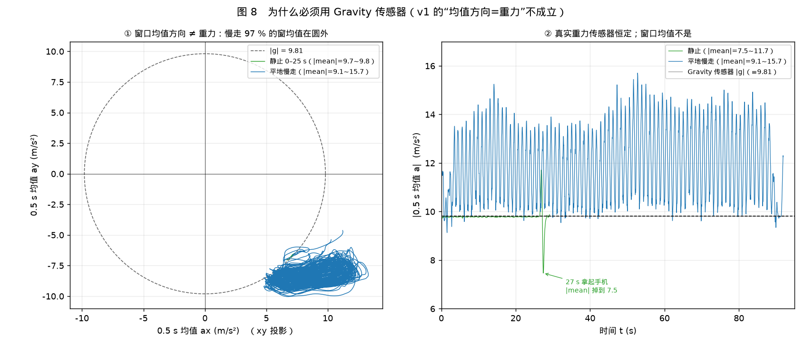

**图 8**　v1 的重力假设为什么失效（v2 图集重绘，数据为 `data_2` 的 `stand` / `walk-1`）：左图是 0.5 s 均值向量的 xy 投影，只有竖直握持的静止段（0–25 s）落在 |g|=9.81 的圆上；慢走 97 % 的窗均值在圆外（9.1–15.7 m/s²）。右图把同一个量随时间展开——Gravity 传感器恒为 9.81，而窗口均值在 9.1–15.7 之间摆，27 s 的拿起手机还把它拉到 7.5。


### 4.2 v2：绝对能量规则

用 2.1 的重力解耦重做特征，五条阈值（快跑用 SD 与峰值两条）：`stand=1.2172`、`run_sd=5.5656`、`run_peak=36.169`、`down_sv=4.2142`、`up_p99=10.3224`（按 2 位小数重实现，`data_2` 会从 97.4 % 掉到 97.0 %，所以阈值保留多位）。

| 口径 | 结果 |
|---|---|
| `data_2` 同集 | 294/302 = 97.4 % |
| `data_2` 留一（walk/run） | 171/189 = 90.5 % |
| `2026-10-24` | 473/640 = 73.9 % |
| `2026-10-25`（跨日） | 42.8 % |

局限集中在跨时段：绝对能量阈值搬不过去，同一天换时段就掉 23 个点，次日掉 54.6 个点。

`data_2` 的 302 窗特征分布（2 / 50 / 98 分位）：

| 状态 | 窗数 | σ | σ_v | p99 | 峰值 | r | f_dom |
|---|---|---|---|---|---|---|---|
| 静止 | 22 | 0.05 / **0.06** / 0.84 | 0.06 / **0.07** / 0.77 | 0.27 / **0.31** / 3.60 | 0.32 / **0.38** / 4.43 | 0.97 / 1.17 / 1.59 | 0.88 / 1.50 / 3.38 |
| 上楼 | 56 | 1.78 / **2.06** / 2.45 | 1.85 / **2.20** / 2.85 | 8.36 / **9.30** / 10.27 | 8.91 / **9.89** / 11.75 | 0.81 / 1.05 / 1.40 | 1.50 / 1.63 / 1.75 |
| 平地慢走 | 180 | 2.30 / **2.56** / 3.05 | 2.68 / **3.43** / 4.39 | 10.61 / **11.77** / 14.03 | 11.09 / **12.48** / 15.26 | 0.99 / 1.28 / 1.51 | 1.75 / 1.75 / 1.88 |
| 下楼 | 35 | 1.99 / **2.85** / 3.57 | 4.25 / **4.77** / 6.13 | 11.88 / **14.40** / 17.43 | 14.73 / **16.63** / 28.09 | 1.54 / 1.99 / 2.51 | 1.75 / 1.87 / 2.00 |
| 快跑 | 9 | 8.48 / **14.21** / 16.47 | 15.30 / **35.83** / 37.52 | 41.26 / **76.53** / 83.54 | 46.58 / **87.73** / 111.25 | 2.67 / 3.22 / 3.38 | 1.62 / 1.87 / 1.87 |

（单位略；σ、σ_v、p99、峰值均为 m/s²，f_dom 为 Hz。）

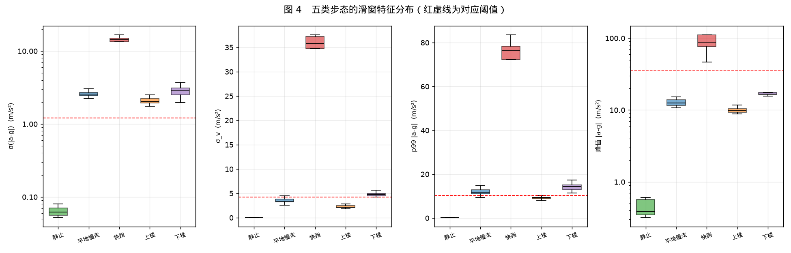

**图 4**　四个判决特征的分布。静止与运动、快跑与其余两级的间隔最干净；上楼/慢走/下楼三者在 σ_v、p99 上都有重叠。

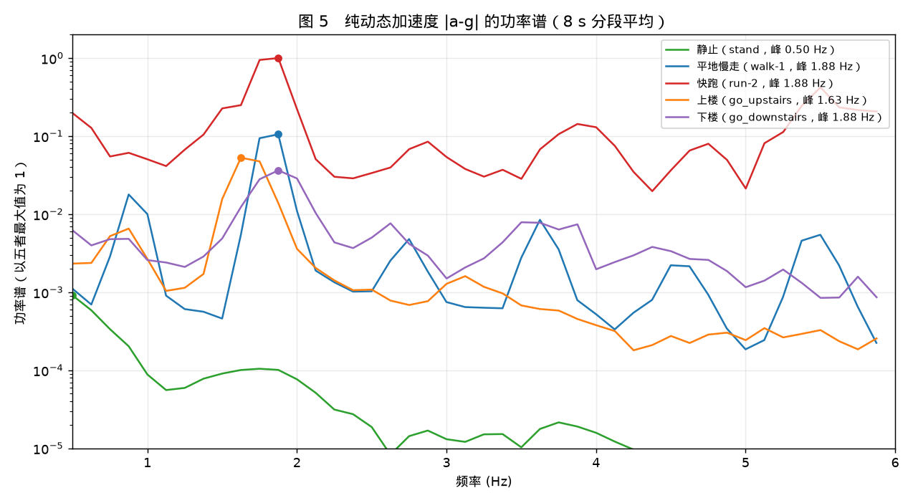

**图 5**　五类状态的功率谱（8 s 分段平均）：静止段无显著峰，运动段主峰集中在 1.5–2.0 Hz。

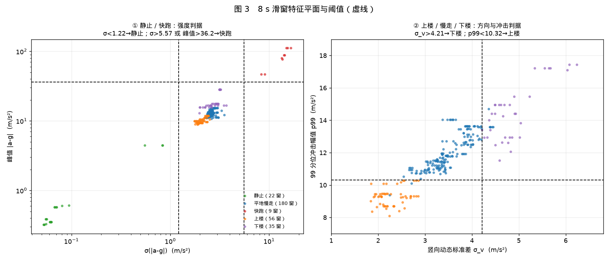

**图 3**　σ_v–p99 平面：同集内五类可分，但边界紧贴绝对幅值。

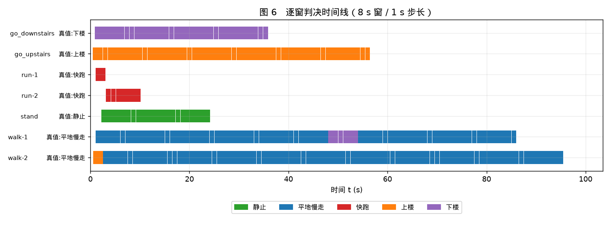

**图 6**　v2 在 `data_2` 上的逐窗判决时间线。

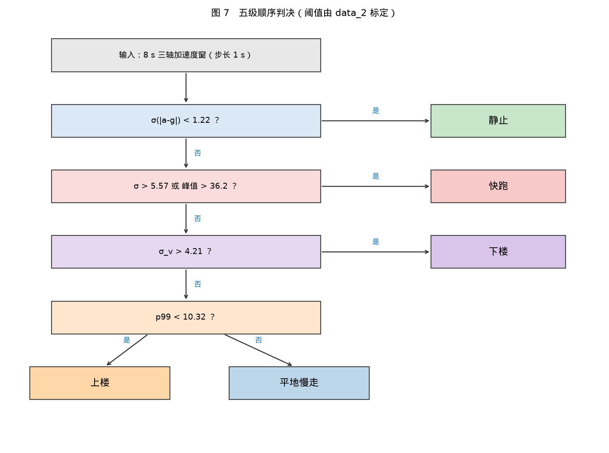

**图 7**　v2 的判决树。

### 4.3 v3：步频阶梯 + 竖向能量比

换成 `f_dom`（谱峰，等价于步频/摆臂频率）与 `r = σ_v/σ_h`（能量方向分布），两个量都是比值，理论上比绝对幅值稳。阈值：`fd_up=1.6875`、`fd_down=1.749913`、`r_down=1.5405`（若按"严格大于 1.75"重实现，`data_2` 会从 91.1 % 掉到 87.4 %）。

| 口径 | v2 | v3 | v3（平滑） |
|---|---|---|---|
| `data_2` 同集 | **97.4 %** | 91.1 % | 92.7 % |
| `data_2` 留一（walk/run） | **90.5 %** | 74.6 % | — |
| `2026-10-24` 跨数据集 | 73.9 % | **82.2 %** | **84.4 %** |
| `2026-10-25` 跨日盲测 | 42.8 % | 44.6 % | **45.3 %** |

同一台手机的另一天变好了（73.9 → 84.4），但跨日仍然崩：v3 的慢走召回（平滑后）只有 0.3 %，296 个慢走窗基本全错；上楼 70.4 %、下楼 75.3 %。**判据从绝对幅值换成了比值，方向是对的，但“比值”不等于“不变量”——这一点直到 v5.1 才被真正纠正。**

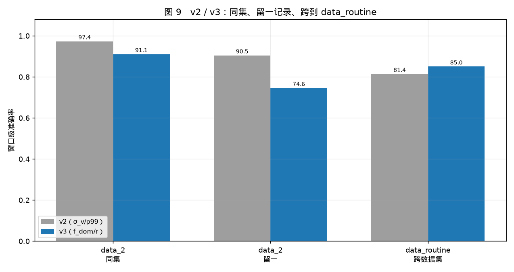

**图 9**　v2 与 v3 的跨数据集对比。

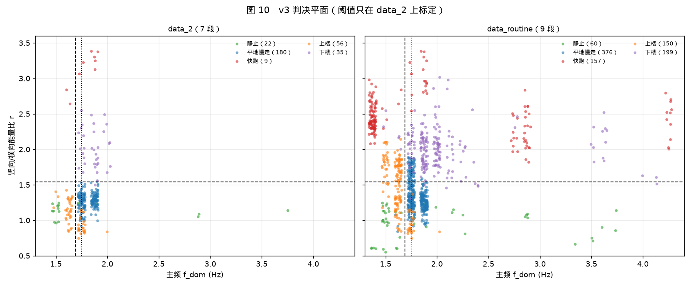

**图 10**　`f_dom`–`r` 平面。

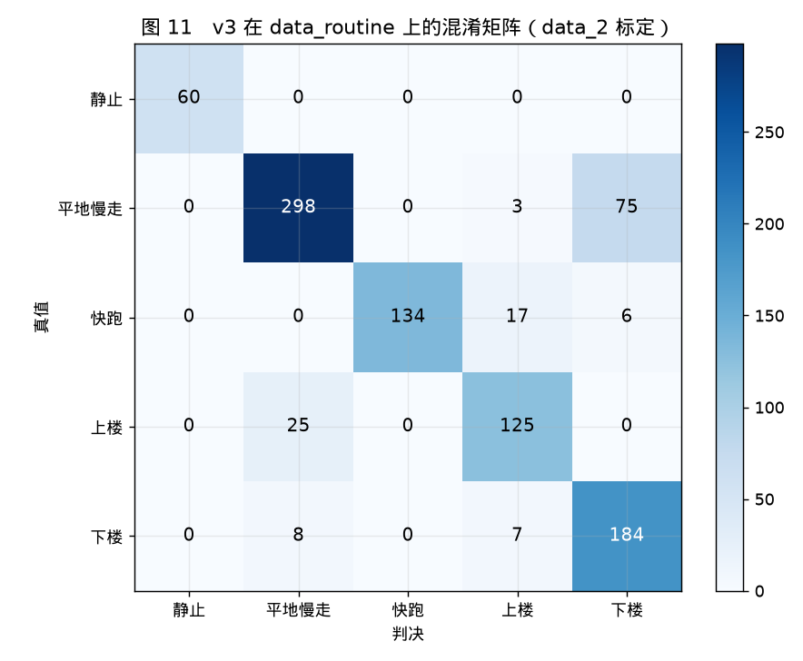

**图 11**　v3 在 `2026-10-24` 上的混淆矩阵。

### 4.4 v4：波形检测（转折点）

不再用窗级统计量，而是直接看波形：0.08 s 低通后检测峰/谷（局部极大 + 全窗最大值 ×0.3 高度门限 + 0.30 s 最小间距），用**峰谷比** `pt` 判下楼，用**窗内自相关峰** `acp` 判慢走/上楼，后接 ±2 窗多数票。阈值 `stand=1.134`、`run=4.411`、`pt=1.174`、`acp=0.720`。

| 口径 | v2 | v3 | v4 |
|---|---|---|---|
| `data_2` 同集 | **97.4 %** | 91.1 % | **97.4 %** |
| `data_2` 留一 | 90.5 % | 74.6 % | **95.8 %** |
| `2026-10-24` | 73.9 % | 82.2 % | **98.9 %** |
| `2026-10-25` 跨日盲测 | 42.8 % | 45.3 % | **68.6 %** |

这是第一次用波形量把跨日从 45.3 % 拉到 68.6 %：峰间隔、自相关、峰谷比都是相对量，受绝对幅值影响小。但它也埋下了下一节的坑——`pt` 是极值之比，不是不变量的比值。

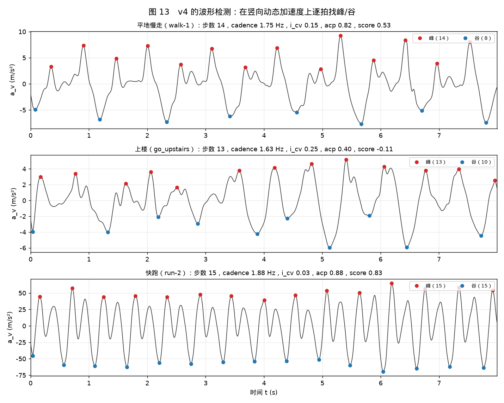

**图 13**　峰/谷检测与步间隔。

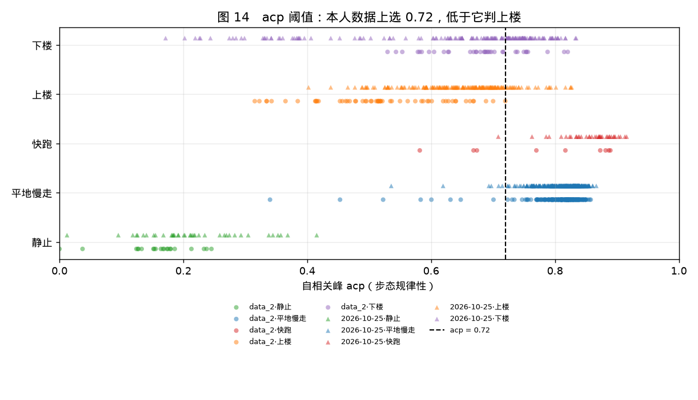

**图 14**　窗内自相关：慢走与上楼的主峰位置不同，但盲测里会靠拢。

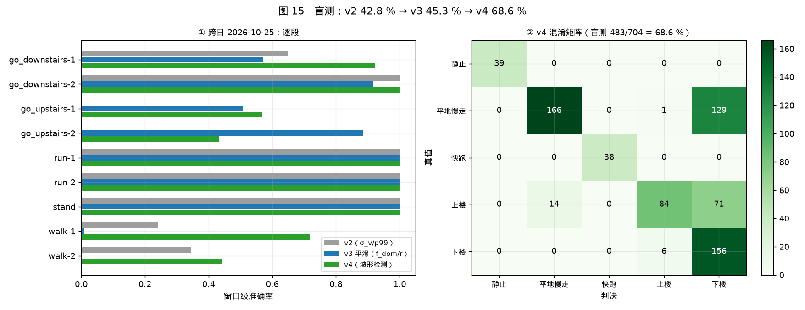

**图 15**　跨日盲测对比：v2 42.8 % → v3 45.3 % → v4 68.6 %。

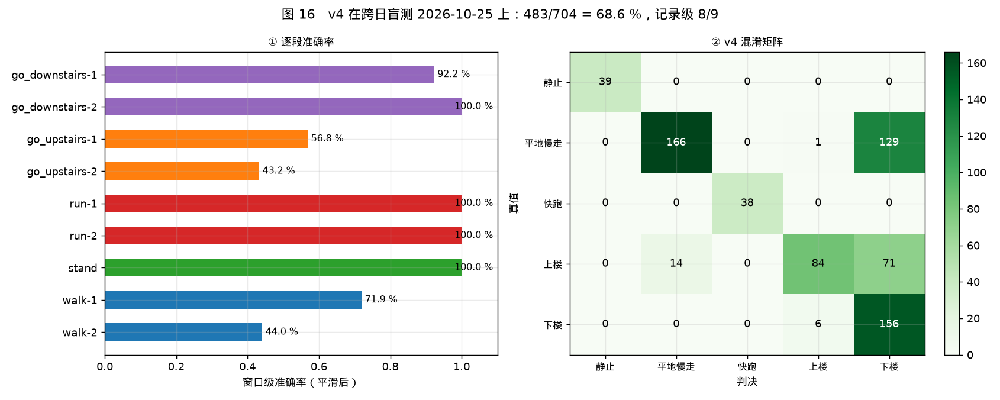

**图 16**　v4 在跨日盲测 2026-10-25 上的逐窗判决。

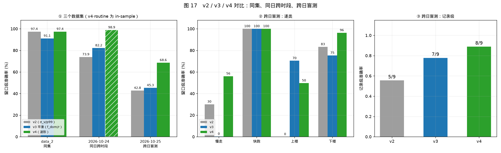

**图 17**　v4 与 v2/v3 的同集/同日跨时段/跨日对比。

v4 之后有一份外部评审，核心意见是：峰谷检测升级（prominence / 最小高度 / 最小宽度 / `scipy.signal.find_peaks`）、加周期性质量指标、对 `pt` 归一化、把硬阈值链改成打分制、加步频约束、阈值标定用留一/分位数、盲测前做零偏/佩戴对齐。逐条核查见 §4.5。

### 4.5 v5：零偏校正 + 分位标定 + 打分

**逐条核查**（能用的进 v5，不能用的给反例）：

| # | 意见 | 结论 | 证据与处理 |
|---|---|---|---|
| 1 | 峰谷检测升级到 prominence/高度/宽度或 `scipy.signal.find_peaks` | 方向对，不是瓶颈 | 自实现 prominence（k=1.0–4.0）替换后 n_steps 中位 15（v4 是 13），ptn 与 v4 版相关仅 0.78–0.80；LORO 95.6 % → 87.5–90.0 %。残余错误在 up/walk 边界与记录首尾，不是漏检峰。**不替换。** |
| 2 | 周期性质量指标（ac_lag 落 0.5–3 Hz；i_cv 大时降权） | 部分成立，但给出的量不判别 | acp 搜索范围已是 0.83–3.33 Hz，慢走主峰常落 1.1 s（≈0.9 Hz）仍在范围内，剔不掉任何窗。i_cv 权重 0.6 → LORO 94.8 %；cadence 权重 0.3/0.6 → 94.7 %/95.0 %（v5 是 95.7 %）。**改用 zcr，i_cv/cadence 只作诊断。** |
| 3 | `pt` 归一化：`(pv−tv)/(pv+tv)` 或除以窗 σ | 方向对，"除以 σ"无益，真问题是零偏 | `(pv−tv)/(pv+tv)` 是 `pt` 的单调变换，单阈值下等价；窗内 `a_v` 中位数绝对值中位 0.36、最大 6.19，`pt` 被这个直流系统性压低。**采用"减中位数 + 归一化"，不除以 σ。** |
| 4 | 判决改打分制 | 采纳，但只用于真正重叠的 up/walk | stand/run 间隔很大（σ 0.784 vs 1.545；3.354 vs 5.064），down 的 ptn 也已分开，给它们打分只增加参数。**只有 up/walk 用 `−z(acp)−z(zcr)`，等权、不调参。** |
| 5 | 加步频约束（cadence/ac_lag/σ 联合） | 不采纳为主判决 | 见 #2：cadence 让 LORO 降到 94.7 %/95.0 %——8 s 窗在记录首尾只有半步，真实慢走的 cadence 被拉低，当"上楼"证据会制造假上楼。**只输出，不判决。** |
| 6 | 阈值标定加鲁棒性（留一、分位数/中位数） | 采纳 | 极值 → 2 %/98 % 分位：stand 1.100、run 4.121、ptn 0.123。留一从 v4 的"只留 4 段"扩到 16 段：v4 91.93 %，v5 95.65 %。 |
| 7 | 盲测前做零偏/佩戴对齐（零偏、幅值缩放、重力重估） | 部分采纳：零偏；不做幅值缩放 | 零偏已采用；σ 只用于 stand/run，其余都是比值或无量纲量，跨日“快跑” 38/38 说明绝对量级在门限上仍可用；重力由 Gravity 传感器逐样本给出。**但跨日盲测说明“窗内减中位数”还不够。** |

**总体判断**：评审的大方向（从硬阈值转向波形 + 形态 + 周期 + 后处理）与 v4 一致，但"核心瓶颈在峰谷检测鲁棒性"不成立；真正有效的三条按贡献排序是**零偏/归一化 > 分位标定 > up/walk 打分**，其余未通过留一验证。

**方法**：窗内 `a_v` 减中位数后检测峰/谷，`ptn=(mean(pv)−mean(tv))/(mean(pv)+mean(tv))`；阈值用 2 %/98 % 分位；up/walk 用 `−z(acp)−z(zcr)` 打分；判决顺序与后处理同 v4。

| 口径 | v4 | v5 |
|---|---|---|
| `data_2` 同集 | 97.4 % | **98.0 %** |
| `data_2` 留一（walk/run） | 95.8 % | **98.4 %** |
| 留一 16 段 | 91.9 % | **95.7 %** |
| `2026-10-24` | 98.9 % | **99.1 %** |
| `2026-10-25` 跨日 | 68.6 % | **79.7 %** |
| 同日跨时段 `data_2`→2026-10-24 | 93.1 % | **94.8 %** |
| 同日跨时段 2026-10-24→`data_2` | **97.0 %** | 96.4 % |

> `data_2` 与 `2026-10-24` 同为 10-24（晚间 17:51–18:33 / 早间 07:58–08:38），这两行是"同日跨时段"，不是跨天；跨天数字见 §3.2 的 `2026-10-25`。

**消融**（同一批窗口特征、同一套留一流程）：

| 变体 | `data_2` | LORO | 说明 |
|---|---|---|---|
| v4（极值 + 原始 pt + 只看 acp） | 97.4 % | 91.9 % | 基线 |
| v5 去掉 zcr（分位 + ptn + 只看 acp） | 97.4 % | 94.0 % | 零偏 + 分位标定 |
| v5 | **98.0 %** | **95.7 %** | 再加 zcr |
| v5 + ptn/σ | 98.0 % | 95.4 % | 无增益 |

第 2、3 行说明**零偏 + 分位标定贡献了大部分留一提升（91.9→94.0）**，zcr 再推到 95.7。

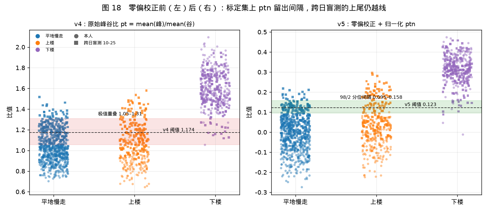

**图 18**　零偏校正前（左）后（右）：标定集上 walk/up 98 分位 0.095、下楼 2 分位 0.158，阈值 0.123 落在间隔里；但跨日盲测（方块）的慢走/上楼上尾越过了同一条线。

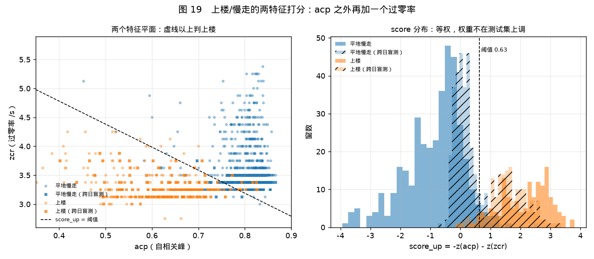

**图 19**　上楼/慢走的两特征打分：虚线以上判上楼；跨日盲测里落在这条边界两侧的那一片就是慢走↔上楼的错分。

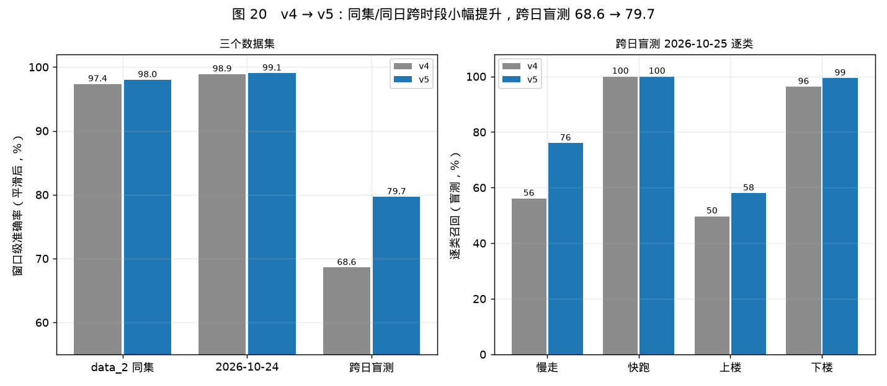

**图 20**　v4 → v5：同集/同日跨时段小幅提升，跨日 68.6 % → 79.7 %。


**图 21**　2026-10-25 跨日盲测：记录级 9/9，窗口级 79.7 %；失分集中在上楼/慢走的 8 s 窗被判成下楼。

**v5 的边界**：v5 的 79.7 % 是严格跨日盲测；但 `ptn` 的类条件基线在新一天整体上移（§3.2），换一天就得重新标；16 段留一仍全部来自本人 PKG110；±2 窗平滑是离线的。

### 4.6 v5.1：只换一个判决量，跨日 79.7 % → 94.6 %

**根因。** `ptn` 的分子分母都含 `pv+tv`，给窗内所有样本加常数 `c` 时峰抬 `c`、谷的绝对值降 `c`，`ptn` 随之改变——它不是平移不变的。"窗内减中位数"只是把当天的 `c` 估出来减掉。

**换成稳健偏度。** 5 %/95 % 分位：

```
rob_skew = (q95 + q05 − 2·q50) / (q95 − q05)
```

加 `c` 时三个分位各加 `c`，分子分母同时不变；乘 `a` 时分子分母同乘 `a`。即**加性零偏与增益都进不了判决**。

**阈值估计器也跟着修了一处。** 有符号量上继续用 v4 的几何中点会被 0 附近的 q98 拉到多数类一侧：只拿 10-24 标定、测 `data_2` 时，`rob_skew` 的 walk/up q98 只有 +0.001，几何中点给出 0.013 的阈值，而 `data_2` 慢走上尾是 0.062，准确率只有 83.4 %；改成 2 %/98 % 分位间隔的**算术中点**后 94.4 %。v5 的 `ptn` 仍用几何中点，历史数字保持可复现。

| 口径 | v5 | v5.1 |
|---|---|---|
| `data_2` 同集 | 98.01 % | 98.01 % |
| routine 同集 | 99.06 % | 99.06 % |
| 留一 16 段 | 95.65 % | 95.54 % |
| 留一 walk/run（4 段） | 98.41 % | 98.41 % |
| **跨日 2026-10-25** | **79.7 %** | **94.60 %** |
| 跨日 去重叠 | 78.9 % | 92.2 % |
| 跨日 记录级 | 9/9 | 9/9 |
| 跨数据集 `data_2`→routine | 94.84 % | 94.84 % |
| 跨数据集 routine→`data_2` | **96.36 %** | 94.37 % |

**代价（明确记下）**：只用 10-24 标定、测 `data_2` 的那一折，v5.1 比 v5 低 2 个点（94.4 vs 96.4）——`rob_skew` 在 `data_2` 与 10-24 之间也有约 0.07 的数据级偏移（`ptn` 只有 0.03），只是它离下楼的间隔更大；两个方向的平均 v5 95.6 % / v5.1 94.6 %。

**实现**：复用 v5 的整条流水线，只改判决量与阈值估计器（`src/v5/gait_analysis_v5.py --asym rob_skew`，默认 `ptn` 时与改造前逐位一致），所以两个版本的差异可以归因到这一处。产物在 `output/v5_1/`。

### 4.7 v6：把"不变性"写成自检 + 段级解码

**四层，一个命令跑完全部口径：**

| 文件 | 职责 |
|---|---|
| `src/v6/invariants.py` | 对 `s→s+c`、`s→a·s`、`s→a·s+c` 逐特征断言不变（RTOL 1e-9）；对 `s→−s` 断言 `rob_skew` 变号；对 `std` 断言"它确实会变"，防止有人把绝对量悄悄挪进不变核 |
| `src/v6/features.py` | 不变核 / 诊断量 / 非不变量显式分列（§2.2 的表） |
| `src/v6/model.py` | 分位标定 + 分层规则 + 段级解码（Viterbi） |
| `src/v6/evaluate.py` | 同集 / 留一 / 跨日 / 因果 / 去重叠 / bootstrap |

这个自检不是形式主义：**如果它早存在，v5 的 `ptn` 在写下的当天就会被判不合格，79.7 % 这个数字根本不会出现。**

**最终判决参数**（`data_2 + 2026-10-24` 标定，2 %/98 % 分位；完整报告见 `output/v6/report.txt`）：

| 判决 | 特征 | 阈值 |
|---|---|---|
| 静止 | `sigma` | 1.100 |
| 快跑 | `sigma` | 4.121 |
| 下楼 | `rob_skew` | +0.1108 |
| 上楼 | `−z(acp)−z(zcr)` | +0.633 |
| 其余 | — | 平地慢走 |
| 段级解码 | Viterbi | penalty = 1.0（只在留一上选） |

`sigma` 是唯一保留的绝对幅值量，只用于静止/快跑两个门限；`rob_skew` 与 `acp`/`zcr` 对零偏、增益不变（§2.2）；up score 的 z 归一化参数在标定集上固定，权重为 1。

**段级解码的消融**（`penalty` 只在留一上选）：

| 解码 | 留一（942 窗） |
|---|---|
| 不平滑 | 94.48 % |
| ±2 窗多数票（v5/v5.1 口径） | 95.54 % |
| Viterbi，penalty=0.3 | 94.48 % |
| Viterbi，penalty=0.6 | 95.12 % |
| **Viterbi，penalty=1.0（选中）** | **95.86 %** |

`penalty=1.0` 意味着"切一次"与"错一窗"等价，于是解码只抹掉孤立的单窗跳变，不会像 ±2 多数票那样把真实的两窗切换也抹平。

**为什么不换成学习模型。** 同一留一协议下，对角高斯朴素贝叶斯（`rob_skew`/`acp`/`zcr`/`log σ`）留一 87.26 %，规则 95.86 %；快跑一类就丢掉 69/157（绝对幅值的重尾被高斯假设拖垮）。16 段记录撑不起判别模型，v6 因此不引入学习层。

**v6 没有做什么（也是结论）**：

1. 没把 `sigma` 换成不变量。试过 `acp`、谱熵、8–20 Hz 能量占比、峰度做尺度无关的静止/快跑判据，静止与运动的间隔都会从“0.06 vs 2.0 m/s²”掉到 0.37 vs 0.43 这种不可用的重叠区。`sigma` 保留并标注为“换另一台设备时第一个要复查的量”。
2. 没加长窗。16 s 窗在跨日盲测上能到 99.7 %，但留一掉到 84.3 %（`data_2/run-1` 只有 11.9 s，长窗下快跑整类消失）。
3. 没做会话级归一化。单段记录只有一种状态，减段内中位数会把唯一的状态也减掉；需要"一天连续记录"的数据才成立。

---

## 5 讨论与局限

1. **同日跨时段与跨日不是同一难度。** v4/v5/v5.1 在同日留一批（`data_2` ↔ `2026-10-24`）上是 93.1/94.8/94.8 %（反向 97.0/96.4/94.4 %），跨日是 68.6/79.7/94.6 %。v4/v5 跨日分别掉 24.5/15.1 个点；v5.1 在两个口径上都是 94.5 % 左右，说明换成 `rob_skew` 后，跨日的主要误差源已不再是零偏漂移。
2. **5 类的瓶颈是特征重叠。** 慢走夹在上楼与下楼之间；`2026-10-24` 的 `walk-4`/`walk-5` 在 v2 只有 71.4 %/44.2 %。v5.1/v6 剩下的 38 个跨日错窗里 24 个是慢走↔上楼。
3. **留一从 4 段扩到 16 段，但仍是一人一机。** v4 的 95.8 % 只留 4 段 walk/run；v5 之后在全部 16 段上重做，v6 得 95.9 %。跨日只有一次。
4. **严谨性上的欠账。** v5.1/v6 的 94.6 %/94.5 % 都是在看到 2026-10-25 之后选定的方向上得到的，只能当回归集回看；"不变性"这个选型理由先于数字成立、也能用 `src/v6/invariants.py` 独立验证，但真正可引用的跨日数字需要另采一天。
5. **绝对加速度值不能当人体加速度读。** 快跑峰值 111 m/s² ≈ 11.3 g，来自手机在掌中拍击/翻转，只作为"区分快跑"的信号特征。
6. **静止门限的验证面很窄。** 2026-10-25 有 39 个静止窗，`stand=1.100` 判对 39/39；2026-10-24 的 38 个静止窗也全部判对；换设备时这个门限还未检验。
7. **窗口重叠放大样本量。** 8 s 窗 / 1 s 步长使 704 个窗去重叠后只剩 90 个；点准确率应结合区间读，不宜按独立样本数比较。
8. **v5.1 与 v6 只差 1 个窗。** 94.60 vs 94.46。v6 的收益在留一（95.9 vs 95.5）、同集/同日跨时段和“以后不会再出同类错”，不在跨日。
9. **在线场景需要重验。** 因果模式下 v6 93.32 %、v5.1 93.75 %，段级解码的离线收益没有带到在线。
10. **2026-10-25 不参与阈值/权重选择。** 但它是在 v5 定稿后才进仓库的，v5.1/v6 只在这一天上验证过“不变性”这一个假设；跨日数字仍需另一天复核。
11. **照片证据只覆盖早期数据。** `data/calib/data_2`、`data/legacy/data_1` 有照片/截图；`2026-10-24`、`2026-10-25` 没有。

---

## 6 复现与交付物

### 6.1 目录

```
topic_8/
├── README.md                     ← 本文
├── data/
│   ├── calib/                    ← 标定集（均为本人 PKG110）
│   │   ├── data_2/               ← 主数据集（7 段，302 窗）
│   │   └── 2026-10-24/           ← 平常数据（9 段，640 窗，v4 起参与标定）
│   ├── blind/                    ← 盲测集（不参与任何阈值/权重选择）
│   │   └── 2026-10-25/           ← 跨日盲测（9 段，704 窗）
│   └── legacy/                   ← 早期数据（v1 用）
│       └── data_1/               ← v1 标定集（11 段）
├── picture/                      ← 打卡照与 Phyphox 截图
├── src/
│   ├── blind_test.py             ← 跨日盲测（v2/v3/v4）+ 独立性检查
│   ├── blind_eval.py             ← 通用盲测：v2/v3/v4/v5/v5.1/v6，一条命令
│   ├── eval_stats.py             ← 置信区间 / macro-F1 / 去重叠（v2–v5）
│   ├── v1/ … v5/                 ← 各版本的规则、作图、回归脚本
│   ├── v5_1/gait_analysis_v5_1.py ← v5 + 稳健偏度 + 算术中点阈值
│   └── v6/                       ← invariants / features / model / evaluate / make_figures
└── output/
    ├── v1/ … v5/                 ← 各版本 features（windows.csv、report）+ figures
    ├── v5/blind_2026-10-25/      ← v5 单独跑的跨日盲测（fig21）
    ├── v5_1/
    │   ├── features/{windows.csv,report.txt}
    │   └── blind_2026-10-25/{windows.csv,report.txt}
    ├── v6/
    │   ├── report.txt、windows.csv   ← 全口径评估
    │   └── figures/              ← fig22（ptn vs rob_skew）、fig23（版本对比）
    └── reports/                  ← 跨版本报告（不属于某一版）
        ├── blind_2026-10-25/     ← 六版同表的盲测报告 + 逐窗 CSV
        ├── blind_test/           ← 跨日盲测（v2/v3/v4）+ 独立性检查
        └── stats_2026-10-25/     ← 统计口径报告
```

提交用 CSV：v1 是 `data/legacy/data_1/` 的 4 段（`output/v1/csv/`，课题的 4 类交付），v2/v3 是 `data/calib/data_2/` 的 5 段（`output/v2/csv/`、`output/v3/csv/`），均与源文件逐字节一致。v1 的 4 份依次对应 `walk-1`、`run`、`go_downstairs-1`、`stand` 的 `Raw Data.csv`（v1 把上/下楼合并为"上下楼梯"，所以 03 号取自下楼段；01/02 为 `Linear Acceleration` 导出，03/04 为 `Acceleration` 导出）。四类的图、阈值与逐段结果见 §1.4。

### 6.2 命令

```bash
cd 01-Field-Discovery/topic_8
python3 -m venv .venv
.venv/bin/pip install -i https://pypi.tuna.tsinghua.edu.cn/simple numpy matplotlib

# 通用盲测（推荐）：一条命令评估 v2/v3/v4/v5/v5.1/v6，换测试集只改 --test
MPLCONFIGDIR=/tmp/mplcfg .venv/bin/python src/blind_eval.py \
    --test data/blind/2026-10-25 --out output/reports/blind_2026-10-25

# 跨日盲测的逐段图（图 12）与统计口径（output/reports/stats_2026-10-25）
MPLCONFIGDIR=/tmp/mplcfg .venv/bin/python src/blind_test.py
MPLCONFIGDIR=/tmp/mplcfg .venv/bin/python src/eval_stats.py

# v6：不变性自检 → 全口径评估 → 图
MPLCONFIGDIR=/tmp/mplcfg .venv/bin/python src/v6/invariants.py       # 失败非零退出
MPLCONFIGDIR=/tmp/mplcfg .venv/bin/python src/v6/evaluate.py
MPLCONFIGDIR=/tmp/mplcfg .venv/bin/python src/v6/make_figures_v6.py

# v5.1：只把下楼判据换成 rob_skew
MPLCONFIGDIR=/tmp/mplcfg .venv/bin/python src/v5_1/gait_analysis_v5_1.py
MPLCONFIGDIR=/tmp/mplcfg .venv/bin/python src/v5_1/gait_analysis_v5_1.py \
    --blind data/blind/2026-10-25 --out output/v5_1/blind_2026-10-25

# 历史版本（各自出同集/留一/图）
MPLCONFIGDIR=/tmp/mplcfg .venv/bin/python src/v2/gait_analysis_v2.py
MPLCONFIGDIR=/tmp/mplcfg .venv/bin/python src/v3/gait_analysis_v3.py --eval data/calib/data_2 data/calib/2026-10-24
MPLCONFIGDIR=/tmp/mplcfg .venv/bin/python src/v4/gait_analysis_v4.py
MPLCONFIGDIR=/tmp/mplcfg .venv/bin/python src/v5/gait_analysis_v5.py
MPLCONFIGDIR=/tmp/mplcfg .venv/bin/python src/v5/gait_analysis_v5.py --asym rob_skew   # 等价于 v5.1

# 图：v1–v5 各自 make_figures_*.py；跨日盲测图 21
MPLCONFIGDIR=/tmp/mplcfg .venv/bin/python src/v5/make_figure_date.py
```

（`MPLCONFIGDIR` 指向可写目录，避免容器内字体缓存报错。）

### 6.3 换新数据：再采一天怎么采

`blind_eval.py` 把标定、测试、六版判决和统计一次跑完，新数据不需要改代码：

```bash
MPLCONFIGDIR=/tmp/mplcfg .venv/bin/python src/blind_eval.py \
    --test data/blind/2026-10-26 --out output/reports/blind_2026-10-26
```

默认 `--calib data/calib/data_2 data/calib/2026-10-24`（v4 之后）、`--calib-v23 data/calib/data_2`（v2/v3）；换标定集就传 `--calib ...` / `--calib-v23 ...`。输出 `report.txt`（窗口/记录/逐类/混淆/Wilson/记录 bootstrap/去重叠）与 `windows.csv`（v5/v5.1 特征 + 六版逐窗判决）。

现有盲测只有 `2026-10-25` 一组（跨日、同人同机）。要复核 §5 的跨日数字，再采一天：

- 换一天（与 `data_2`、`2026-10-24`、`2026-10-25` 不同日期）、换地点（非同一走廊/楼梯），仍由本人采集；
- 5 类各 ≥ 2 段：静止 ≥ 20 s，其余每段 ≥ 30 s；`meta/device.csv` 会记录手机型号；
- 目录结构与 `data/blind/2026-10-25/` 一致：`data/blind/2026-10-26/<记录>/{Accelerometer,Gravity}.csv` + `meta/{device,time}.csv`（同一 Phyphox 实验导出格式）；
- 不要与旧数据同时段采集；`src/blind_test.py` 会做时间重叠检查，`blind_eval.py` 只在报告开头打印设备与最早 START。

```bash
# 旧脚本仍可单独跑（可选）
MPLCONFIGDIR=/tmp/mplcfg .venv/bin/python src/blind_test.py --test data/blind/2026-10-26 --out output/reports/blind_2026-10-26
MPLCONFIGDIR=/tmp/mplcfg .venv/bin/python src/eval_stats.py --test data/blind/2026-10-26 --out output/reports/stats_2026-10-26
```

只有“无时间重叠”时，这组数字才能作为跨日证据。现有结论：2026-10-25 上 v5 是 79.7 %、v5.1/v6 是 94.6/94.5 %（记录级都 9/9）；再一天的数据还没有。
