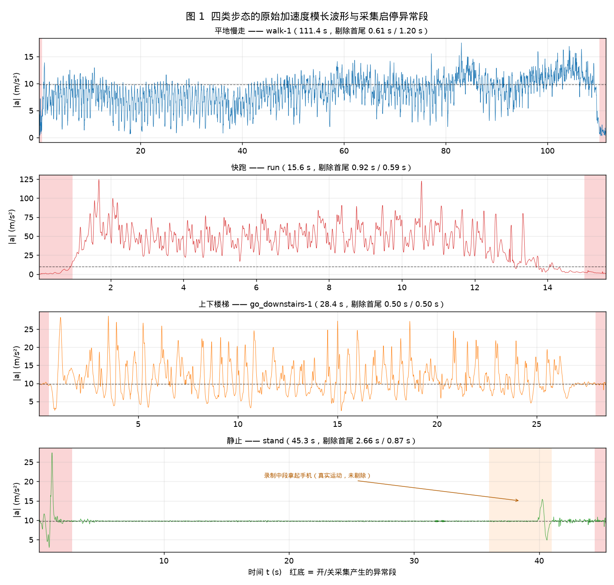
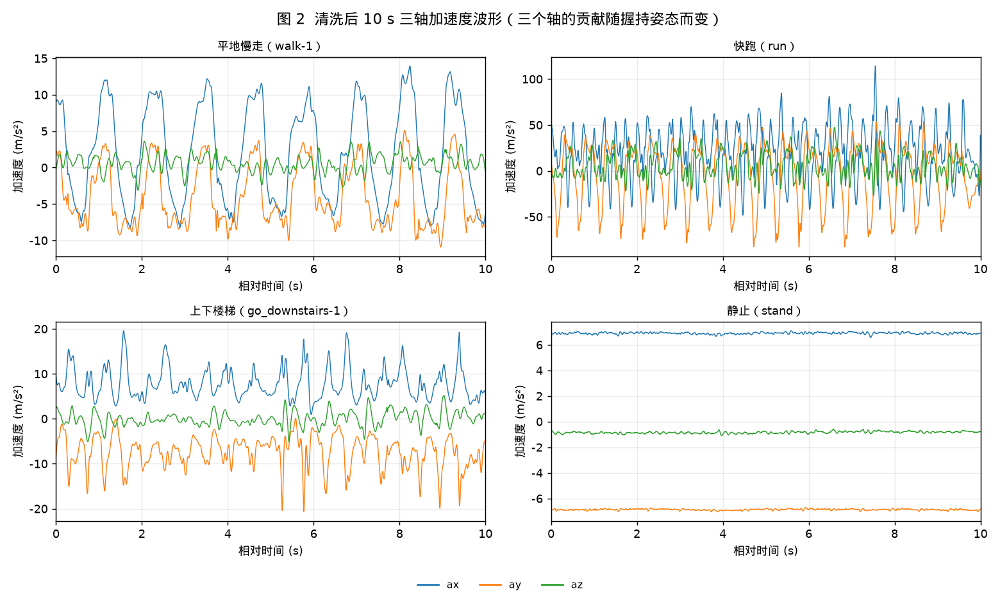
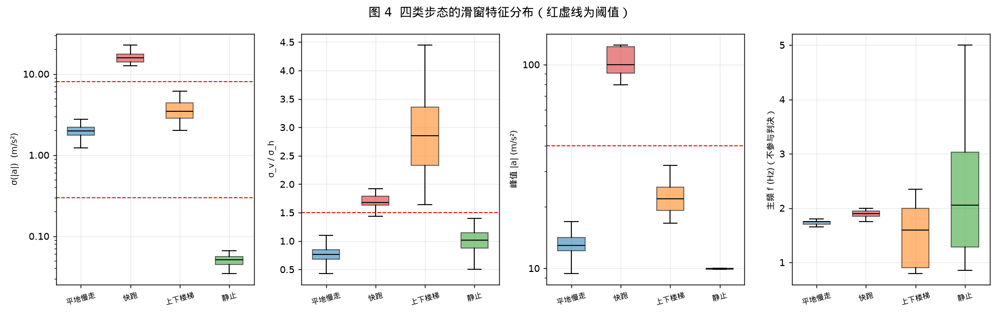
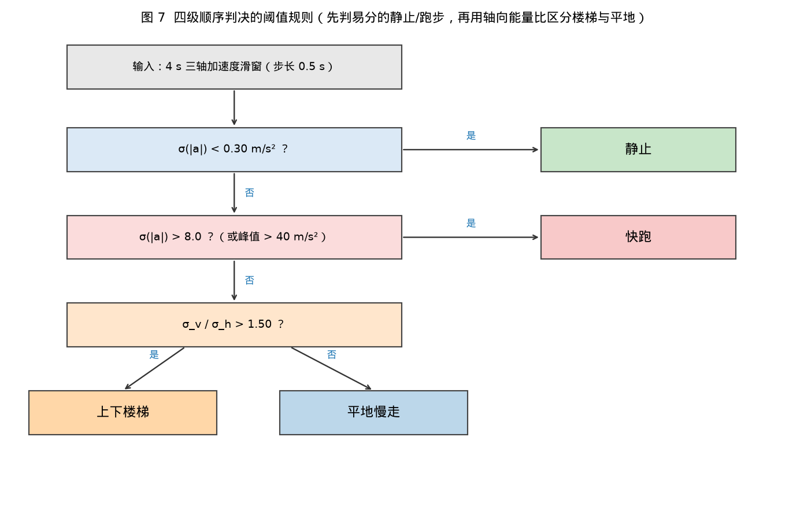
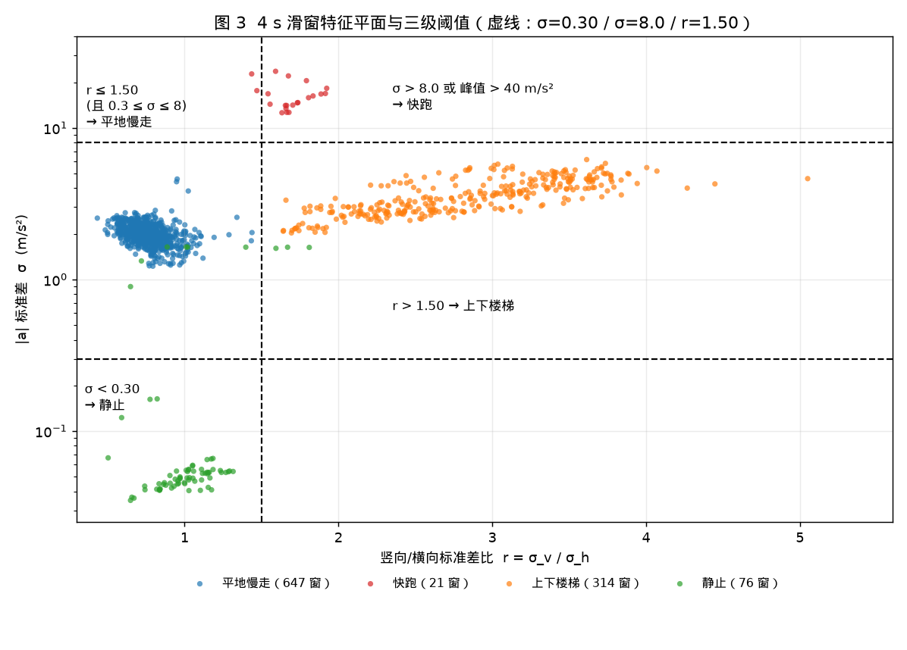
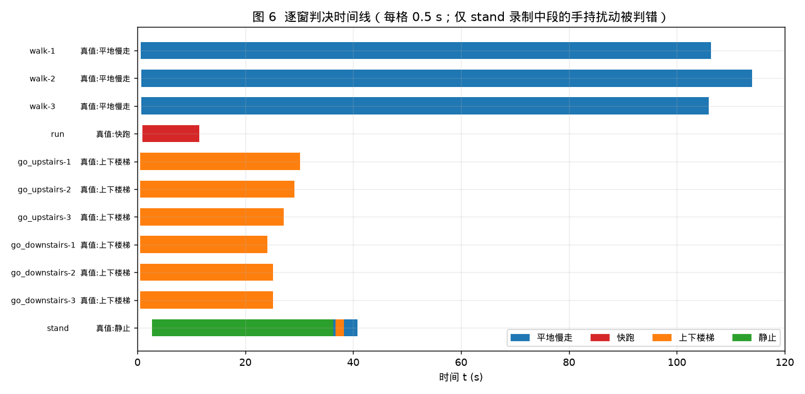
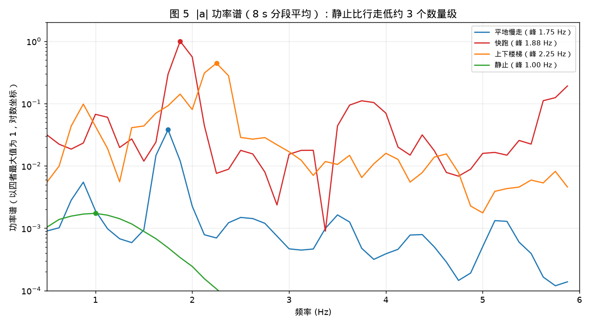
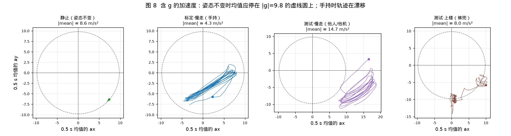
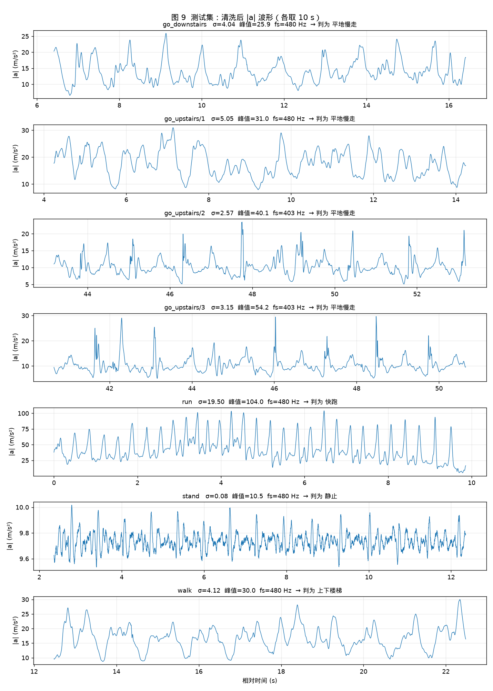

# 课题 08：多姿态步态加速度特征采集与对比

> 采集：手机加速度传感器（Phyphox）· 平地慢走 / 快跑 / 上下楼梯 / 静止 四种状态
> 交付：4 份原始 CSV + 可视化图 + 判别动作的阈值规则
> 采集时间：2026-10-23 15:33—16:25　地点：深圳城市职业学院（见 `picture/photos/` 水印打卡照）

> [!WARNING]
> **数据质量告警（自查发现）**：标定集 `data/` 混用了两个不同的 Phyphox 实验——`walk-1~3` 与 `run` 用的是**「加速度（不含 g）」**，而 `go_upstairs/downstairs-*` 与 `stand` 用的是**「加速度（含 g）」**（依据见 `picture/screenshots/` 同名截图标题栏）。两者不是同一个物理量，因此**第 4–7 节的对比、阈值与准确率都存在系统性混淆**，需要在统一采集模式后重算。详见 §2.1 与 §7。

---

## 1 目标

用同一部手机、同一种握持方式，采集四种日常步态的**三轴加速度**原始波形，回答三个问题：

1. 这四种状态的加速度波形在**幅值、节律、方向分布**上有什么可量化的差别？
2. 能否只靠**少量阈值**就把四种状态分开（不用训练模型）？
3. 采集启停造成的首尾异常数据如何识别和剔除？

---

## 2 采集方案

| 项 | 内容 |
|---|---|
| 设备 | 手机（内置加速度计，含重力分量） |
| 工具 | Phyphox → *Acceleration* 实验，导出 `Raw Data.csv` |
| 数据列 | `Time (s)`, `ax`, `ay`, `az`, `\|a\|`（= √(ax²+ay²+az²)；静止时：含 g 记录 ≈ 9.8，不含 g 记录 ≈ 0，见 §2.1） |
| 握持 | 右手单手握持手机，屏幕朝上偏前，自然摆臂 |
| 场地 | 校园道路（平地）/ 教学楼室外台阶（上、下） |
| 重复 | 慢走 3 次、上楼 3 次、下楼 3 次；快跑 1 次；静止 1 次 |
| 采样率 | 慢走/快跑 201.6 Hz；楼梯/静止 403.1 Hz（Phyphox 两次采集的传感器档位不同） |

原始数据共 11 段，放在 `data/<记录名>/Raw Data.csv`：

| 记录 | 状态 | 原始时长 | 采样率 | 原始样本数 | 剔除初段/末段 | 有效区间 (s) | 4 s 窗数 |
|---|---|---|---|---|---|---|---|
| walk-1 | 平地慢走 | 111.4 s | 201.6 Hz | 22 458 | 0.61 s / 1.20 s | 0.63 – 110.23 | 211 |
| walk-2 | 平地慢走 | 119.1 s | 201.6 Hz | 24 014 | 0.69 s / 1.51 s | 0.72 – 117.65 | 226 |
| walk-3 | 平地慢走 | 111.0 s | 201.6 Hz | 22 367 | 0.64 s / 1.34 s | 0.66 – 109.65 | 210 |
| run | 快跑 | 15.6 s | 201.6 Hz | 3 138 | 0.92 s / 0.59 s | 0.95 – 15.01 | 21 |
| go_upstairs-1 | 上下楼梯 | 34.5 s | 403.1 Hz | 13 911 | 0.50 s / 0.50 s | 0.52 – 34.03 | 59 |
| go_upstairs-2 | 上下楼梯 | 33.5 s | 403.1 Hz | 13 516 | 0.50 s / 0.50 s | 0.52 – 33.05 | 57 |
| go_upstairs-3 | 上下楼梯 | 31.2 s | 403.1 Hz | 12 564 | 0.50 s / 0.50 s | 0.52 – 30.68 | 53 |
| go_downstairs-1 | 上下楼梯 | 28.4 s | 403.1 Hz | 11 467 | 0.50 s / 0.50 s | 0.52 – 27.96 | 47 |
| go_downstairs-2 | 上下楼梯 | 29.1 s | 403.1 Hz | 11 716 | 0.50 s / 0.50 s | 0.52 – 28.58 | 49 |
| go_downstairs-3 | 上下楼梯 | 29.5 s | 403.1 Hz | 11 875 | 0.50 s / 0.50 s | 0.52 – 28.97 | 49 |
| stand | 静止 | 45.3 s | 403.1 Hz | 18 260 | 2.66 s / 0.87 s | 2.68 – 44.44 | 76 |

### 2.1 两套实验混用（重要）

| 记录 | 状态 | Phyphox 实验 | 判定依据 |
|---|---|---|---|
| walk-1 / 2 / 3 | 平地慢走 | **加速度（不含 g）** | `picture/screenshots/walk-1~3.jpg` 标题栏，轴名“线性加速度” |
| run | 快跑 | **加速度（不含 g）** | `picture/screenshots/run.jpg` 同上 |
| go_upstairs-1 | 上下楼梯 | 加速度（含 g） | `picture/screenshots/go_upstairs-1.jpg` 标题栏，轴名“加速度计” |
| go_upstairs-2 / 3、go_downstairs-1 / 2 / 3 | 上下楼梯 | 加速度（含 g） | 同机型无截图，由数据判定：`p1(\|a\|) > 3`、`\|mean\| ≈ g` |
| stand | 静止 | 加速度（含 g） | `picture/screenshots/stand.jpg` |
| test_data 全部 7 段 | 四类 | 加速度（含 g）**（待确认）** | 无截图；由数据判定：`p1(\|a\|) ≥ 4.7`、`\|mean\| ≈ 8 ~ 14` |

“不含 g”是手机端融合算出的线性加速度（静止时 ≈ 0），“含 g”是原始加速度计读数（静止时 ≈ 9.8）。**同一段动作在这两种模式下 `|a|`、σ、均值全都不可比**：含 g 时 `σ(|a|) ≈ σ(竖向分量)`，不含 g 时 `σ(|a|) ≈ 三轴合矢量的 RMS`，两者天然差 2 ~ 3 倍。所以第 4–6 节里“慢走 σ≈2.0、楼梯 σ≈3.5”的差别**至少有一部分来自模式差异而非步态差异**。

（“剔除初段/末段”是下面第 3 节清洗规则算出来的，`go_upstairs/downstairs` 之所以正好 0.50 s，是因为它们首尾本来就没有异常，只被保护带切掉而已。）

---

## 3 数据清洗：开/关采集造成的首尾异常

**现象**（图 1 红色区域）：

| 现象 | 出现位置 | 数据表现 | 成因 |
|---|---|---|---|
| ① 归零 | 慢走、快跑的首段和末段 | 三轴同时趋近 0，`\|a\|` 掉到 0.5 m/s² 以下并保持 0.14 ~ 2 s | **这两类记录用的是“不含 g”模式**（§2.1），手机静止时线性加速度本就 ≈ 0，所以这是“开始走之前/走完之后站着不动”，不是传感器掉零 |
| ② 拿起/放下手机 | 静止段开头 0.9 ~ 2.0 s | `\|a\|` 冲到 15 ~ 27 m/s² 再缓落，同时三轴缓慢旋转（重力分量重新分配） | 手指点按屏幕、把手机拿起或放到台面上的动作 |

**处理规则**（`src/gait_analysis.py::clean`，三条规则依次执行）：

1. **首尾静止段剔除**：从两端开始，`|a| < 2.0 m/s²` 的样本丢弃（含 g 记录里这对应缓冲清零/自由落体，不含 g 记录里对应站着不动）；
2. **启停瞬态剔除**：计算 0.5 s 滑窗标准差，若某样本所在窗的标准差 > 全段中位数的 3 倍，视为“手部动作”，从两端向内丢弃；
3. **保护带**：两端再各丢 0.5 s，避开半个摆动周期与重力耦合迟滞。

规则 2 的自适应阈值（3 × 中位数）不会误删跑步段——跑步段整体都很剧烈，中位数本身就大（15.8），3 倍阈值 47 远高于其最大值 23.6；而静止段中位数只有 0.05，拿起手机的动作（3.1）立刻被判为瞬态。

> 另外三处细节：
> - `go_upstairs-1`（t≈0.72 s，0.07 s）、`go_downstairs-1`（t≈0.77 – 0.87 s，0.10 s）各有一段**内部瞬时掉零**，时长不到 0.1 s，不足以影响 4 s 窗，因此保留；
> - `stand` 录制**中段**（36 – 41 s）还有人拿起手机看屏幕的**真实动作**，它不在首尾，按规则无法自动剔除，见第 6 节；
> - `go_upstairs/downstairs` 六段的首尾本来就干净，表里的 0.50 s 全部来自第 3 条保护带。



**图 1**　四类状态的原始 `|a|` 波形，红底为被剔除的启停异常段。可以看出慢走/快跑的首尾明显归零，静止段开头有拿起手机的瞬态、结尾也有一次，而楼梯类记录首尾基本干净。

---

## 4 特征提取

手机握持姿态在四段记录里并不一致（图 2：慢走时重力主要落在 x、y 轴，下楼时落在一、二轴之间），**所以不能用某一根轴的原始值当特征**，必须先做姿态解耦。每个 **4 s 滑窗**（步长 0.5 s）计算四个特征：

| 特征 | 定义 | 物理含义 |
|---|---|---|
| **σ** | `std(\|a\|)`，模长标准差 | 运动强度（与朝向无关） |
| **σ_v** | 把窗口平均重力方向 **ḡ** 当作“竖向”，`a·ĝ` 的标准差 | 竖直颠簸强度 |
| **σ_h** | 垂直于 **ḡ** 的残差模长的标准差 | 水平（前后左右）摆动强度 |
| **r** | `σ_v / σ_h` | 能量方向分布（姿态无关的比值） |
| **峰值** | 窗内 `max\|a\|` | 冲击强度 |
| **f_dom** | 0.8 – 5 Hz 内 `\|a\|` 的谱峰 | 步频 / 摆臂频率 |

竖向单位向量 `ĝ = mean(ax,ay,az) / ‖mean(ax,ay,az)‖` 用窗口均值估计（等价于对三轴做约 0.25 Hz 的低通来抓重力方向），因此**结果不随手机怎么拿而改变**——这是本课题“多姿态”条件下的关键一步。



**图 2**　清洗后 10 s 三轴波形。慢走时三轴都在大幅摆动（手机随腕部一起转，重力在手机坐标系里被“甩”着转），下楼时重力方向相对固定、`ay` 长期偏负。直接用某一根轴无法比较，必须先做姿态解耦。

四类状态的滑窗特征统计（`output/features/windows.csv`，共 1058 个窗）：

| 状态 | 窗数 | σ(\|a\|) p1 / p50 / p99 | r = σ_v/σ_h p1 / p50 / p99 | 峰值 p50 / max | f_dom p50 |
|---|---|---|---|---|---|
| 静止 | 76 | 0.036 / **0.052** / 0.163 † | 0.57 / 1.02 / 1.70 | 10.0 / 15.4 | 2.05（噪声，无意义） |
| 平地慢走 | 647 | 1.28 / **1.98** / 2.74 | 0.53 / **0.76** / 1.11 | 13.0 / 20.6 | 1.75 Hz |
| 上下楼梯 | 314 | 2.08 / **3.47** / 5.65 | 1.69 / **2.85** / 4.06 | 21.9 / 37.4 | 1.60 Hz |
| 快跑 | 21 | 12.61 / **15.83** / 23.45 | 1.44 / **1.67** / 1.92 | 99.7 / 124.6 | 1.90 Hz |

† 静止段前两列取全部 76 窗；第三列只统计 67 个纯静止窗——若把中段 9 个“拿手机”窗算进来，p99 会被拉到 1.64（见第 6 节）。



**图 4**　四个特征的分布对比。σ 与峰值的类别间隔最干净，r 次之，f_dom 基本不能单独用（四类都落在 0.85 – 3 Hz，且静止段无真实节律）。

---

## 5 阈值规则（核心结论）

### 5.1 判决流程



```
输入：4 s 三轴加速度窗（步长 0.5 s）
  ①  σ(|a|) < 0.30 m/s²                     → 静止
  ②  σ(|a|) > 8.0  或  峰值|a| > 40 m/s²    → 快跑
  ③  σ_v / σ_h > 1.50                       → 上下楼梯
  ④  其余                                    → 平地慢走
```

### 5.2 阈值是怎么定出来的

每条阈值都取在两类实测范围的**几何中点**附近，保证两侧都有余量：

| 判据 | 阈值 | 相邻两类的实测范围 | 两侧裕量 |
|---|---|---|---|
| σ(\|a\|)：静止 ↔ 运动 | **0.30 m/s²** | 静止 ≤ 0.163（最大）｜慢走 ≥ 1.22 | 1.8 × ／ 4.1 × |
| σ(\|a\|)：楼梯 ↔ 跑步 | **8.0 m/s²** | 楼梯 ≤ 6.18｜跑步 ≥ 12.59 | 1.29 × ／ 1.57 × |
| 峰值：楼梯 ↔ 跑步 | **40 m/s²** | 楼梯 ≤ 37.4｜跑步 ≥ 79.5 | 1.07 × ／ 1.99 × |
| r：慢走 ↔ 楼梯 | **1.50** | 慢走 ≤ 1.44｜楼梯 ≥ 1.64 | 1.04 × ／ 1.09 × |

**为什么 r（能量方向比）能分开楼梯和平地**：平地慢走时加速度的方差主要落在与竖向垂直的方向上（σ_h 中位 ≈ 2.9，σ_v ≈ 2.2，r ≈ 0.76），因为人走路是一前一后地“荡”；上下楼梯时方差反过来集中在竖直方向（σ_v 中位 2.7 ~ 4.7，σ_h 只有 1.2 ~ 1.5），因为每上一级台阶都要抬升重心并承受一次落地冲击，r 抬到 1.7 ~ 4.1。这与采集时的体感一致：爬楼时手机上下颠得厉害、前后几乎不摆。**在标定集内这是最有区分度的特征**——但第 7 节会说明，它依赖“窗口均值方向 = 重力方向”这一假设，换人 / 换机 / 换佩戴后并不成立。



**图 3**　4 s 滑窗在 (r, σ) 平面上的分布与三条阈值线。四团点被三条线完整切开：慢走 r 最高 1.44、楼梯 r 最低 1.64，中间 1.50 这条线两侧各留了一点余量。

### 5.3 直接可用的判定函数

```python
T_STAND_SD, T_RUN_SD, T_RUN_PEAK, T_STAIRS_RATIO = 0.30, 8.0, 40.0, 1.50

def classify(std_mag, peak, std_v, std_h):
    if std_mag < T_STAND_SD:                       return "静止"
    if std_mag > T_RUN_SD or peak > T_RUN_PEAK:    return "快跑"
    if std_v / (std_h + 1e-9) > T_STAIRS_RATIO:    return "上下楼梯"
    return "平地慢走"
```

完整实现见 `src/gait_analysis.py`（含清洗、特征、滑窗、批量评估）。

---

## 6 验证结果

把 11 段记录按 4 s 窗、0.5 s 步长切分，用上面 4 条规则逐窗判决：

| 记录 | 真值 | 窗数 | 判对 | 窗口级准确率 | 多数票结果 |
|---|---|---|---|---|---|
| walk-1 | 平地慢走 | 211 | 211 | 100.0 % | 平地慢走 |
| walk-2 | 平地慢走 | 226 | 226 | 100.0 % | 平地慢走 |
| walk-3 | 平地慢走 | 210 | 210 | 100.0 % | 平地慢走 |
| run | 快跑 | 21 | 21 | 100.0 % | 快跑 |
| go_upstairs-1 | 上下楼梯 | 59 | 59 | 100.0 % | 上下楼梯 |
| go_upstairs-2 | 上下楼梯 | 57 | 57 | 100.0 % | 上下楼梯 |
| go_upstairs-3 | 上下楼梯 | 53 | 53 | 100.0 % | 上下楼梯 |
| go_downstairs-1 | 上下楼梯 | 47 | 47 | 100.0 % | 上下楼梯 |
| go_downstairs-2 | 上下楼梯 | 49 | 49 | 100.0 % | 上下楼梯 |
| go_downstairs-3 | 上下楼梯 | 49 | 49 | 100.0 % | 上下楼梯 |
| stand | 静止 | 76 | 67 | 88.2 % | 静止 |
| **合计** | | **1058** | **1049** | **99.15 %** | **11/11 段判对** |

唯一的错判集中在 `stand` 录制的中段（36.3 – 40.3 s，9 个窗）：那是采集者中途**拿起手机看屏幕再放回**的真实动作，`|a|` 标准差升到 0.9 ~ 1.6 m/s²，已经达到慢走水平，规则判成“慢走/楼梯”是**正确的观测、错误的意图**——它不是采集开停异常（不在首尾），所以清洗规则没有、也不应该删除它。



**图 6**　逐窗判决时间线（每格 0.5 s）。前三行慢走、第四行快跑、中间六行楼梯全部纯色一路到底；只有最后一行 `stand` 在 36 – 41 s 处出现了绿→橙/蓝的跳变。



**图 5**　`|a|` 功率谱。静止的功率比运动低约 3 个数量级、没有周期峰；慢走 1.75 Hz、快跑 1.88 Hz、下楼 2.25 Hz 各有清晰谱峰。但四个状态的主频互相重叠（楼梯记录里上楼段谱峰甚至落在 0.85 Hz），所以**步频只能作为辅助特征，不能单独当判据**。

---

## 7 独立测试集：这套规则没有通过

### 7.1 测试条件与结果

`test_data/` 是独立采集的 7 段数据，**采集条件与标定集不同**：除 `go_upstairs/2`、`3` 是"手机放裤兜"外，其余都是**其他同学用各自手机、按同样手持姿势**采集的。直接套用第 5 节的阈值：

| 记录 | 真值 | 采集条件 | fs | 时长 | 窗数 | 判对 | 记录级结果 |
|---|---|---|---|---|---|---|---|
| go_upstairs/1 | 上下楼梯 | 手持 · 他人/他机 | 480 Hz | 18.5 s | 29 | 24.1 % | ✗ 判成平地慢走 |
| go_upstairs/2 | 上下楼梯 | **裤兜** · 他人/他机 | 403 Hz | 96.4 s | 185 | 13.0 % | ✗ 判成平地慢走 |
| go_upstairs/3 | 上下楼梯 | **裤兜** · 他人/他机 | 403 Hz | 91.3 s | 175 | 5.1 % | ✗ 判成平地慢走 |
| go_downstairs | 上下楼梯 | 手持 · 他人/他机 | 480 Hz | 22.8 s | 38 | 44.7 % | ✗ 判成平地慢走 |
| walk | 平地慢走 | 手持 · 他人/他机 | 480 Hz | 35.0 s | 62 | 4.8 % | ✗ 判成**上下楼梯**（方向相反） |
| run | 快跑 | 手持 · 他人/他机 | 480 Hz | 9.9 s | 12 | 100 % | ✓ 快跑 |
| stand | 静止 | 手持 · 他人/他机 | 480 Hz | 14.7 s | 22 | 100 % | ✓ 静止 |

**依赖 σ / 峰值的两级（静止、快跑）全部命中；依赖 r 的两级（慢走 / 楼梯）全部判错，而且方向相反**——测试里的"慢走"被判成楼梯、"楼梯"被判成慢走。楼梯类合计 57/427 窗 = 13.3 %。

四类混淆矩阵（行 = 真值，列 = 判决，单位：4 s 窗）：

| 真值 ↓ / 判决 → | 静止 | 平地慢走 | 上下楼梯 | 快跑 | 合计 |
|---|---|---|---|---|---|
| 静止 | **22** | 0 | 0 | 0 | 22 |
| 平地慢走 | 0 | **3** | 59 | 0 | 62 |
| 上下楼梯 | 3 | 355 | **57** | 12 | 427 |
| 快跑 | 0 | 0 | 0 | **12** | 12 |

两处额外发现：
- 楼梯有 12 个窗被判成快跑——裤兜记录里每步冲击峰值达 40 ~ 54 m/s²，触发了"峰值 > 40"这条辅助判据，说明该判据在冲击型信号上会误触发。
- 静止的 22 窗全部正确（他人手持的静置段，`σ` 只有 0.06 ~ 0.11），证实强度类阈值对人和设备都不敏感。

按采集条件分组：

| 分组 | 段数 | 窗数 | 窗准确率 | 记录级 |
|---|---|---|---|---|
| 手持 · 他人/他机 | 5 | 163 | 37.4 % | 2/5 |
| 裤兜 · 他人/他机 | 2 | 360 | 9.2 % | 0/2 |

### 7.2 根因：r 用的"重力方向"根本不成立

| 条件 | 记录 | \|mean(ax,ay,az)\| | σ 中位 | r 中位 | 峰值中位 | \|a\| 峰度 |
|---|---|---|---|---|---|---|
| 标定·手持 | walk-1~3（慢走） | **4.2 ~ 4.6** | 1.9 ~ 2.1 | 0.74 ~ 0.78 | 13 | 3.0 ~ 4.5 |
| 标定·手持 | go_upstairs-1 | **12.2** | 3.06 | 2.44 | 19 | 5.98 |
| 标定·手持 | go_downstairs-1 | **11.1** | 4.48 | 3.45 | 27 | 3.74 |
| 测试·手持 | go_upstairs/1 | **13.5** | 4.52 | 1.41 | 28 | 2.70 |
| 测试·手持 | go_downstairs | **12.6** | 3.76 | 1.47 | — | — |
| 测试·手持 | walk | **14.5** | 3.95 | 1.87 | — | — |
| 测试·裤兜 | go_upstairs/2 | **8.0** | 2.49 | 1.24 | 22 | 11.89 |
| 测试·裤兜 | go_upstairs/3 | **9.5** | 2.84 | 1.23 | 25 | 19.54 |

（真实重力 |g| = 9.8 m/s²。若"窗口均值方向 = 重力方向"成立，第三列必须约等于 9.8。）

1. **σ 和峰值其实是对的**。楼梯类测试记录的强度（σ 2.4 ~ 5.6、峰值 22 ~ 28 m/s²）都落在标定集楼梯区间内，且明显高于慢走，所以"强度"类判据跨人、跨机、跨佩戴仍然成立。
2. **r 崩了，而且是"排序错乱"，不是"整体平移"**：4 段楼梯的 r 中位 1.23 ~ 1.47 全部落到 1.50 以下（判成慢走），而慢走 walk 的 r 中位 1.87 反而跳上去（判成楼梯）。方向相反，说明 r 已经不是"楼梯 vs 平地"的可靠度量。
3. **根因（自查时才发现，比"参数没调好"严重）**：r 用"窗口内三轴均值方向"当重力方向，而**只要手机在手里摆，这个假设就不成立**。
   - 上表第三列是直接证据：标定时**手持慢走的均值模长只有 4.2 ~ 4.6**、手持上楼 11 ~ 12、他人手持 12.6 ~ 14.5——**没有一段手持记录接近 g = 9.8**。
   - 手机绕手腕转动时，向心/切向分量在手机坐标系里不随步态周期归零，均值向量因此偏离重力（可以偏小，也可以偏大）。所以 σ_v / σ_h 里的"竖向"从来不是竖直方向，**只是标定集那一种手腕摆动风格的投影**。换个人、换个手机，投影方向就变，r 自然失效——这正是"排序错乱"的来源。
   - 反观裤兜记录，均值模长 8.0 / 9.5，**接近 g**，方向估计基本可用；但口袋里每步是 20 ~ 54 m/s² 的窄脉冲（峰度 11.9 / 19.5，手持只有 2.5），竖向与横向能量相当，r 只有 1.2。于是同一套 r 阈值在"手持"和"裤兜"两种佩戴下含义完全不同。
   - **注意：这不是说数据没含 g。** 数据确实含 g（静止时 `|a|` = 9.74，`|mean|` = 9.7）。"含 g" 保证的是**瞬时** `|a|` ≈ 9.8，而"`mean` = 重力"还额外要求**姿态不变**。图 8 把这层区别画出来了：静止时 0.5 s 均值向量稳稳停在 |g| = 9.8 的圆上；手持时它在手机坐标系里来回漂，慢走甚至从 (−4, −9) 划到 (17, 4)，平均值落在这段弧的"重心"上，自然不再等于 g。

4. **调阈值救不回来**。标定慢走 r 最高 1.44、测试上楼 r 中位 1.23 ~ 1.47，重叠；测试慢走 r 中位 1.87 又高于测试上楼。不存在任何单调的 r 阈值能同时满足。
5. **更根本的一层：标定集的“慢走”根本不是同一个物理量**（§2.1）。`walk-1~3` 与 `run` 用的是“加速度（不含 g）”，`|a|` 是纯动态加速度、静止时读 0；楼梯与静止用的是“加速度（含 g）”，`|a|` 里始终含着 9.8。于是标定出来的“慢走 σ≈2.0 / 楼梯 σ≈3.5”“慢走 r≈0.76 / 楼梯 r≈2.85”，**至少有一部分是“哪个实验页面”的差别，而不是“哪种步态”的差别**——用不含 g 的数据算 r 时，均值方向是融合算法的偏置（实测模长约 4.4，不是 g），本身就没有物理意义。这一条比第 3 条更致命，必须在统一采集模式后重做标定。



**图 8**　0.5 s 均值向量的轨迹（手机坐标系）。虚线圆为 |g| = 9.8：只有静止那一段落在圆上，说明"含 g"成立；手持记录整段都在圆内/圆外游走，说明只靠这段数据无法把重力方向定出来。

**结论：这套阈值规则的适用边界是"同一采集者 + 同一台手机 + 手持自然摆臂"。** 根因不是阈值不灵活，而是 r 用的重力方向本身就估错了。要真正跨人、跨机、跨佩戴，只有两条路：

- **方案 A（推荐，改动小）**：在 Phyphox 里**同时导出 Gravity 传感器**（`meta/device.csv` 显示两台设备都带 QTI 的 `gravity`）或 Rotation Vector 姿态，用真实重力方向重算 σ_v / σ_h。这样 r 才真正"姿态无关"，手持、裤兜都能用。
- **方案 B（不改采集）**：承认 r 只对"某一种握持风格"有效，报告中把它降级为辅助特征，主判据只用强度类（σ、峰值）——但那只能分开"静止 / 运动"，分不开慢走与楼梯。

### 7.3 复现

```bash
.venv/bin/python src/eval_folder.py --dir test_data   # 逐段判决（文本）
.venv/bin/python src/make_figures.py                  # 重画图 1 – 图 9
```



**图 9**　测试集清洗后 |a| 波形（各取 10 s）。第 1、2、7 行是**他人手持**采集：步态周期清楚可辨，但整体基线被抬到 15 ~ 20 m/s²（标定集只有 ~10 ~ 12）；第 3、4 行是**裤兜**里被每步冲击的窄脉冲；第 5 行快跑；第 6 行静止。

---

## 8 讨论与局限

1. **静止段的误判说明“阈值只认运动强度，不认意图”**。工程上应再加一层时序约束（例如判决结果需连续 5 ~ 10 s 一致才切换状态，或对长度 ≥ 8 s 的窗口做多数票），这样拿起手机的 4.5 s 扰动就会被平滑掉。
2. **r 判据的根本缺陷：重力方向估不出来**。r 用“4 s 窗内三轴均值方向”当竖直方向，但手机绕手腕转动时均值向量会偏离重力——标定集里手持慢走的均值模长只有 4.2 ~ 4.6、手持上楼 11 ~ 12，**没有一段等于 g = 9.8**。所以 r 实际编码的是“标定集那一种手腕摆动风格”，换人 / 换机 / 换佩戴即失效，且失效能双向发生（第 7.2 节）。σ 与峰值两条强度阈值不受此影响。修复办法是同时导出 Gravity / 姿态传感器，用真实重力方向重算（第 7.2 节方案 A）。
3. **快跑段的数值异常大**（峰峰值最高 124.6 m/s² ≈ 12.7 g）。从波形看三轴在快速翻转（`ax` 从 +120 到 −48），说明手机在掌中未被握紧、每步都有拍击与转动。这使“快跑”类与其他类的间隔极大（裕量 1.6 ~ 2 ×），阈值非常稳；但**这些绝对值不能当作人体加速度去解读**。
4. **采样率不统一**（201.6 Hz / 403.1 Hz）。本文所有滑窗与谱分析都按各段实际 `fs` 计算，不影响结论；但做实时系统时应统一采样率。
5. **附加观察：上楼与下楼可分**。下楼 σ(|a|) 中位 4.0 ~ 4.6、r 中位 3.1 ~ 3.5；上楼 σ 2.6 ~ 3.1、r 2.1 ~ 2.6。若需要进一步区分方向，可用 `σ > 3.2 m/s² → 下楼`。但两类各只有 3 段记录，样本太少，本课题不把它写进主规则。
6. **样本量小**：11 段、约 2.6 min 有效数据。阈值是在本人、同一天、同一部手机上标定的，属于“个体内可分”，跨人泛化需要更多被试。

---

## 9 交付物与复现

```
topic_8/
├── README.md                    ← 本文
├── data/                        ← 11 段标定数据（Phyphox 导出，未改动）
│   └── _zips/                   ← 手机导出的原始 zip 包
├── picture/                     ← 照片与截图
│   ├── photos/                  ← 采集现场打卡照 1–8
│   └── screenshots/             ← Phyphox 截图（按记录名命名）
├── src/
│   ├── gait_analysis.py         ← 清洗 + 特征 + 阈值判定 + 批量评估
│   ├── make_figures.py          ← 生成图 1 – 图 9
│   └── eval_folder.py           ← 在任意数据目录（如 test_data/）上回归测试
└── output/
    ├── csv/                     ← 4 份提交用原始 CSV（与 data/ 中文件逐字节一致）
    │   ├── 01_walk_flat.csv     ← 平地慢走（data/walk-1）
    │   ├── 02_run.csv           ← 快跑（data/run）
    │   ├── 03_stairs.csv        ← 上下楼梯（data/go_downstairs-1）
    │   └── 04_static.csv        ← 静止（data/stand）
    ├── figures/                 ← 可视化图 fig1 – fig9
    │   ├── fig1 – fig8.png
    │   └── fig9_test_waveforms.png
    └── features/
        ├── windows.csv          ← 1058 个滑窗的全部特征与判决
        ├── summary.csv          ← 每段记录的统计汇总
        ├── eval.txt             ← 标定集逐段准确率
        └── test_data_eval.txt   ← 测试集逐段准确率
```

复现：

```bash
cd 01-Field-Discovery/topic_8
python3 -m venv .venv
.venv/bin/pip install -i https://pypi.tuna.tsinghua.edu.cn/simple numpy matplotlib
MPLCONFIGDIR=/tmp/mplcfg .venv/bin/python src/gait_analysis.py   # 清洗+特征+评估
MPLCONFIGDIR=/tmp/mplcfg .venv/bin/python src/make_figures.py    # 出图
```

（国内直连 PyPI 很慢，这里显式使用清华镜像；`MPLCONFIGDIR` 指向可写目录避免字体缓存报错。）
