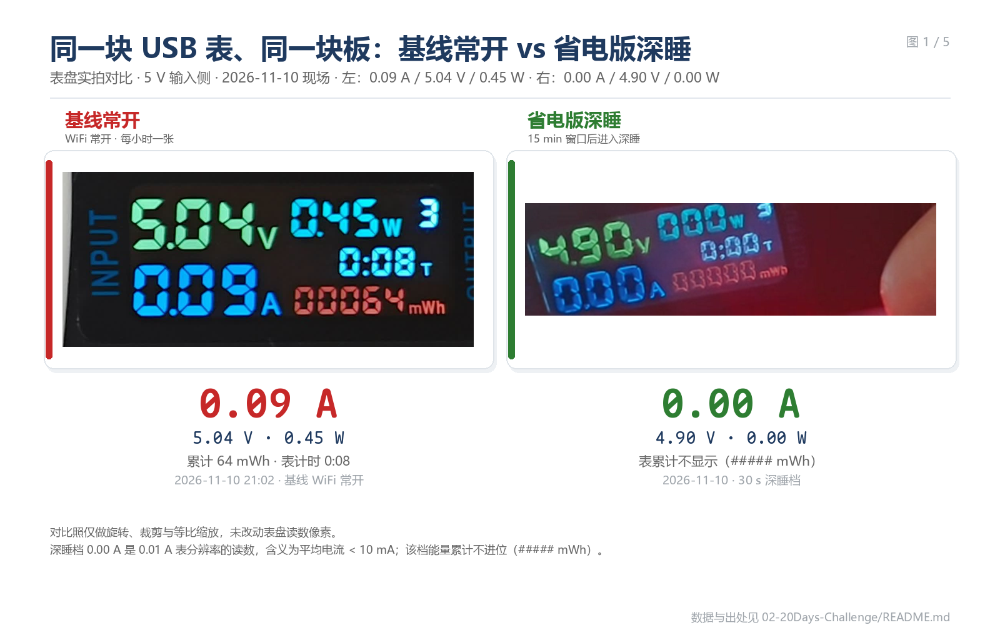
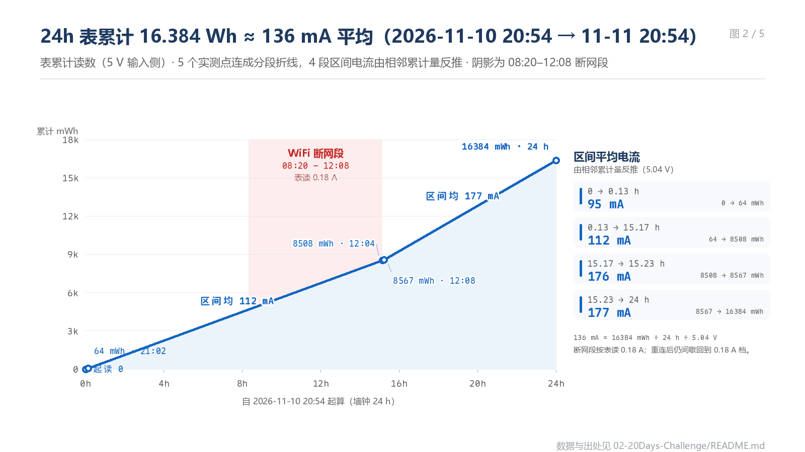
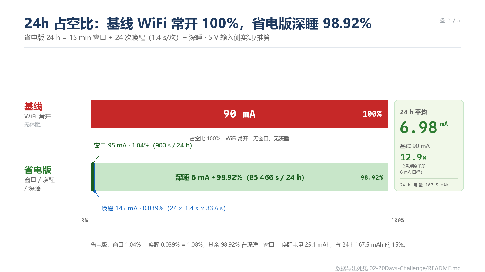
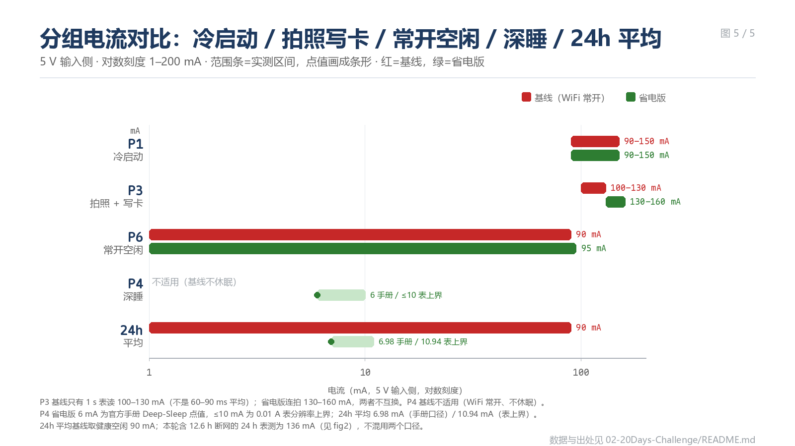
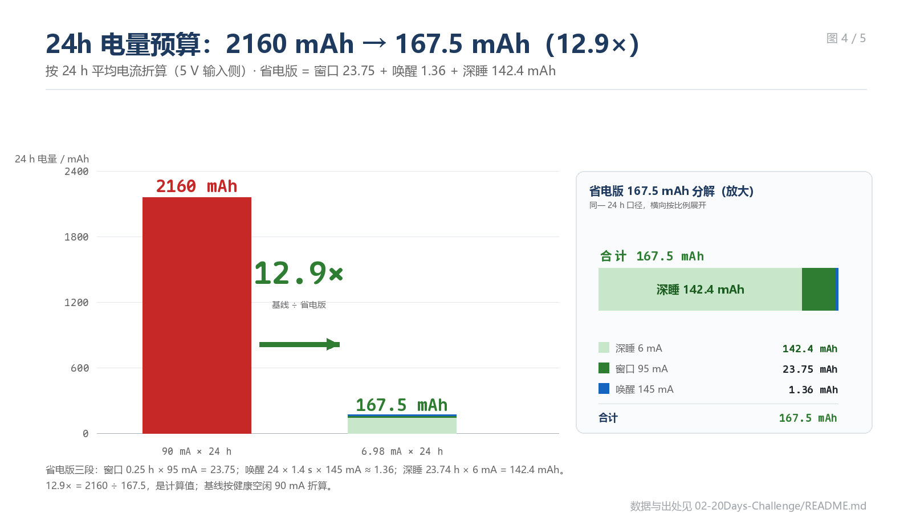
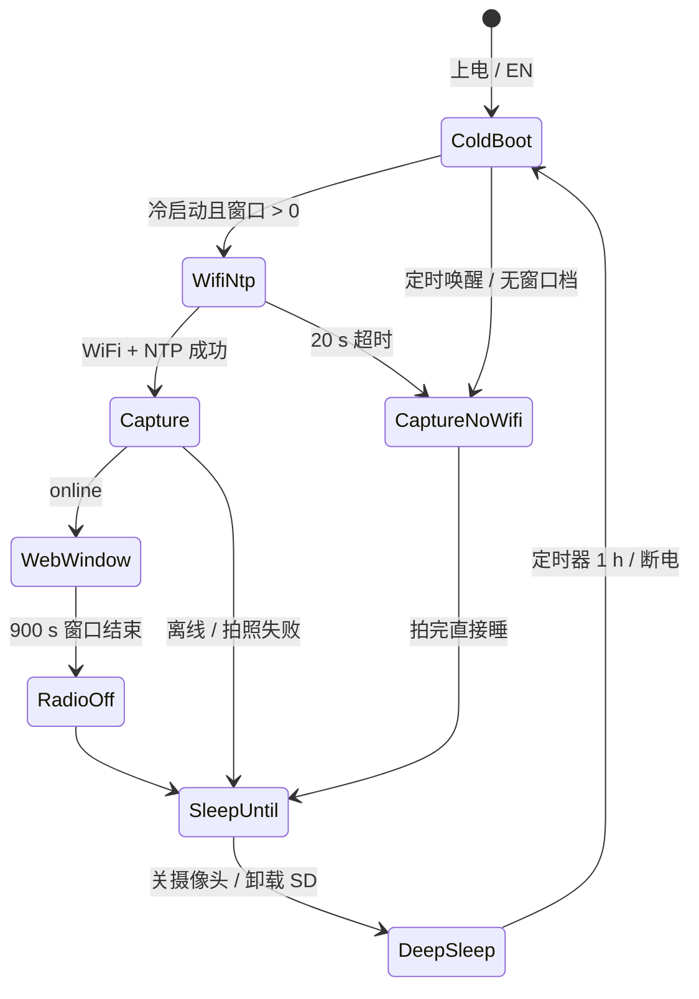

# 项目一：ESP32-CAM 极致省电（Ultra-Low Power）方案设计与实证

> 硬件：AI-Thinker ESP32-CAM（ESP32-D0WDQ6 + OV2640 + microSD）+ USB 电压电流表（5 V 输入侧）
> 固件：[`esp32cam-viewer`](firmware/esp32cam-viewer/README.md)（主基线，WiFi 常开）与 [`esp32cam-powersave`](firmware/esp32cam-powersave/README.md)（15 min 窗口 + 深睡占空比）
> 结论：24 h 平均电流 **`90 mA → 6.98 mA`（12.9×，手册 6 mA 口径）**；按表分辨率上界 10 mA 为 `10.94 mA`（8.2×）。题面“10 倍”的临界是深睡 `≤ 8.04 mA`。

**评审 3 分钟路径**：本页「评分项对照」→ 第 1 节对照表 + 表盘对比照 → 第 2 节 24 h 实测曲线与区间表 → 第 3 节预算公式 + 状态机 → [`docs/power-budget-model.md`](docs/power-budget-model.md)。

## 评分项对照

| 题面要求 | 本仓库交付 | 直接证据 | 状态 |
|---|---|---|---|
| **①** 优化前后各阶段实测电流对比照与视频（15 分） | P1–P6 分阶段对照表、同一块表的对比照、6 段录屏 | 第 1 节；[`current-comparison.csv`](measurement/current-comparison.csv)；[`evidence/`](evidence/) | ✅ 五个阶段都有表读；基线 P3 只有 1 s 视频表读，60–90 ms 未测（见 1.4） |
| **②** 连续 24 h 以上电池电压/功耗实测时序 CSV（25 分） | 24.00 h 设备侧 5 min 日志（317 行；另一轮 322 行）+ **24 h 表累计能量区间序列**（4 段）+ 10 个表盘点 + 24 张整点照片（11-09 轮归档；11-10 轮 api 清单 28 张未入库） | 第 2 节；[`24h-meter-series.csv`](measurement/24h-meter-series.csv)；[`POWER.CSV`](evidence/baseline-24h-meter-2026-11-10/POWER.CSV)；[`meter-readings.csv`](evidence/baseline-24h-meter-2026-11-10/meter-readings.csv) | 🟡 24 h 连续设备日志 ✅、表实测能量区间 ✅；连续**电压/电流**曲线 ❌（0.01 A 表限制，见 2.5） |
| **③** 功耗预算推导模型与状态机源码（20 分） | 三段式预算模型 + 敏感性分析 + 可跑代码/测试；状态机源码、状态图与源码行号映射 | 第 3 节；[`theory.py`](measurement/theory.py)；[`powersave.ino`](firmware/esp32cam-powersave/powersave/powersave.ino)；[`state-machine.md`](docs/state-machine.md) | ✅ 模型可复跑（`verify.py` 自检 34 项）；外设断电与 Deep-Sleep 已落地，时钟降频已定量评估未启用（见 3.3） |

## 0. 三张图看懂



*图 1：左为基线 viewer 常开空闲（`0.09 A / 5.04 V`），右为省电版深睡（`0.00 A / 4.90 V`）。同一块板、同一块表；省电版深睡低于表的 0.01 A 分辨率，所以读数是 `0.00`，只能给上界。*



*图 2：2026-11-10 20:54 → 11-11 20:54 的表累计能量。24 h 共 `16384 mWh`，等效平均 `135.4 mA @5.04 V`；中间 `08:20–12:08` 的 WiFi 断连把电流抬到 `0.18 A`。*



*图 3：基线 100 % 时间 WiFi 常开；省电版 98.9 % 时间深睡、1.04 % 窗口、0.039 % 唤醒拍照。活跃段电流没有变神奇，变的是**时间占比**。*

## 1. ① 各阶段实测电流对照（15 分）

### 1.1 测法

```text
USB 电源 ── USB 电压电流表 ── 5V/GND 直连板子
USB-TTL  ── 只接 TX / RX / GND（不接 5V、不接 3V3，避免绕开电流表）
```

表串在 5 V 输入端，量的是表后整条路径（AMS1117 LDO + OV2640 + microSD + ESP32），
0.01 A 分辨率、秒级刷新。接线、表的限制与误差详见 [`measurement/README.md`](measurement/README.md)。

### 1.2 分阶段对照

| 阶段 | 基线 viewer | 省电版 powersave | 性质 |
|---|---|---|---|
| P1 冷启动（上电 → WiFi/NTP → 首拍） | `0.09–0.15 A`，约 6 s | `0.09–0.15 A`，约 6 s | 上电瞬间波动，无稳定均值 |
| P2 窗口空闲（仅省电版；基线无窗口） | 不适用 | `0.09–0.10 A / 4.90 V`（`95 mA`） | 窗口段直读 + 录屏 |
| P6 常开空闲（WiFi 关联、不看网页） | `0.09 A / 5.04 V` | 不适用（窗口外深睡；窗口内见 P2） | viewer 端直读；基线持续空闲 |
| P6 开网页（浏览器翻图） | `0.11–0.14 A` | `0.12–0.19 A`，峰值 `0.22 A` | 直读 + 录屏 |
| P3 拍照 + 写卡（连拍放大占空比） | 1 s 表读 `0.10–0.13 A`；60–90 ms 平均**未测** | `0.13–0.16 A`（24 s / 10 次连拍） | 省电版为连拍实测；基线只有 1 s 窗口读数，两者不互换 |
| P4 深睡 | 不适用（不休眠） | 表 `≤ 0.01 A`；官方手册 `6 mA @ 5 V` | 表只给上界，手册给点值 |
| P5 单次唤醒（复位 → 再入睡） | 不适用 | `1.4–2.1 s` | 串口 `[CAP]` / `[SLEEP]` 时间戳 |
| **24 h 平均** | **`90 mA`（健康段）** | **`6.98–10.94 mA`（推算）** | 见第 2、3 节 |

全量字段（单位、电压、方法、证据路径）在 [`current-comparison.csv`](measurement/current-comparison.csv)；
原始打点在 [`measure-record.csv`](measurement/measure-record.csv)。



*图 5：P1/P3/P6/P4/24 h 分组电流（对数刻度）。P3 的省电版并不比基线低——省电来自占空比，不是把拍照瞬间变快；图 3 解释这一点。*

### 1.3 对比照与视频

| 视频 | 内容 | 时长 |
|---|---|---|
| [`meter_sleep_vs_capture.mp4`](evidence/powersave-meter-2026-11-10/meter_sleep_vs_capture.mp4) | 深睡 ↔ 拍照，表始终 `0.00 A`：证明变化小于表分辨率 | 60.7 s |
| [`meter_window_idle.mp4`](evidence/powersave-meter-2026-11-10/meter_window_idle.mp4) | 省电版窗口空闲 `0.09–0.10 A` | 38.9 s |
| [`meter_window_web_load.mp4`](evidence/powersave-meter-2026-11-10/meter_window_web_load.mp4) | 省电版窗口内开网页：`0.09 → 0.18 A`，峰值 `0.22 A` | 35.0 s |
| [`video_20261110_212524772.mp4`](evidence/baseline-viewer-meter-2026-11-10/video_20261110_212524772.mp4) | 基线常开空闲 `0.09 A`，开网页 `0.11–0.14 A` | 49.4 s |
| [`video_20261111_120804103.mp4`](evidence/baseline-24h-meter-2026-11-10/video_20261111_120804103.mp4) | 24 h 轮次中 12:08 WiFi 重连：`0.10 → 0.09 A` | 10.5 s |
| [`video_20261116_184118896.mp4`](evidence/baseline-viewer-meter-2026-11-16/video_20261116_184118896.mp4) | 基线 P3：24 s 内 10 次 `/capture`，1 s 表读 `0.09 → 0.10–0.13 A` | 36.4 s |

表盘原始照片、抽帧与 `manifest.sha256` 在各证据目录的 `README.md` 中；图 1 是
[`baseline-viewer-meter-2026-11-10/frame_meter_zoom.jpg`](evidence/baseline-viewer-meter-2026-11-10/frame_meter_zoom.jpg)
与 [`powersave-meter-2026-11-10/frame_meter_zoom.jpg`](evidence/powersave-meter-2026-11-10/frame_meter_zoom.jpg)
的并排裁剪（不改读数，只做旋转/缩放）。

### 1.4 P3 的口径（不互换）

- 省电版 P3 的 `0.13–0.16 A` 是**连拍放大占空比**后的表读：窗口内 24 s 发 10 次 `/capture`，
  把 60–90 ms 的拍照+写卡脉冲摊到表能读的窗口。
- 基线 P3 没有同口径的 60–90 ms 平均值；2026-11-16 的基线连拍视频给出 **1 s 表读 `0.10–0.13 A`**，
  这是 1 s 窗口，**不是** 60–90 ms 的 P3 平均。不能把省电版的 `130–160 mA` 抄成基线值。
- 结论：P3 的定量值用 `0.13–0.16 A`；视频的 `0.10–0.13 A` 只作 1 s 窗口旁证。两者不互换。

**这张表能证明**：两条固件“开着 WiFi 不干活”的底值相同（`0.09 A`），跨固件比较成立；
窗口段、P3 有现场读数/录屏，P5 有串口时长。
**不能证明**：P4 的定量值（`0.00 A` 只说明 `< 10 mA`）、60–90 ms 的拍照峰值、基线 P3 的 60–90 ms 平均值（没有同口径数据）。

## 2. ② 24 h 连续日志与表实测（25 分）

### 2.1 交付清单

| 文件 / 目录 | 固件 | 跨度 | 规模 | 性质 |
|---|---|---|---|---|
| [`POWER.CSV`](evidence/baseline-24h-meter-2026-11-10/POWER.CSV) | viewer | 24.00 h | 317 行（289 SAMPLE + 28 CAPTURE） | 设备侧连续日志；电流字段为固件模型值 |
| [`POWER.CSV`](evidence/baseline-24h-2026-11-09/POWER.CSV) | viewer | 24.00 h 主体（+1.15 h 复位后残行） | 322 行 + 26 张照片（24 整点，00:22 缺 1 张；另 2 张复位后） | 设备侧连续日志；独立复盘轮次 |
| [`24h-meter-series.csv`](measurement/24h-meter-series.csv) | —— | 24.00 h | 4 个实测区间 | **表累计 `mWh` 差分出的实测平均功率/电流** |
| [`meter-readings.csv`](evidence/baseline-24h-meter-2026-11-10/meter-readings.csv) | —— | 24.0 h | 10 个表盘点 | 表盘读数转写（含照片文件名） |
| [`baseline-24h-meter-2026-11-10/`](evidence/baseline-24h-meter-2026-11-10/README.md) | viewer | 24.00 h | 端点/断连/续测照片 + 视频 | 24 h 表端点与异常段证据 |
| [`powersave-15h-2026-11-10/`](evidence/powersave-15h-2026-11-10/README.md) | powersave | 15.20 h | 50 行 + 21 张照片 | 省电版运行片段；**不是 24 h** |

### 2.2 24 h 表实测能量曲线


| # | 区间 | 时长 | Δ能量 | 平均功率 | 平均电流 | 说明 |
|---|---|---|---|---|---|---|
| 1 | 11-10 20:54 → 21:02 | 8 min | `64 mWh` | `480 mW` | `95.2 mA` | 上电稳定段 |
| 2 | 11-10 21:02 → 11-11 12:04 | 15 h 02 min | `8444 mWh` | `561.7 mW` | `111.4 mA` | 含 08:20–12:04 WiFi 断连段 |
| 3 | 11-11 12:04 → 12:08 | 4 min | `59 mWh` | `885 mW` | `175.6 mA` | 重连成功后的 4 min |
| 4 | 11-11 12:08 → 20:54 | 8 h 46 min | `7817 mWh` | `891.7 mW` | `178.9 mA` | 累计量反推仍主要处于 `0.18 A` 档 |
| **合计** | **24 h 00 min** | **`16384 mWh`** | **`682.7 mW`** | **`135.4 mA`** | 健康空闲段为 `90 mA` |

数据由 [`build_meter_series.py`](measurement/build_meter_series.py) 从表盘锚点自动差分生成，
`verify.py` 会检查 CSV 与重算结果逐字段一致；读数来源照片在
[`meter-readings.csv`](evidence/baseline-24h-meter-2026-11-10/meter-readings.csv) 中逐行标注。

### 2.3 设备侧连续日志

```text
uptime_s,event,window_s,v5_mv,i_ma,p_mw,e_mwh
116,CAPTURE,3600,-1,45.0,225.0,0.0000
300,SAMPLE,300,-1,45.0,225.0,18.7500
...
```

- 每 5 min 一条 `SAMPLE`，共 289 条；`CAPTURE` 28 条（含复位残行），覆盖 24.00 h。另一轮 11-09 是 296 条 `SAMPLE` + 26 条 `CAPTURE`。
- 11-09 轮归档了 24 张整点照片（另有 2 张复位后）；11-10 轮的 `api.json` 列出 28 张，但只归档端点/断连照片，照片本身未入库。`api.json` 的 08:54–12:54 5 张编号仍在，配合 12:08 重连视频，说明**拍照不依赖 WiFi**。
- 电流字段 `i_ma=45` 是固件模型值（不含 WiFi），实测常开空闲是它的 **2 倍**（`90 mA`）。
  所以 24 h 的**电流绝对值**以表实测为准；`POWER.CSV` 用来证明“采样连续、事件完整、
  拍照时间线”，不拿它的 `e_mwh` 当实测能量。

### 2.4 异常段与口径

- 2026-11-11 08:20 起 WiFi 断连，12:08 重连；断连/反复重连期间电流从 `0.09 A` 抬到 `0.18 A`，
  24 h 表累计 `16384 mWh`（`≈16.38 Wh`）。异常日单列，**不进倍数表**；倍数用健康段 `90 mA`。
- 表计时 24 h 慢 7 min（实际 24:00 时表显 23:53）；本页一律用墙钟 24:00 当分母，
  若用表时间会把平均电流高估约 0.49 %。
- 终点两张照片相隔 7 min 都显示 `16384`，是显示停顿不是计数上限：21:46 鼠标续测到
  `16396 → 16398 mWh`，证明计数能过 16384。
- `W` 是时段平均、`A` 是瞬时，不能拿 `W` 反推瞬时电流；功率/能量用 `A × V` 或累计 `mWh ÷ 时间`。

### 2.5 测量边界（与结论一起读）

1. **表是 0.01 A 分辨率**：`0.09 A` 对应 `90 ± 5 mA`（±5 %）；深睡 `5–6 mA` 一律显示 `0.00 A`，
   只能给 `≤ 10 mA` 的上界。
2. **深睡时表会停表**：约 99 % 时间深睡，表不累计，所以**省电版没有 24 h 连续表曲线**；24 h 平均是“实测段 + 深睡 6/10 mA”的推算。要直读需 INA219 一类低阻分流记录，原因见 [`measurement/README.md`](measurement/README.md) 第 2 节。
3. **测的是 5 V 输入侧整条路径**（含 AMS1117、摄像头、SD），不是芯片电流；对省电方案是保守口径。
4. **电压只有 5 V 输入侧的 10 个锚点**（`5.04 / 5.03 / 5.02 / 4.93 V`），没有连续电压曲线，**电池端未测**；本项目的“续航 N 天”是
   按 `1600 mAh` 可用容量折算的预算值，不是实测电池放电。
5. **本项交付 = 24 h 连续设备日志 + 24 h 表实测能量区间 + 表盘点 + 24 张整点照片（11-09 轮）**，
   不写成“24 h 实测电流曲线”。这条边界在第 1、2 节的表格里都保留，避免把上界当实测值。

## 3. ③ 功耗预算模型与状态机源码（20 分）

### 3.1 模型：窗口 + 唤醒 + 深睡

```text
t_sleep = 86400 − 900 − 24×1.4 = 85466.4 s
E_win   = 95  mA × 900 s            / 3600 = 23.75  mAh
E_wake  = 145 mA × 24 × 1.4 s       / 3600 =  1.353 mAh
E_sleep = I_sleep × 85466.4 s       / 3600 = 142.444 mAh（I_sleep=6 mA）
I_avg   = (E_win + E_wake + E_sleep) / 24 h
```

| 口径 | 24 h 电量 | 平均电流 | 续航（1600 mAh 可用） | 相对基线 `90 mA` |
|---|---|---|---|---|
| 深睡按手册 `6 mA` | `167.5 mAh` | `6.98 mA` | `9.5 天` | **12.9×** |
| 深睡按表上界 `10 mA` | `262.5 mAh` | `10.94 mA` | `6.1 天` | **8.2×** |
| 全保守上限（窗口 90 mA，其余 10 mA） | `260.0 mAh` | `10.83 mA` | `6.2 天` | `8.3×` |
| 基线 viewer（健康段 `90 mA`） | `2160 mAh` | `90 mA` | `0.74 天` | `1×` |



*图 4：基线 2160 mAh → 省电版 167.5 mAh（12.9×）。省电版里 85 % 是深睡项（142.4 mAh），窗口段 23.75 mAh，唤醒拍照 1.36 mAh。*

完整推导、符号表、敏感性与不确定度见 [`docs/power-budget-model.md`](docs/power-budget-model.md)；
代码是 [`measurement/theory.py`](measurement/theory.py) 的 `compute_budget()`（纯函数，CLI 与 `--json` 共用）。

### 3.2 状态机



| 状态 / 动作 | 源码位置 |
|---|---|
| 唤醒原因分叉（冷启动 vs 定时唤醒）、重新上电自动复位 | `setup()`（[L500-L528](firmware/esp32cam-powersave/powersave/powersave.ino#L500-L528)） |
| 拍照 + 写卡 + 记录 `[CAP]` | `captureOnce()`（[L273-L309](firmware/esp32cam-powersave/powersave/powersave.ino#L273-L309)） |
| 关摄像头：`esp_camera_deinit()` + PWDN 拉高 + `gpio_hold_en` | `powerDownCamera()`（[L344-L350](firmware/esp32cam-powersave/powersave/powersave.ino#L344-L350)） |
| 卸载 SD → 定时器唤醒 → `esp_deep_sleep_start()` | `sleepUntil()`（[L363-L384](firmware/esp32cam-powersave/powersave/powersave.ino#L363-L384)） |
| Web 窗口开关、`WiFi.mode(WIFI_OFF)` | `startWeb()` / `stopWeb()`（[L477-L498](firmware/esp32cam-powersave/powersave/powersave.ino#L477-L498)） |
| 能耗记账、`POWER.CSV` 追加 | `accumulateEnergy()` / `powerLogAppend()`（[L192-L231](firmware/esp32cam-powersave/powersave/powersave.ino#L192-L231)） |

完整状态表、RTC 变量、失败模式与“时钟降频”定量评估见 [`docs/state-machine.md`](docs/state-machine.md)。

### 3.3 题面三项策略的落地

| 策略 | 落地 | 证据 | 状态 |
|---|---|---|---|
| 外设断电控制 | 拍照后 `esp_camera_deinit()` + PWDN 保持高电平；睡眠前 `SD_MMC.end()`；闪光灯 GPIO4 拉低 | `powerDownCamera()`、`sleepUntil()` | ✅ 软件侧；MOSFET 切供电未做（硬件项） |
| Deep-Sleep 深度休眠唤醒 | 每小时 timer 唤醒，唤醒只拍照、不连 WiFi；状态与能耗存 `RTC_DATA_ATTR` | `sleepUntil()`、`kCaptureIntervalMs` | ✅ 实机运行 |
| 时钟降频 | 定量评估后**未启用**：活跃段仅 33.6–50.4 s/天，上限收益 `≤0.42 mAh/天`（<0.25 %），却给 OV2640 XCLK / SDMMC 时序引入风险 | [`state-machine.md` 第 6 节](docs/state-machine.md#6-时钟降频专项点名要求但未落地) | ⚠ 未落地（有定量取舍） |

### 3.4 代码与复核

| 文件 | 职责 |
|---|---|
| [`theory.py`](measurement/theory.py) | 三段式预算纯函数 + CLI + `--json` |
| [`build_meter_series.py`](measurement/build_meter_series.py) | 从表盘锚点差分生成 24 h 实测区间 CSV |
| [`verify.py`](measurement/verify.py) | 34 项自检：CSV、预算、日志、markdown 链接 |
| [`test_power_model.py`](measurement/test_power_model.py) | 7 个回归测试，锁定 6.98 / 10.94 / 12.9× / 8.04 mA |
| [`powersave.ino`](firmware/esp32cam-powersave/powersave/powersave.ino) | 省电版状态机（588 行） |
| [`viewer.ino`](firmware/esp32cam-viewer/viewer/viewer.ino) | 基线（WiFi 常开、无深睡） |

```text
$ python3 measurement/verify.py
...
34/34 通过
```

### 3.5 “10 倍”怎么判

按 24 h 平均电流，10 倍要求 `I_avg ≤ 90 / 10 = 9.0 mA`。代入三段式：

```text
I_avg ≈ 1.05 + 0.989 × I_sleep  (mA)
→ I_sleep ≤ 8.04 mA 时达到 10 倍
```

- 深睡 = 手册 `6 mA` → `6.98 mA`，**12.9×，达标**；
- 深睡 = 表上界 `10 mA` → `10.94 mA`，**8.2×，不到 10 倍**；
- 关键：`10 mA` 是**仪器分辨率上界**，不是实测值；手册 `6 mA` 与表上界相容。主口径取 6 mA，
  同时完整列出 10 mA 上界，避免把上界当实测。

## 4. 局限与未完成

| 边界 | 影响 | 详见 |
|---|---|---|
| 深睡电流无单板实测，取手册 `6 mA` + 表上界 `10 mA` | 倍数区间 `8.2–12.9×` | 2.5、[`measurement/README.md`](measurement/README.md) |
| 省电版没有 24 h 表曲线（深睡停表） | 24 h 平均为“实测段 + 深睡点值”推算 | 2.5 |
| 基线 P3 的 60–90 ms 平均未单测 | P3 对照用同条件推断 + 1 s 视频旁证 | 1.4 |
| 拍照峰值、P1 稳定均值测不到 | 只给区间/上界，不写单点值 | 1.2、2.5 |
| 硬件改造（换 LDO、MOSFET、去 LED）未做 | 深睡上限受 AMS1117 限制 | [`docs/ESP32-CAM-Ultra-Low-Power-Solution.md`](docs/ESP32-CAM-Ultra-Low-Power-Solution.md) |
| 时钟降频未启用 | 三项策略落地 2/3，已给收益/风险表 | 3.3、[`state-machine.md`](docs/state-machine.md) |
| 供电是充电宝/充电器，不是电池 | “续航 N 天”是 1600 mAh 预算值，不是实测放电 | 2.5 |
| 2026-11-11 有约 12.6 h WiFi 断连 | 异常日单列，不进倍数表 | 2.4 |

这些不是“补白”，而是测量口径的一部分：能证明的写进结论，不能证明的留在边界里。

## 5. 复现

```bash
cd 02-20Days-Challenge

# 预算模型（无需硬件，仅标准库）
python3 measurement/theory.py
python3 measurement/theory.py --i-sleep 10
python3 measurement/theory.py --json

# 24 h 实测区间序列（从表盘锚点重算）
python3 measurement/build_meter_series.py
python3 measurement/build_meter_series.py --check

# 全量自检 + 回归测试
python3 measurement/verify.py
python3 measurement/verify.py --manifest   # 额外校验 evidence 的 SHA256
python3 -m unittest discover -s measurement -p 'test_*.py' -v

# 串口日志切阶段（可选）
python3 measurement/phases.py <串口日志> --summary
```

固件编译（需自行安装 `arduino-cli` 与 esp32 core 3.3.12；本仓库不提交 36 MB 的本地二进制）：

```bash
export ARDUINO_DIRECTORIES_DATA=$PWD/.arduino/data ARDUINO_DIRECTORIES_USER=$PWD/.arduino/user
arduino-cli compile --fqbn esp32:esp32:esp32cam --build-path .arduino/build-viewer    firmware/esp32cam-viewer/viewer
arduino-cli compile --fqbn esp32:esp32:esp32cam --build-path .arduino/build-powersave firmware/esp32cam-powersave/powersave
```

30 s 短周期测量档的编译宏、烧录与串口抓取见 [`measurement/README.md`](measurement/README.md)；
烧录/看串口在本机走宿主机（`distrobox-host-exec`），板子 DTR/RTS 已接 GPIO0/EN。

## 6. 目录与证据索引

```text
02-20Days-Challenge/
├── README.md                        # 本页：评分项 → 交付 → 证据
├── docs/
│   ├── ESP32-CAM-Ultra-Low-Power-Solution.md  # 方案：功耗测算、架构、sdkconfig、陷阱
│   ├── power-budget-model.md                  # 三段式预算推导、敏感性、不确定度
│   ├── state-machine.md                       # 状态机、源码行号、失败模式、降频评估
│   ├── figures/                               # 5 张实测证据图（本页引用）
│   └── FreeRTOS-V11.3.1-Source-Analysis.md    # 内核源码分析（附功耗专题）
├── firmware/
│   ├── esp32cam-viewer/             # 主基线：WiFi 常开 + 每小时一张 + 网页
│   ├── esp32cam-powersave/          # 省电版：15 min 窗口 + 深睡占空比（状态机源码）
│   └── esp32cam-capture-probe/      # 拍照电流标定探针（连拍放大占空比）
├── measurement/
│   ├── current-comparison.csv       # P1–P6 + 24 h 全量对照表
│   ├── 24h-meter-series.csv         # 24 h 表实测能量区间（4 段）
│   ├── theory.py                    # 24 h 功耗预算推导
│   ├── build_meter_series.py        # 表盘锚点 → 区间 CSV
│   ├── make_figures.py              # 5 张证据图（纯 PIL，宿主机运行）
│   ├── verify.py                    # 34 项自检
│   ├── test_power_model.py          # 7 个回归测试
│   ├── README.md                    # 测量方案、接线、表限制、已知误差
│   ├── phases.py                    # 串口日志切 P1–P6
│   ├── serial_capture.py            # 宿主机抓串口（带时间戳、--reset）
│   └── measure-record.csv           # 每阶段实测打点原始记录
└── evidence/                        # 证据：时序 CSV + 视频 + 照片
    ├── baseline-24h-2026-11-09/          # 基线 24.00 h：26 张照片 + 模型 CSV
    ├── baseline-24h-meter-2026-11-10/    # 基线 24 h 表端点 + api 清单（照片未入库）
    ├── baseline-viewer-meter-2026-11-10/ # 基线常开直读 + 开网页录屏
    ├── baseline-viewer-meter-2026-11-16/ # 基线 P3 24 s/10 次连拍录屏（已静音）
    ├── powersave-15h-2026-11-10/         # 省电版 15.20 h 运行片段（模型 CSV）
    └── powersave-meter-2026-11-10/       # 省电版三段录屏 + 抽帧 + 拍照抽样
```

## 7. 相关文档

- 方案与测算：[`docs/ESP32-CAM-Ultra-Low-Power-Solution.md`](docs/ESP32-CAM-Ultra-Low-Power-Solution.md)
- 预算推导：[`docs/power-budget-model.md`](docs/power-budget-model.md)
- 状态机与源码映射：[`docs/state-machine.md`](docs/state-machine.md)
- 测量方案、接线与误差：[`measurement/README.md`](measurement/README.md)
- 内核源码分析（含功耗专题）：[`docs/FreeRTOS-V11.3.1-Source-Analysis.md`](docs/FreeRTOS-V11.3.1-Source-Analysis.md)
- 总仓库入口：[`../README.md`](../README.md)
