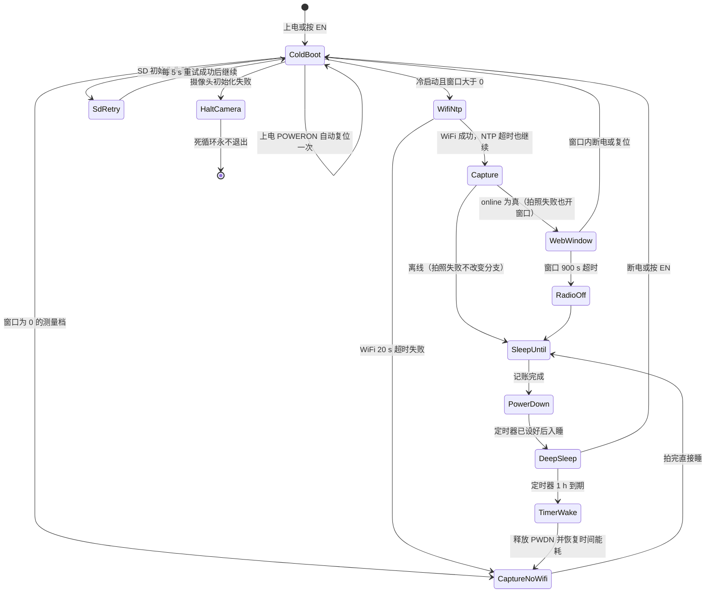

# 省电版固件状态机与源码映射

> 一句话：这是**省电版固件**（源码 [powersave.ino](../firmware/esp32cam-powersave/powersave/powersave.ino)，588 行，esp32 core 3.3.12）的状态机；实机运行证据在 [powersave-15h-2026-11-10](../evidence/powersave-15h-2026-11-10/README.md)（15.20 h、21 张照片、50 行 `POWER.CSV`）和 [powersave-meter-2026-11-10](../evidence/powersave-meter-2026-11-10/README.md)（5 V 输入侧表直读 + 录屏）。
>
> 行号以当前源码为准（`grep -n` 核对，命令见第 8 节）。基线对照固件为 [viewer.ino](../firmware/esp32cam-viewer/viewer/viewer.ino)（WiFi 常开，无深睡）。

## 1. 状态机



## 2. 状态、动作与源码行号

| 状态 | 进入动作 | 退出条件 / 去向 | 源码函数 | 源码行号 |
|---|---|---|---|---|
| ColdBoot 冷启动 | 读唤醒原因；`ESP_RST_POWERON` 先自动复位一次；关闪光灯 | 摄像头/SD 就绪后 → WifiNtp | `setup()` | [L500-L528](../firmware/esp32cam-powersave/powersave/powersave.ino#L500-L528) |
| WifiNtp 联网校时 | `connectWifi()` 40×500 ms（上限 20 s）、`syncClock()` 20×500 ms（上限 10 s） | 成功 → Capture；失败 → CaptureNoWifi | `connectWifi()` / `syncClock()` | [L311-L333](../firmware/esp32cam-powersave/powersave/powersave.ino#L311-L333) |
| Capture 冷启动拍照 | `esp_camera_fb_get()` → 写 `/IMG_%05lu.jpg` → 追加 `CAPTURE` 行 | 有网 → WebWindow；无网 → SleepUntil | `captureOnce()` | [L273-L309](../firmware/esp32cam-powersave/powersave/powersave.ino#L273-L309) |
| WebWindow 网页窗口 | 注册 5 条路由、`s_web_off_ms = millis()+900000`、写 `WEB_ON` | `loop()` 发现 `millis()-s_web_off_ms >= 0` → RadioOff | `startWeb()` / `loop()` | [L477-L489](../firmware/esp32cam-powersave/powersave/powersave.ino#L477-L489) / [L569-L576](../firmware/esp32cam-powersave/powersave/powersave.ino#L569-L576) |
| RadioOff 关射频 | `server.stop()` → `WiFi.disconnect(true)` → `WiFi.mode(WIFI_OFF)` → 写 `WEB_CLOSE` | 立即 → SleepUntil | `stopWeb()` | [L491-L498](../firmware/esp32cam-powersave/powersave/powersave.ino#L491-L498) |
| SleepUntil 入睡准备 | 补记深睡能耗到 RTC、算醒来 epoch、写 `[SLEEP]` 日志 | 记账完成 → PowerDown | `sleepUntil()` | [L363-L378](../firmware/esp32cam-powersave/powersave/powersave.ino#L363-L378) |
| PowerDown 关外设 | `powerDownCamera()`（deinit + PWDN 拉高 + hold）、`SD_MMC.end()`、`esp_sleep_enable_timer_wakeup()` | `esp_deep_sleep_start()`，不返回 → DeepSleep | `powerDownCamera()` / `sleepUntil()` | [L344-L350](../firmware/esp32cam-powersave/powersave/powersave.ino#L344-L350) / [L380-L383](../firmware/esp32cam-powersave/powersave/powersave.ino#L380-L383) |
| DeepSleep 深睡 | 定时器运行，其余掉电；PWDN 电平被 GPIO hold 保持 | 定时器到期 → TimerWake；断电/EN → ColdBoot | 硬件 + `esp_sleep_enable_timer_wakeup` | [L382-L383](../firmware/esp32cam-powersave/powersave/powersave.ino#L382-L383) |
| TimerWake 定时唤醒 | `releaseCameraPowerHold()` → `restoreTimeFromRtc()` → `s_energy_mwh = s_energy_mwh_rtc` | init 摄像头/SD 后 → CaptureNoWifi | `setup()` / `releaseCameraPowerHold()` / `restoreTimeFromRtc()` | [L504-L508](../firmware/esp32cam-powersave/powersave/powersave.ino#L504-L508) / [L336-L360](../firmware/esp32cam-powersave/powersave/powersave.ino#L336-L360) |
| CaptureNoWifi 离线拍照 | 同 Capture，但不连 WiFi、不开网页、不写 `WEB_ON`；编号从 SD 续 | → SleepUntil | `setup()` / `captureOnce()` | [L559-L566](../firmware/esp32cam-powersave/powersave/powersave.ino#L559-L566) |
| HaltCamera 死等 | 串口 `[FATAL] 摄像头初始化失败`，`while(true) delay(1000)` | 永不退出，只能复位 | `setup()` | [L530-L535](../firmware/esp32cam-powersave/powersave/powersave.ino#L530-L535) |

补充：`loop()` 末尾的拍照分支（[L583-L587](../firmware/esp32cam-powersave/powersave/powersave.ino#L583-L587)）是防御性代码——当前配置下 `setup()` 要么带窗口返回、要么直接 `sleepUntil()`，进不了该分支。

## 3. RTC_DATA_ATTR 与跨深睡的数据

| RTC 变量 | 类型 | 作用 | 写入 | 读取 |
|---|---|---|---|---|
| `s_energy_mwh_rtc` | `float` | 累计能耗（mWh），含深睡段补记 | `sleepUntil()` [L372](../firmware/esp32cam-powersave/powersave/powersave.ino#L372) | `setup()` [L507](../firmware/esp32cam-powersave/powersave/powersave.ino#L507) |
| `s_rtc_epoch` | `time_t` | 预计醒来时刻的 epoch，兜底 `time()` 连续性 | `sleepUntil()` [L375](../firmware/esp32cam-powersave/powersave/powersave.ino#L375) | `restoreTimeFromRtc()` [L353-L360](../firmware/esp32cam-powersave/powersave/powersave.ino#L353-L360) |

| 深睡会丢的量 | 后果 | 固件的补偿 |
|---|---|---|
| `s_next_index` | 照片编号会重头 | 不依赖 RTC，每次从 SD 目录扫 `IMG_%u.jpg` 取最大值 +1（`nextIndexFromSd()` [L164-L182](../firmware/esp32cam-powersave/powersave/powersave.ino#L164-L182)），掉电也不丢号 |
| `s_energy_mwh`、`millis()` 基准 | `e_mwh` 归零、时间基准回 0 | 非冷启动从 RTC 恢复能耗；`s_next_capture_ms`/`s_next_log_ms` 用新的 `millis()+interval` 重算（[L548-L560](../firmware/esp32cam-powersave/powersave/powersave.ino#L548-L560)） |
| `s_web_on`、`WebServer`、WiFi 状态 | 窗口状态不存在 | 深睡即结束；冷启动重新 `startWeb()` |
| TZ 环境变量 | 时间显示差 8 h | 每次启动 `applyTimeZone()`（[L124-L127](../firmware/esp32cam-powersave/powersave/powersave.ino#L124-L127)） |
| 摄像头 / SD 句柄 | 外设掉电 | 睡前主动 `esp_camera_deinit()` + `SD_MMC.end()`，醒来重新 init |
| `time()` 连续性 | 唤醒后可能回退/跳变 | `s_rtc_epoch` 兜底 `settimeofday` |

设计取舍：RTC 慢速内存小、且只有 RTC 域供电才保持，所以只放两项"无法从外部恢复"的量——能耗是累计值，丢了 `e_mwh` 每小时归零；墙钟跨深睡不可靠。编号、文件、窗口状态都能从 SD 或本次启动重算，不占 RTC。**代价**：真正断电（RTC 域掉电）后 `e_mwh` 仍归零，15.20 h 证据就是 9 段各从 0 累计（[证据 README 第 3 节](../evidence/powersave-15h-2026-11-10/README.md)）。

## 4. 24 h 占空比时间账

模型口径来自 [measurement/README.md 第 5 节](../measurement/README.md) 与 [theory.py](../measurement/theory.py)：`i_win=95 mA`、`i_wake=145 mA`、`t_wake=1.4 s`、`i_sleep=6 mA`、`V=4.9 V`；窗口 900 s/天，唤醒 24 次/天。

| 段 | 每天 | 秒/天 | 时间占比 | 电流 | mAh/天 | 能量占比 |
|---|---|---|---|---|---|---|
| WebWindow（含 P1 冷启动 ≈6 s） | 1 × 900 s | 900.0 | 1.04 % | 95 mA | 23.75 | 14.2 % |
| TimerWake + Capture + Save | 24 × 1.4 s | 33.6 | 0.039 % | 145 mA | 1.35 | 0.81 % |
| DeepSleep | 余量 | 85466.4 | 98.92 % | 6 mA | 142.44 | 85.0 % |
| 合计 | — | 86400 | 100 % | 平均 6.98 mA | 167.54 | 100 % |

- 与 `python3 measurement/theory.py` 默认输出逐项对齐：`23.75 / 1.35 / 142.44 mAh`，`167.5 mAh`、`6.98 mA`；深睡取表上界 10 mA 时 `262.5 mAh / 10.94 mA`（`--i-sleep 10`）。
- 口径提醒：`t_wake` 是"复位→再入睡"的整段，随卡上照片数从 1.4 s 涨到 2.1 s；按 2.1 s 算 `50.4 s`、唤醒段 `2.03 mAh`，合计 `168.2 mAh → 7.01 mA`（+0.4 %）。
- 窗口电流敏感性：全程刷页面按 `0.18 A` → `45 mAh`，合计 `188.8 mAh → 7.87 mA`（+12.7 %）；按峰值 `0.22 A` → `55 mAh → 8.28 mA`（+18.6 %），与 [meter 证据第 2 节](../evidence/powersave-meter-2026-11-10/README.md) 一致。
- `P1`（冷启动约 6 s，`0.09–0.15 A`）没有单独建模，被并进 900 s 窗口项，误差 <0.1 mAh；`theory.py` 的 V 只影响 Wh，不影响 mAh 与 mA。

## 5. 失败模式

| 失败模式 | 固件怎么处理 | 代码依据 | 证据 |
|---|---|---|---|
| WiFi 连不上 | 20 s 超时 → `online=false` → 不开网页，照拍一张后直接深睡；`[WIFI] 连接失败，跳过网页服务` | [L311-L325](../firmware/esp32cam-powersave/powersave/powersave.ino#L311-L325)、[L551-L566](../firmware/esp32cam-powersave/powersave/powersave.ino#L551-L566) | 未实测单独注入（15.2 h 里无纯 WiFi 失败会话） |
| NTP 失败 | 10 s 超时后继续；`fmtTime()` 输出"无时间戳"；`s_rtc_epoch` 置 0，下次唤醒不 `settimeofday`，但拍照照跑 | [L327-L333](../firmware/esp32cam-powersave/powersave/powersave.ino#L327-L333)、[L112-L122](../firmware/esp32cam-powersave/powersave/powersave.ino#L112-L122)、[L375](../firmware/esp32cam-powersave/powersave/powersave.ino#L375) | 间接：`IMG_00019` 时间戳为"无时间戳"（[证据 README 第 2 节](../evidence/powersave-15h-2026-11-10/README.md)），说明未同步仍完成拍照 |
| SD 初始化失败 | `while(!initSdCard())` 每 5 s 重试，**永不入睡**；`[WARN] SD 卡初始化失败，5 秒后重试` | [L538-L542](../firmware/esp32cam-powersave/powersave/powersave.ino#L538-L542) | 未实测 |
| 摄像头初始化失败 | `[FATAL]` + `while(true)` 死循环：不睡、不连 WiFi、不拍照，停在约 240 MHz 空转 + LDO 的电流档（模型 45 mA） | [L530-L535](../firmware/esp32cam-powersave/powersave/powersave.ino#L530-L535) | 未实测；无看门狗兜底，是风险最高的失败态 |
| 窗口内断电 | 只有 `CAPTURE`+`WEB_ON`，没有 `WEB_CLOSE`；重新上电后窗口从 900 s 重新计时，`e_mwh` 从 0 累计 | [L497](../firmware/esp32cam-powersave/powersave/powersave.ino#L497)（`WEB_CLOSE` 只在正常关闭时写） | 会话 4/5/8/9 事件集（[证据 README 第 2 节](../evidence/powersave-15h-2026-11-10/README.md)） |
| 意外复位 | `ESP_RST_POWERON` 先自动 `ESP.restart()` 一次（保留 SD 数据）；重启后唤醒原因为 UNDEFINED → 走冷启动，重开 15 min 窗口，整点重锚 | [L515-L519](../firmware/esp32cam-powersave/powersave/powersave.ino#L515-L519)、[L500-L502](../firmware/esp32cam-powersave/powersave/powersave.ino#L500-L502) | 07:34→08:23、22:23→22:34 冷启动重锚，10:27/10:29/10:31 连续冷启动（[证据 README 第 2 节](../evidence/powersave-15h-2026-11-10/README.md)） |
| 拍照失败（fb 为 NULL / 写卡不完整） | 返回 `false`，`s_next_index` 不递增，不写 `CAPTURE` 行，本周期不重试，继续睡 | [L273-L309](../firmware/esp32cam-powersave/powersave/powersave.ino#L273-L309) | 未实测 |

复位与断电在现有证据里同时发生，软复位是否保留 RTC 域（`e_mwh` 是否连续）未单独实测。

## 6. "时钟降频"专项：点名要求但未落地

结论：**未落地**。理由不是"忘了"，而是收益落在模型误差以内、风险落在唯一的数据通路上。原判断见固件 README 第 4 节："CPU 降频（240 → 80 MHz）… 省下的电 < 0.1 %；反而给 SDMMC / 摄像头时序引入风险"。

定量评估（活跃段按 24×1.4 s = 33.6 s/天，慢卡 24×2.1 s = 50.4 s/天；基准 167.5 mAh/天、6.98 mA）：

| 假设省流 ΔI | 33.6 s/天 折合 | 50.4 s/天 折合 | 占 167.5 mAh | 对 24 h 平均 |
|---|---|---|---|---|
| 保守 10 mA | 0.093 mAh | 0.140 mAh | 0.06 % / 0.08 % | −0.004 ~ −0.006 mA |
| 中性 20 mA | 0.187 mAh | 0.280 mAh | 0.11 % / 0.17 % | −0.008 ~ −0.012 mA |
| 上限 30 mA | 0.280 mAh | 0.420 mAh | 0.17 % / 0.25 % | −0.012 ~ −0.018 mA |

- 30 mA 已接近理论上限：`kModelIdleMa=45 mA` 里含约 5 mA AMS1117 静态，CPU 部分约 40 mA；按频率线性折到 80 MHz 约 13 mA，差值 ≈27 mA。而 45 mA 本身就是**模型值（未实测）**。
- 窗口段 900 s 理论上也受益，但窗口电流由 WiFi 关联空闲主导、CPU 空闲时被时钟门控；按满额 27 mA 算上限 `6.75 mAh`（4 %），这个上限同样没有实测支撑，不能写进结论。
- 净效果：即使按上限也只有 `0.42 mAh/天`，24 h 平均 `6.98 → 6.96 mA`，小于深睡 6/10 mA 的口径差（6.98 vs 10.94）。

风险（均**未验证**）：

| 项 | 说明 | 依据 |
|---|---|---|
| OV2640 XCLK | `xclk_freq_hz = 20 MHz` 由 LEDC 从 APB 分频；CPU 降到 80 MHz 时 APB 仍为 80 MHz，分频关系不变，但改频会重配 flash cache 与时序 | [L149](../firmware/esp32cam-powersave/powersave/powersave.ino#L149) |
| SDMMC | 40 MHz 级时钟同样源自 APB；改频后建立/保持时间需实测。SD 初始化失败会卡在 5 s 重试死循环（第 5 节） | [L160-L161](../firmware/esp32cam-powersave/powersave/powersave.ino#L160-L161) |
| 收益/风险比 | 收益 ≤0.25 %，风险落在"拍照写卡"这条唯一数据通路上，失败即丢一个周期 | 本文第 4、5 节 |

建议实现位置（**未验证**，仅说明改动点，未合入）：

```cpp
// 未验证：放在 setup() 的 applyTimeZone() 之后、initCamera() 之前（约 L512）
// 深睡唤醒后同样生效；deep sleep 复位会回到默认频率，无需显式恢复
setCpuFrequencyMhz(80);
```

## 7. 与基线 viewer 的差异

- 射频：viewer 常开；本固件仅冷启动后 900 s，窗口结束即 `WIFI_OFF`（[stopWeb L491-L498](../firmware/esp32cam-powersave/powersave/powersave.ino#L491-L498)）。
- 睡眠：viewer 无深睡、`loop()` 常驻；本固件每次拍照后 `esp_deep_sleep_start()`，且只靠定时器唤醒（[L382-L383](../firmware/esp32cam-powersave/powersave/powersave.ino#L382-L383)、[L501-L502](../firmware/esp32cam-powersave/powersave/powersave.ino#L501-L502)）。
- 外设：viewer 摄像头/SD 常供电；本固件睡前 `deinit` + PWDN hold、`SD_MMC.end()`（[L344-L350](../firmware/esp32cam-powersave/powersave/powersave.ino#L344-L350)、[L381](../firmware/esp32cam-powersave/powersave/powersave.ino#L381)）。

## 8. 如何核对

```bash
cd 02-20Days-Challenge

# 1) 状态机函数与行号（应输出 setup/loop/captureOnce/sleepUntil/powerDownCamera/startWeb/stopWeb）
grep -n "^void setup\|^void loop\|^static bool captureOnce\|^static void sleepUntil\|^static void powerDownCamera\|^static void startWeb\|^static void stopWeb" \
  firmware/esp32cam-powersave/powersave/powersave.ino

# 2) 关键判定与跨深睡变量
grep -n "esp_sleep_get_wakeup_cause\|ESP_RST_POWERON\|esp_sleep_enable_timer_wakeup\|esp_deep_sleep_start\|RTC_DATA_ATTR" \
  firmware/esp32cam-powersave/powersave/powersave.ino

# 3) 降频是否真的没做（应输出 0）
grep -c "setCpuFrequencyMhz" firmware/esp32cam-powersave/powersave/powersave.ino

# 4) 串口日志关键字（状态推进顺序）
#    冷启动: === ESP32-CAM 省电版（冷启动：WiFi + 网页开 15 分钟）===
#    联网:   [WIFI] 已连接，IP 192.168.16.10 / [TIME] ...
#    拍照:   [CAP] /IMG_00001.jpg ... capture=0ms save=60-90ms
#    窗口:   [WEB] http://192.168.16.10/  窗口 15 分钟 → [WEB] 窗口结束，已关闭网页服务与 WiFi
#    入睡:   [SLEEP] 深睡 2699s，预计 ... 醒来
#    异常:   [WIFI] 连接失败 / [WARN] SD 卡初始化失败 / [FATAL] 摄像头初始化失败

# 5) POWER.CSV 事件行样例（来自 15.20 h 证据，生成于常量回填之前，故 i_ma=165）
head -6 evidence/powersave-15h-2026-11-10/POWER.CSV
grep -n "WEB_CLOSE" evidence/powersave-15h-2026-11-10/POWER.CSV | head -3
```

样例（[POWER.CSV](../evidence/powersave-15h-2026-11-10/POWER.CSV)）：

```text
uptime_s,event,window_s,v5_mv,i_ma,p_mw,e_mwh
1,CAPTURE,3600,-1,5.0,25.0,0.0000
1,WEB_ON,0,-1,165.0,825.0,0.0000
300,SAMPLE,300,-1,165.0,825.0,68.7500
901,WEB_CLOSE,900,-1,165.0,825.0,206.2500
```

口径提醒：该 CSV 的 `165 mA` 是**回填前**的旧模型值，现固件 `kModelWindowMa=95`（[L81](../firmware/esp32cam-powersave/powersave/powersave.ino#L81)），重跑时 `WEB_ON`/`SAMPLE`/`WEB_CLOSE` 应记 95；深睡期间 SD 已卸载，所以没有深睡 `SAMPLE`，深睡能耗在入睡时一次性补进 `e_mwh`（[L371](../firmware/esp32cam-powersave/powersave/powersave.ino#L371)）。
